# Administrer processer

Med procesmodulet beskrives sagsbehandlingen som processer: de trin en sag skal igennem, hvem der udfører dem, hvilke frister der gælder, og hvad OpenCase selv skal gøre undervejs. En proces kan f.eks. være *modtag ansøgning → vurdér → godkend afgørelsen → send den med Digital Post → luk sagen*.

Processerne tegnes som diagrammer i en grafisk procesdesigner (BPMN 2.0-notation) og afvikles af procesmotoren (Flowable). Sagsbehandleren starter en proces på sagen og ser opgaverne under fanen **Processer** og under **Foreslået arbejde** – se [Processer](../sager/processer.md).

Menupunktet **Administrer processer** vises for brugere med rollen **OpenCase administrator** eller **Procesadministrator**, når procesmodulet er aktiveret (se [Opsætning](#opsaetning) nederst på siden).

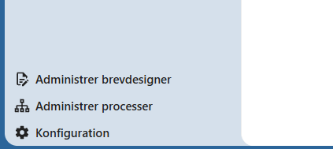

---

## Sådan hænger det sammen

| Begreb | Betydning |
|--------|-----------|
| **Proces** | En beskrivelse af et sagsforløb, f.eks. *Byggesag – almindelig behandling*. Har et navn, en afgrænsning (hvilke sager den kan bruges på) og en eller flere versioner. |
| **Version** | Et bestemt diagram for processen. Ændringer laves i en **kladde**, som **udgives**, når den er klar. Nye processer startes altid på den udgivne version. |
| **Kørende proces** | En proces, der er startet på en sag. Den følger diagrammet trin for trin, indtil den når en sluthændelse, annulleres, eller sagen lukkes. |
| **Brugeropgave** | Et trin, som en sagsbehandler udfører, evt. med frist, udfald (f.eks. *Godkend/Afvis*) og felter, der skal udfyldes. |
| **Automatisk trin** | Et trin, som OpenCase udfører selv (en *serviceopgave*), f.eks. at oprette et dokument, sende Digital Post eller vente på et svar. |
| **Gateway** | Et forgreningspunkt: processen vælger vej ud fra et udfald, eller deler sig i parallelle grene, der samles igen. |

Procesmotoren holder styr på, hvor hver kørende proces er nået til. OpenCase viser opgaverne på sagen, udfører de automatiske trin og registrerer alt i sagens log.

---

## Kom godt i gang – en første proces

Dette eksempel laver en lille proces, hvor sagsbehandleren vurderer en ansøgning, og OpenCase derefter enten opretter et afgørelsesbrev eller skriver et journalnotat om afslaget.

1: Vælg **Administrer processer** og klik **Ny proces**. Skriv navnet *Ansøgning – enkel behandling*, og klik **Opret**. Procesdesigneren åbner med en starthændelse. 

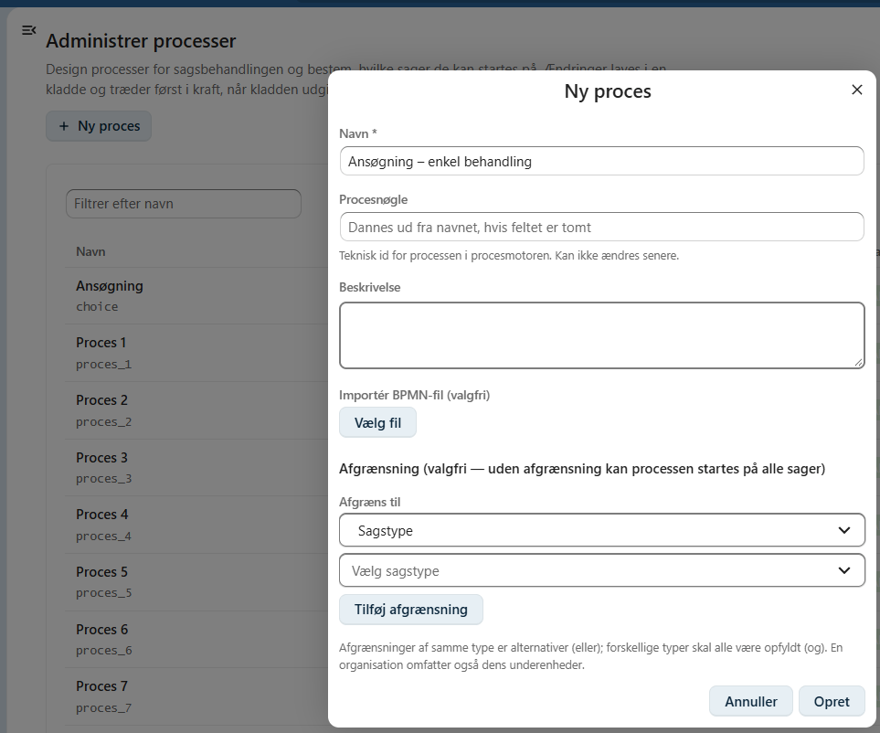

2: Klik på starthændelsen, og vælg **Tilføj opgave** i den lille menu ved elementet. Klik på skruenøglen (**Skift elementtype**), og vælg **Brugeropgave**. Giv den navnet *Vurdér ansøgningen*. 

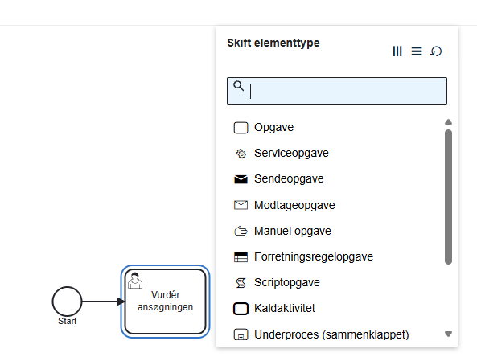

3: I egenskabspanelet til højre: vælg **Tildel til** *Sagens ansvarlige sagsbehandler*, sæt **Frist** til 10 dage, og tilføj udfaldene *Bevilg* og *Afslå*.

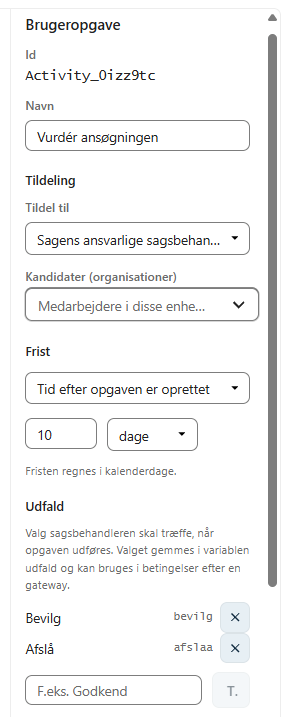

4: Tilføj en **eksklusiv gateway** efter opgaven og to opgaver efter gatewayen. Skift dem til **Serviceopgave**:

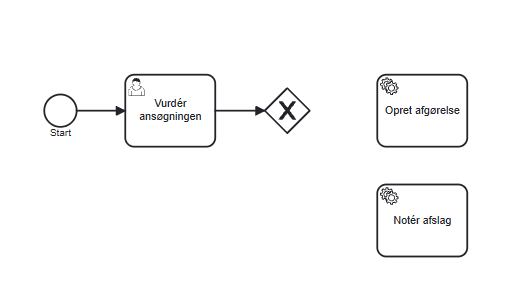

- *Opret afgørelse* med handlingen **Opret dokument** (titel, kategori og evt. skabelon).

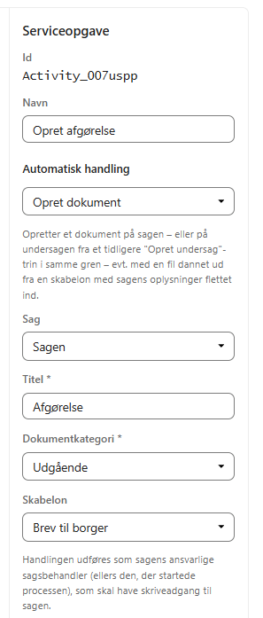

- *Notér afslag* med handlingen **Opret journalnotat**.

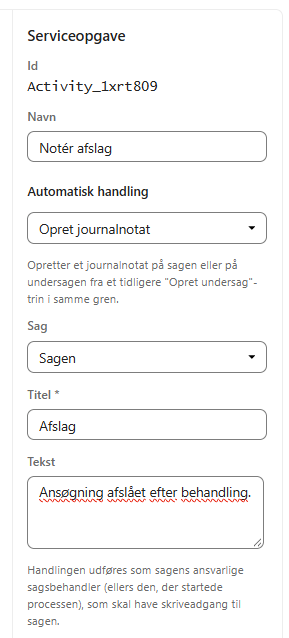

5: Klik på pilen fra gatewayen til *Opret afgørelse*, og klik på udfaldet **Bevilg** under **Betingelse**. 

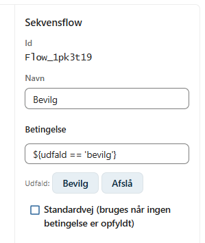

Gør det samme med pilen til *Notér afslag* og **Afslå**.

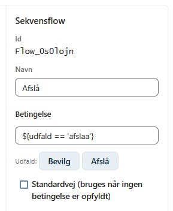

6: Afslut begge veje med en **sluthændelse**.

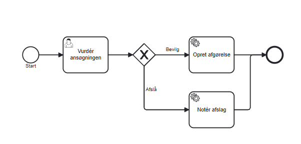

7: Klik **Gem** og derefter **Udgiv**. Dialogen kontrollerer diagrammet og fortæller, hvad der evt. mangler.

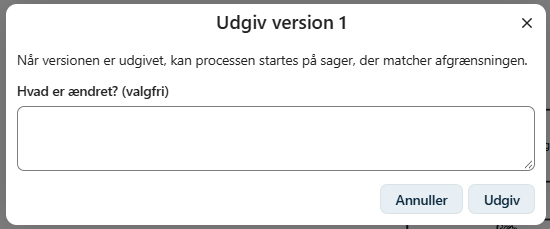

8: Åbn en sag, vælg fanen **Processer**, og klik **Start proces**.

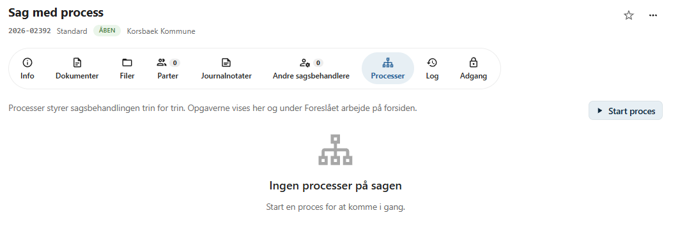

9: Vælg processen og klik **Start**
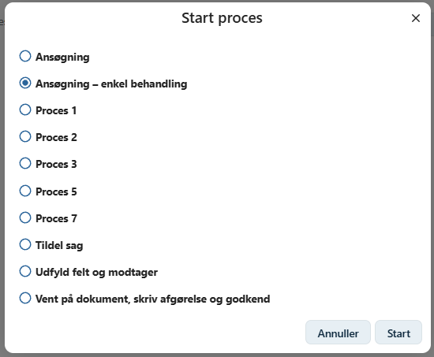
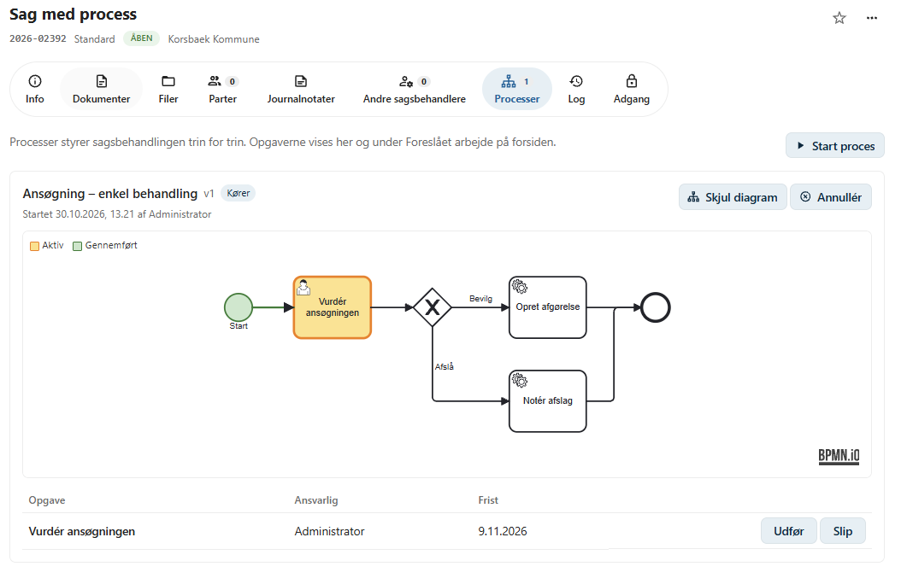


---

## Oversigten over processer

Siden **Administrer processer** viser alle processer med status (aktiv/inaktiv), udgivet version, om der findes en kladde, afgrænsningen og hvor mange der kører lige nu. Listen kan filtreres efter navn. Klik på en proces for at åbne den i procesdesigneren.

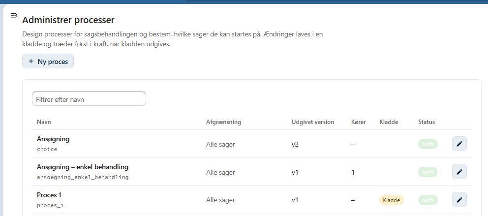

---

## Opret en proces

Klik på **Ny proces**, og angiv:

| Felt | Beskrivelse |
|------|-------------|
| **Navn** | Processens navn, som sagsbehandlerne ser, når de starter en proces. |
| **Procesnøgle** | Teknisk id i procesmotoren. Dannes ud fra navnet, hvis feltet er tomt, og kan ikke ændres senere. |
| **Beskrivelse** | Valgfri beskrivelse, f.eks. hvornår processen skal bruges. |
| **Importér BPMN-fil** | Valgfrit. Et diagram fra et andet BPMN-værktøj (f.eks. Camunda Modeler eller en eksport fra en anden OpenCase) kan bruges som udgangspunkt. |
| **Afgrænsning** | Hvilke sager processen kan startes på (se nedenfor). |

Processen oprettes med version 1 som kladde og åbnes i procesdesigneren.

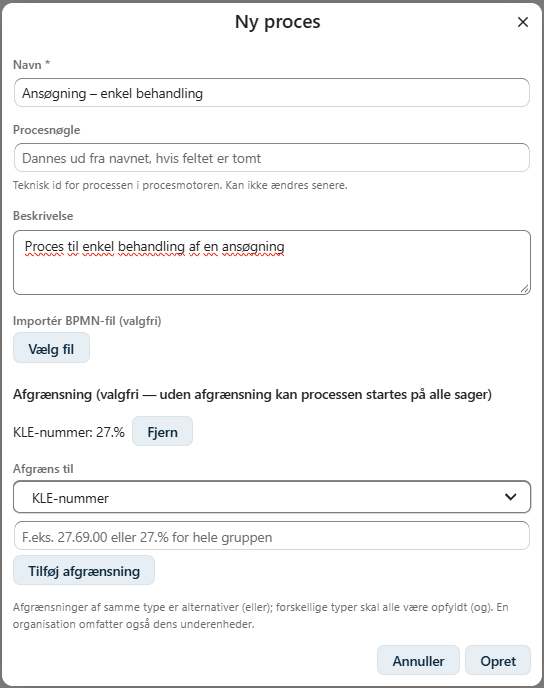

### Afgrænsning

En proces kan afgrænses til sagstyper, organisationer og KLE-numre – på samme måde som tillægsfelter. Kun processer, der passer til sagen, kan vælges, når en proces startes (også i dialogen *Ny sag*).

- Afgrænsninger af samme type er alternativer: *Sagstype A* og *Sagstype B* betyder sager af type A **eller** B.
- Forskellige typer skal alle være opfyldt: *Sagstype A* og *KLE 02.\** betyder sager af type A **og** med et KLE-nummer under 02.
- En organisation omfatter også dens underenheder.
- KLE-numre kan angives præcist (`02.34.02`) eller for en hel gruppe (`02.*` eller `02.%`).
- En proces uden afgrænsning kan startes på alle sager.

| Afgrænsning | Processen kan startes på |
|-------------|--------------------------|
| *(ingen)* | Alle sager |
| Sagstype *Byggesag* | Byggesager |
| Sagstype *Byggesag*, organisation *Teknik og Miljø* | Byggesager i Teknik og Miljø eller en af dens underenheder |
| KLE `02.34.*` og KLE `02.36.*` | Sager med et KLE-nummer under 02.34 eller 02.36 |

Afgrænsningen ændres under **Indstillinger** i procesdesigneren. Her kan processen også gøres **inaktiv**, så den ikke længere kan startes på nye sager. Processer, der allerede kører, fortsætter.

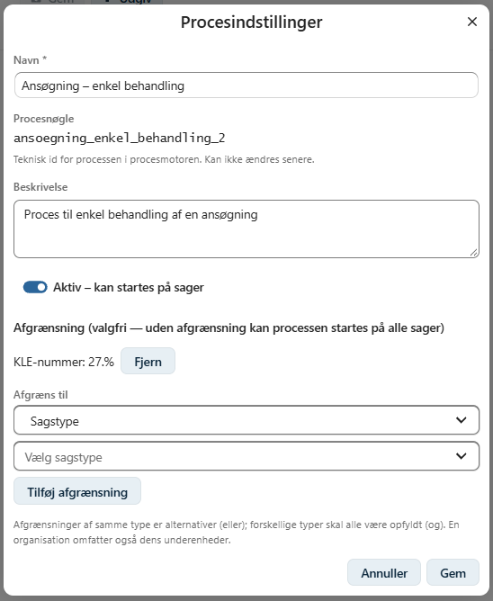

---

## Procesdesigneren

Procesdesigneren består af en værktøjslinje øverst, en palet med elementer i venstre side, selve diagrammet i midten og et egenskabspanel i højre side, som viser egenskaberne for det valgte element.

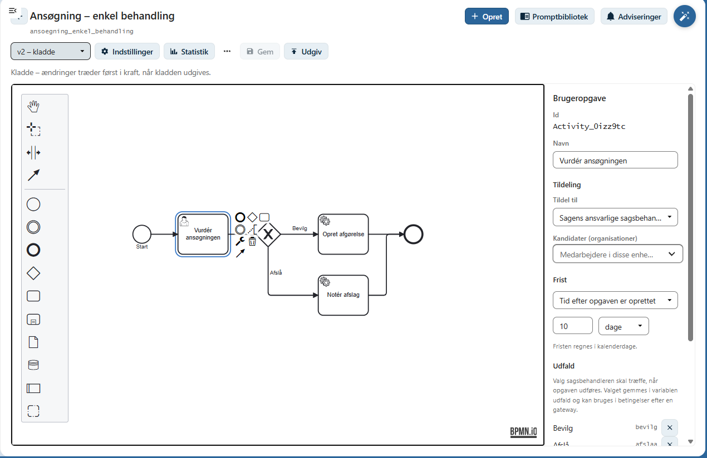

### Værktøjslinjen

| Knap | Funktion |
|------|----------|
| **Tilbage til processer** | Til oversigten. Advarer, hvis der er ændringer, der ikke er gemt. |
| **Version** | Vælg hvilken version der vises. Udgivne og tidligere versioner vises skrivebeskyttet. |
| **Gem** (Ctrl+S) | Gem kladden. *Ikke gemt* vises, så længe der er ændringer. |
| **Udgiv** | Kontrollér kladden og tag den i brug (se [Versioner](#versioner)). |
| **Rediger (ny kladde)** | Vises på en udgivet version: opretter en kladde som kopi af den. |
| **Statistik** | Tal for kørende og afsluttede processer (se [Statistik](#statistik)). |
| **Indstillinger** | Navn, beskrivelse, aktiv/inaktiv og afgrænsning. |
| **⋯** (menu) | Eksportér/importér BPMN-fil, ny kladde ud fra en ældre version, slet kladde, slet proces og flyt kørende processer til den udgivne version. |

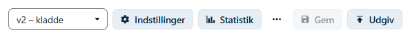

### Arbejd i diagrammet

- **Tilføj elementer** ved at trække dem fra paletten, eller klik på et element og brug den lille menu ved siden af det (*Tilføj opgave*, *Tilføj gateway*, *Tilføj sluthændelse* osv.) – så forbindes de automatisk med en pil.
- **Skift elementtype** med skruenøglen i menuen ved elementet, f.eks. fra *Opgave* til *Brugeropgave* eller *Serviceopgave*. Egenskaber, der passer til den nye type, bevares.
- **Forbind** to elementer ved at trække fra pilikonet i menuen ved det første element til det andet.
- **Navngiv** et element ved at dobbeltklikke på det, eller i feltet *Navn* i egenskabspanelet. Navnet vises for sagsbehandlerne.
- **Flyt** diagrammet ved at trække i et tomt område, og **zoom** med Ctrl + musehjul.
- **Slet** med Delete-tasten eller skraldespanden i menuen ved elementet.
- **Fortryd** med Ctrl+Z (og gentag med Ctrl+Y).

Menuer og værktøjstip i designeren er på dansk.

### Elementtyper

Designeren tilbyder alle BPMN's elementtyper, men OpenCase bruger kun nogle af dem:

| Elementtype | I OpenCase |
|-------------|------------|
| **Brugeropgave** | En opgave, som en sagsbehandler udfører (se [Brugeropgaver](#brugeropgaver)). |
| **Serviceopgave** | En automatisk handling, som OpenCase udfører (se [Automatiske handlinger](#automatiske-handlinger)). |
| **Underproces**, **Hændelsesunderproces** | Grupperer trin i samme proces, f.eks. for at sætte én timer på en hel fase. |
| **Gateways, timere, start- og sluthændelser** | Valg mellem veje, parallelle grene, ventetid og frister. |
| **Opgave** (uden type), **Manuel opgave** | Processen går lige igennem dem uden at gøre noget. Kan udgives, men giver en advarsel. |
| **Sendeopgave**, **Modtageopgave**, **Forretningsregelopgave**, **Scriptopgave**, **Kaldaktivitet**, **Transaktion**, **Ad hoc-underproces**, hændelser der venter på en **besked** | Understøttes ikke: de ville vente for altid, fejle eller køre uden for sagen. En proces med dem kan ikke udgives, og forklaringen viser, hvad der skal bruges i stedet. |

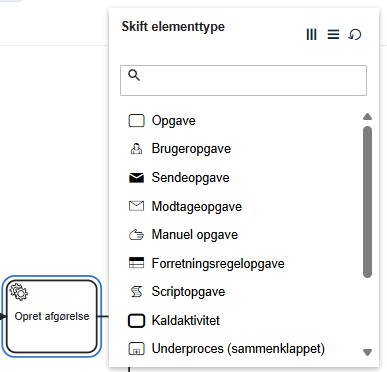

Sluthændelser:

- En almindelig **sluthændelse** afslutter den gren, der når den. Processen er afsluttet, når alle grene er afsluttet.
- En **termineringssluthændelse** afslutter hele processen med det samme – også andre grene, der stadig kører. Bruges f.eks. når en gren med påmindelser skal stoppe, når sagsbehandlingen er færdig.

---

## Brugeropgaver

En brugeropgave er en opgave, som en sagsbehandler skal udføre. Den vises på sagen under **Processer**, under **Foreslået arbejde** på forsiden og i medarbejderens opgaveliste, og den ansvarlige får en notifikation, når opgaven tildeles.

| Egenskab | Beskrivelse |
|----------|-------------|
| **Tildel til** | *Sagens ansvarlige sagsbehandler*, *en bestemt medarbejder*, eller *ingen* – så kan opgaven tages af en kandidat. |
| **Kandidater** | Organisationer, hvis medarbejdere (også i underenheder) kan tage opgaven. Uden kandidater kan alle med skriveadgang til sagen tage den. |

Har den, opgaven tildeles, ikke skriveadgang til sagen – eller mister vedkommende den – gives opgaven tilbage, så den kan tages af andre med adgang, og sagens ansvarlige får en notifikation. Medarbejderen får ingen notifikation med sagens oplysninger. Har opgaven kandidater, kan kun de tage den.
| **Frist** | Antal dage, uger eller måneder efter opgaven er oprettet. Fristen regnes i kalenderdage. |
| **Udfald** | Valg, sagsbehandleren skal træffe, når opgaven udføres, f.eks. *Godkend* og *Afvis*. |
| **Felter** | Oplysninger, sagsbehandleren udfylder, når opgaven udføres (se nedenfor). |

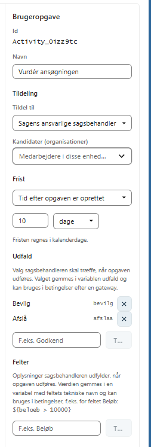

### Tildeling

- **Sagens ansvarlige sagsbehandler** er det almindelige valg. Skifter sagen ansvarlig – på sagen eller med handlingen *Tildel sag* – får opgaver, der oprettes derefter, den nye ansvarlige. Åbne opgaver beholder deres ansvarlige.
- **En bestemt medarbejder** bruges, når en bestemt person altid skal udføre trinnet, f.eks. en leder, der godkender.
- **Ingen – tages af en kandidat** bruges til fælles opgaver, f.eks. visitering i et team. Opgaven vises for alle kandidater, og den, der klikker **Tag opgaven**, får den.

### Frister og notifikationer

Den ansvarlige for opgaven får en notifikation, når fristen nærmer sig (2 dage før), og når den er overskredet. For en opgave, som ingen har taget, går notifikationen til sagens ansvarlige sagsbehandler. Skal der ske mere end en notifikation, når fristen overskrides – f.eks. eskalering til en leder – så sæt en [timer](#timere) på opgaven.

### Udfald

Udfald er de valg, sagsbehandleren skal træffe for at udføre opgaven, f.eks. *Godkend* / *Afvis* eller *Bevilg* / *Delvis bevilling* / *Afslå*. Skriv udfaldets tekst og klik **Tilføj**; den tekniske værdi (f.eks. `godkend`) vises ved udfaldet. Valget gemmes i procesvariablen `udfald` og bruges af gatewayen efter opgaven (se [Gateways og valg mellem veje](#gateways-og-valg-mellem-veje)).

### Felter

Felter er oplysninger, sagsbehandleren udfylder, når opgaven udføres. Et felt kan være påkrævet.

| Type | Udfyldes som | Eksempel på brug |
|------|--------------|------------------|
| **Tekst** | Fri tekst | En begrundelse, der senere skrives i et tillægsfelt |
| **Heltal** | Et helt tal | Et beløb, der afgør, om en leder skal godkende: `${beloeb > 10000}` |
| **Dato** | En dato | Opfølgningsdato, der bruges som frist på en påmindelse |
| **Ja/nej** | Et afkrydsningsfelt | *Kræver partshøring*: `${partshoering}` |
| **Medarbejder** | Vælges blandt medarbejderne | Hvem sagen skal tildeles ved visitering |

Værdien gemmes i en variabel med feltets tekniske navn, som vises ved feltet (f.eks. `beloeb` for *Beløb*), og kan bruges i betingelser og af automatiske handlinger (*Tildel sag*, *Udfyld tillægsfelt*, *Opret påmindelse*). Værdierne vises også i sagens historik for processen.

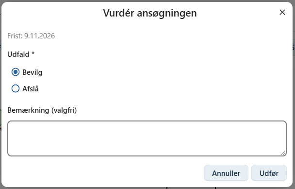

---

## Gateways og valg mellem veje

### Eksklusiv gateway – vælg én vej

Ved en **eksklusiv gateway** fortsætter processen ad den første udgående pil, hvis betingelse er opfyldt. Vælg en pil efter gatewayen, og skriv betingelsen under **Betingelse**, f.eks. `${udfald == 'godkend'}`. Kommer gatewayen lige efter en opgave med udfald – eller efter *Send til godkendelse* – vises udfaldene som knapper, og betingelsen indsættes med et klik.

Markér én af pilene som **standardvej**, så processen altid kan fortsætte, også hvis ingen betingelse er opfyldt. Uden en standardvej giver det en fejl, når processen når gatewayen: opgaven før den kan ikke udføres, eller det automatiske trin før den fejler.

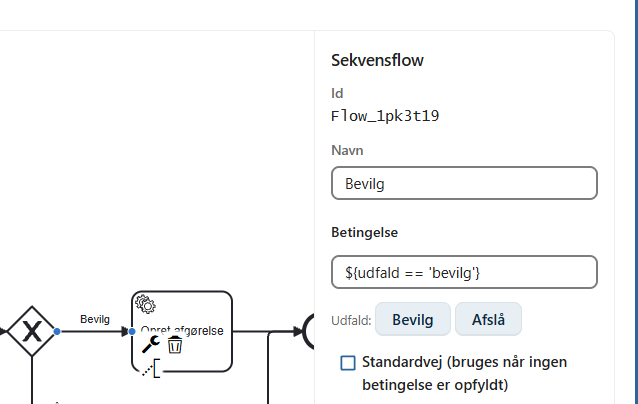

Eksempler på betingelser:

| Betingelse | Betydning |
|------------|-----------|
| `${udfald == 'godkend'}` | Sagsbehandleren valgte udfaldet *Godkend* |
| `${udfald == 'afvist'}` | Godkenderen afviste (efter *Send til godkendelse*) |
| `${beloeb > 10000}` | Feltet *Beløb* er over 10.000 |
| `${partshoering}` | Ja/nej-feltet *Partshøring* er sat til ja |
| `${udfald == 'godkend' && beloeb <= 10000}` | Begge dele |

Udtryk må kun bruge procesvariabler, tekst i anførselstegn, tal, sammenligninger, `&&`, `||`, `!`, regnetegn og parenteser – også i tildeling, frister og timere. Kald af metoder og felter (`a.b`, `a()`), lyttere (`executionListener`, `taskListener`) og andre Flowable-udvidelser kan køre kode i procesmotoren og afvises, når processen udgives.

### Parallel gateway – flere ting på én gang

En **parallel gateway** deler processen i grene, der kører samtidig – f.eks. at tre undersager oprettes og behandles hver for sig. En parallel gateway, hvor grenene mødes igen, **venter, til alle grene er nået frem**, før processen fortsætter. Det er altså ikke nødvendigt at gøre noget særligt for at synkronisere grene, der tager forskellig tid.

```
           ┌─ Opret undersag (Ejendom) ── Behandl ──┐
Start ── (+)─ Opret undersag (Miljø) ──── Behandl ──(+)── Saml afgørelse ── Slut
           └─ Opret undersag (Plan) ───── Behandl ──┘
```

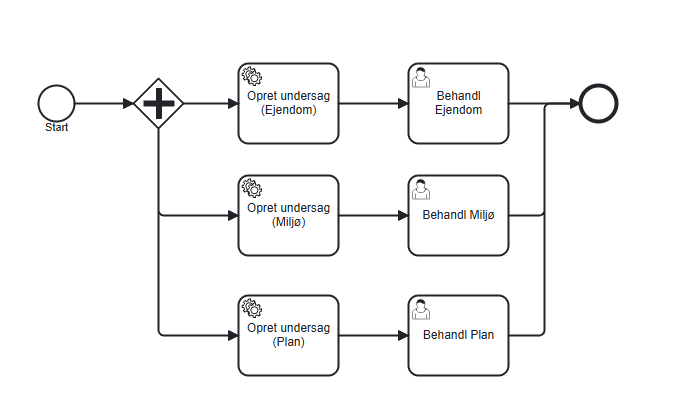

### Inklusiv gateway – en eller flere veje

En **inklusiv gateway** følger alle pile, hvis betingelse er opfyldt – f.eks. *partshøring* og/eller *udtalelse fra anden myndighed*. Når grenene mødes i en inklusiv gateway, ventes der kun på de grene, der blev startet.

---

## Timere

Timere bruges til ventetid, påmindelser og eskalering. Mellemliggende timerhændelser og timere på kanten af en opgave (grænsehændelser) sættes op i egenskabspanelet under **Timer**:

| Valg | Betydning |
|------|-----------|
| **Efter** | Udløses et antal minutter, timer, dage, uger eller måneder efter, at processen nåede hertil – for en timer på en opgave: efter opgaven blev oprettet. |
| **Gentages hver** | (kun timer på en opgave) Udløses igen og igen med det interval, så længe opgaven er åben – f.eks. en påmindelse hver 3. dag. |
| **På et bestemt tidspunkt** | Udløses på en fast dato og tid. |
| **Udtryk (avanceret)** | En ISO 8601-varighed eller et udtryk, f.eks. `${frist}`. |

En timer på en opgave kan **afbryde opgaven** (opgaven lukkes, og processen fortsætter ad timerens pil – f.eks. eskalering) eller lade den være åben (f.eks. en påmindelse).

```
Vurdér ansøgningen ───────────────────────── Send afgørelse
   │ timer 10 dage (afbryder ikke)
   └─ Send notifikation (påmindelse til ansvarlig)
```

Processer startes altid fra en sag, så starthændelsen skal være almindelig – uden timer, besked eller signal.

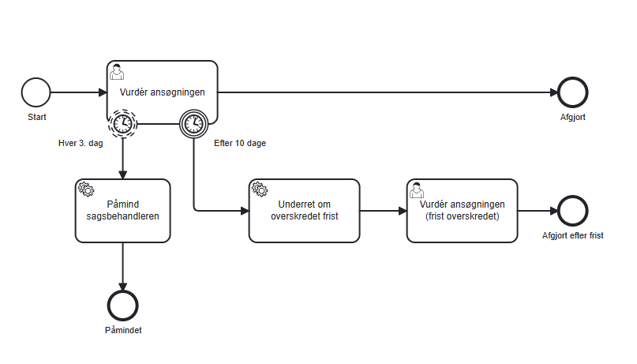

---

## Automatiske handlinger

En **serviceopgave** udføres automatisk af OpenCase, når processen når til den. Vælg handlingen under **Automatisk handling** i egenskabspanelet og udfyld dens felter. Beskrivelsen af handlingen vises i panelet.

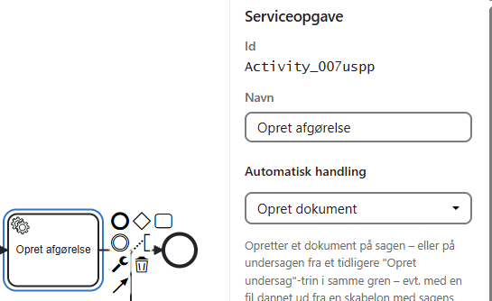

### Oversigt

| Område | Handlinger |
|--------|------------|
| Sagen | Opret journalnotat, Opret undersag, Tildel sag, Udfyld tillægsfelt, Luk sagen |
| Dokumenter | Opret dokument, Vent på dokument, Send til godkendelse, Gør dokument endeligt, Tilføj modtager, Send Digital Post |
| Kommunikation | Send notifikation, Opret påmindelse |
| Ventetid | Vent på inaktivitet, Vent på dokument, Send til godkendelse |

### Handlingerne

| Handling | Felter | Hvad sker der |
|----------|--------|---------------|
| **Opret journalnotat** | Titel, tekst | Et journalnotat oprettes på sagen. |
| **Opret dokument** | Titel, dokumentkategori, skabelon (valgfri) | Et dokument oprettes på sagen. Med en skabelon dannes også en fil med sagens oplysninger, skabelonens obligatoriske og forvalgte fraser og organisationens logo, som i dialogen *Ny fil fra skabelon*. Skabelonen skal være tilgængelig for sagens organisation, ellers fejler trinnet. |
| **Opret undersag** | Titel, sagstype (valgfri), proces (valgfri) | En undersag oprettes med samme organisation, KLE-nummer, handlingsfacet, følsomhed, indsigtsgrad og ansvarlige som sagen – og med sagens sagstype, hvis ingen er valgt. I titlen kan `{sagsnummer}` og `{sagstitel}` bruges, f.eks. *Undersag – {sagstitel}*. Er en proces valgt, startes den på undersagen; kan den ikke startes (f.eks. fordi den ikke passer til undersagen), oprettes undersagen alligevel, og det vises ved trinnet. En proces kan ikke starte sig selv. |
| **Send Digital Post** | Dokumentkategori (valgfri), kan besvares (ja/nej), medtag bilag (ja/nej) | Et dokument sendes kun én gang: er det allerede sendt, går processen videre uden at sende det igen, og det vises ved trinnet. Processens dokument (se nedenfor) – eller, hvis der ikke er et, det nyeste dokument på sagen i den valgte kategori – sendes med Digital Post til dokumentets modtagere (kontakter med rollen *Modtager*), eller til sagens primære part, hvis dokumentet ingen modtagere har. Modtagere uden Digital Post får brevet som fysisk post. Kræver at Digital Post er aktiveret (`feature_digital-post`). |
| **Send notifikation** | Sag, modtagere, medarbejder (ved *En bestemt medarbejder*), overskrift (valgfri), besked | En Nextcloud-notifikation med link til sagen sendes til sagens ansvarlige sagsbehandler, sagens andre sagsbehandlere eller en bestemt medarbejder. Kun modtagere med adgang til sagen får den; andre springes over og vises ved trinnet. I overskrift og besked kan `{sagsnummer}` og `{sagstitel}` bruges. |
| **Vent på inaktivitet** | Sag, antal dage | Processen venter, til der ikke har været aktivitet på sagen i det angivne antal dage – og mindst så længe efter trinnet er nået. Aktivitet er ændringer af sagen og dens dokumenter, filer, dokumentnoter, journalnotater og parter (ikke visninger). Ved trinnet vises, hvornår der ventes til. |
| **Vent på dokument** | Sag, dokumentkategori (valgfri) | Processen venter, til der kommer et dokument på sagen efter trinnet er nået – oprettet af en medarbejder, modtaget (Digital Post, Fordelingskomponenten, import) eller flyttet hertil fra indbakken – evt. kun i den valgte kategori. Dokumentet bliver processens dokument for de følgende trin. Der kigges efter nye dokumenter hvert 2. minut. |
| **Send til godkendelse** | Sag, dokumentkategori (valgfri), type (godkendelse/gennemsyn), sendes til, medarbejder (ved *En bestemt medarbejder*), frist i dage (valgfri) | Processens dokument sendes til godkendelse eller gennemsyn hos en bestemt medarbejder, sagens ansvarlige sagsbehandler eller sagens andre sagsbehandlere (én ad gangen), som når det gøres fra dokumentet. Processen venter på svaret, som gemmes i `udfald` (`godkendt`, `afvist`, `gennemset` eller `annulleret`). Er dokumentet allerede sendt til godkendelse, ventes på den. |
| **Gør dokument endeligt** | Sag, dokumentkategori (valgfri) | Processens dokument får status *Endelig*, så dets filer ikke kan ændres – f.eks. før *Send Digital Post*. Er det allerede endeligt, sker der ikke noget. |
| **Tildel sag** | Sag, som (ansvarlig/sagsbehandler), medarbejder fra (vælg her/medarbejderfelt på en opgave), medarbejder eller felt | Medarbejderen gøres til sagens ansvarlige sagsbehandler – som når sagen redigeres; den tidligere ansvarlige beholder ikke automatisk adgang – eller tilføjes som sagsbehandler med skriveadgang. Medarbejderen kan vælges i designeren eller tages fra et *Medarbejder*-felt, som en sagsbehandler har udfyldt på en tidligere opgave, f.eks. ved visitering. Følgende trin udføres som den nye ansvarlige. |
| **Udfyld tillægsfelt** | Sag, tillægsfelt, værdi fra (angiv her/felt på en opgave), værdi eller felt | Et af sagens tillægsfelter sættes til en fast værdi eller til det, der er udfyldt i et felt på en tidligere opgave, f.eks. et beløb eller en afgørelsesdato. Værdien skal passe til tillægsfeltet (dato som ÅÅÅÅ-MM-DD, ja/nej, en af listens værdier); ellers stopper processen med en forklaring. Tillægsfeltet skal gælde for sagen. Er opgavens felt tomt, ryddes tillægsfeltet. |
| **Tilføj modtager** | Sag, dokumentkategori (valgfri), parter (primær part/alle parter) | Sagens primære part – eller alle sagens parter med CPR-/CVR-nummer – tilføjes som *Modtager* på processens dokument med navn og adresse. Parter, der allerede er modtagere, springes over. Bruges før *Send Digital Post*, når brevet skal til flere end den primære part. |
| **Opret påmindelse** | Sag, titel, til (ansvarlig/bestemt medarbejder/medarbejderfelt på en opgave), frist (antal dage/datofelt på en opgave/ingen), påmindelsen gælder (sagen/processens dokument) | En almindelig påmindelse oprettes, som når den oprettes på sagen: den vises under *Foreslået arbejde* og på sagen, medarbejderen får en notifikation og skriveadgang til sagen, hvis vedkommende ikke har den. Processen fortsætter med det samme. I titlen kan `{sagsnummer}` og `{sagstitel}` bruges. |
| **Luk sagen** | – | Sagen lukkes. Bør være processens sidste trin: når sagen lukkes, annulleres andre processer, der kører på den. |

### Fælles regler

- **Sag**: Alle handlinger undtagen *Opret undersag* og *Luk sagen* har feltet **Sag**: *Sagen* (processens egen sag) eller *Undersagen fra et tidligere trin* – undersagen fra det nærmeste *Opret undersag*-trin før trinnet **i samme gren**. Så kan hver gren i en parallel proces oprette sin undersag og arbejde videre på den. Efter at grenene er samlet med en gateway, er det uklart hvilken undersag der menes, og trinnet fejler med en forklaring – placér det i grenen i stedet.
- **Processens dokument**: *Send Digital Post*, *Send til godkendelse*, *Gør dokument endeligt*, *Tilføj modtager* og *Opret påmindelse* (på dokumentet) bruger dokumentet fra det nærmeste *Opret dokument*- eller *Vent på dokument*-trin før trinnet i samme gren – eller, hvis der ikke er et, det nyeste dokument på sagen i den valgte kategori.
- **Hvem handler**: Handlingen udføres som sagens **ansvarlige sagsbehandler** – eller, hvis sagen ikke har en, den der startede processen – og vedkommende skal have skriveadgang til sagen. Det er denne bruger, der står i sagens log.
- **Hvornår**: Handlinger udføres med det samme, når processen når dem efter en handling i OpenCase (f.eks. når en opgave udføres), og ellers inden for et minut.
- **Fejl**: Fejler en handling på grund af opsætningen (f.eks. en skabelon, der er slettet, eller manglende adgang), stopper processen, og fejlen vises på sagen med knappen **Prøv igen**. Andre fejl (f.eks. midlertidigt utilgængelige systemer) forsøges automatisk igen et par gange først.
- **Ventende trin** (*Vent på inaktivitet*, *Vent på dokument*, *Send til godkendelse*) vises på sagen med, hvad de venter på. Afbrydes *Send til godkendelse* af en timer, eller annulleres processen, fortsætter godkendelsen på dokumentet; den kan annulleres fra dokumentet.
- **Udgivelse**: En proces kan ikke udgives, før alle serviceopgaver har en handling med de påkrævede felter udfyldt, felter fra opgaver findes i diagrammet, og handlingerne er aktiveret på installationen (f.eks. Digital Post).

---

## Eksempler på forløb

### Afgørelse med godkendelse og Digital Post

Afgørelsen dannes ud fra en skabelon, godkendes af en leder, låses og sendes til parterne. Afviser lederen, går sagen tilbage til sagsbehandleren.

```
Opret dokument (skabelon) ── Skriv afgørelse ── Send til godkendelse (leder) ── (x) ──godkendt── Gør dokument endeligt ── Tilføj modtager (alle parter) ── Send Digital Post ── Luk sagen
                                  ▲                                             │
                                  └─────────────────── afvist ──────────────────┘
```

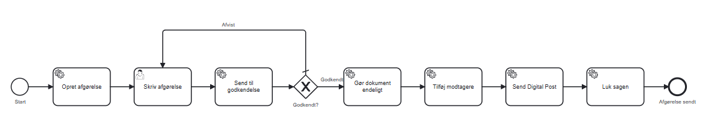

### Vent på svar fra borgeren

**Vent på dokument** venter, til der kommer et dokument på sagen. Sæt en **timer** på trinnet (en grænsehændelse) for at gøre noget andet, hvis der ikke kommer noget i tide:

```
Opret dokument ── Gør dokument endeligt ── Send Digital Post ── Vent på dokument (Indgående) ── Behandl svar
                                                                       │ timer 14 dage
                                                                       └─ Send notifikation (rykker)
```

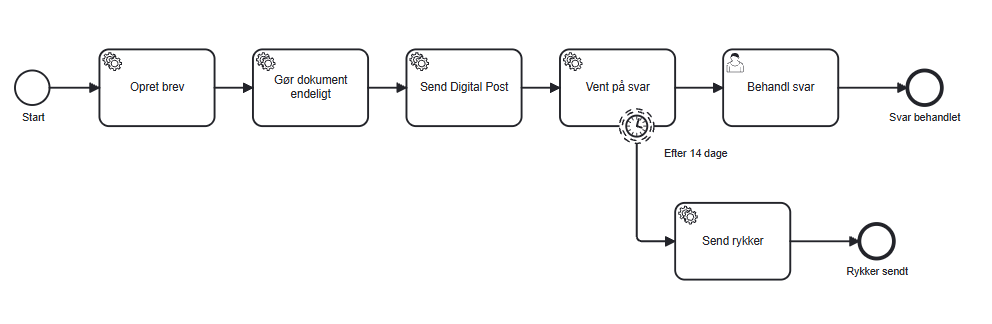

Er timeren afbrydende, stopper ventetiden, og processen fortsætter ad timerens vej. Er den ikke-afbrydende, sendes rykkeren, mens der fortsat ventes på svaret.

### Visitering til en medarbejder

Giv en brugeropgave et felt af typen **Medarbejder** (f.eks. *Sagsbehandler*), og lad **Tildel sag** med *Medarbejderfelt på en opgave* bruge det:

```
Visitér sagen (felt: Sagsbehandler) ── Tildel sag (ansvarlig, felt: Sagsbehandler) ── Behandl sagen (tildelt sagens ansvarlige)
```

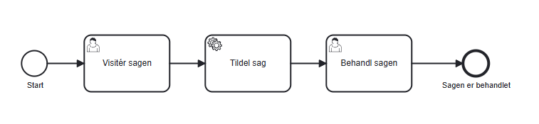

Visiteringsopgaven tildeles typisk *ingen* med teamet som kandidater, så den, der visiterer, tager opgaven. En proces kan ikke udgives, hvis feltet ikke findes som medarbejderfelt på en opgave i diagrammet.

Skal sagen i stedet fordeles efter faste regler, giv visiteringsopgaven udfald (f.eks. *Pension*, *Boligstøtte*) og sæt en gateway med et *Tildel sag*-trin med en fast medarbejder på hver vej.

### Påmindelse ved inaktivitet

Kombinér **Vent på inaktivitet** og **Send notifikation** i en gren ved siden af den almindelige sagsbehandling:

```
        ┌─ almindelig sagsbehandling ───────────────────── (Termineringssluthændelse)
Start ─(+)
        └─ Vent på inaktivitet (14 dage) ── Send notifikation ─┐
                   ▲                                          │
                   └──────────────────────────────────────────┘
```

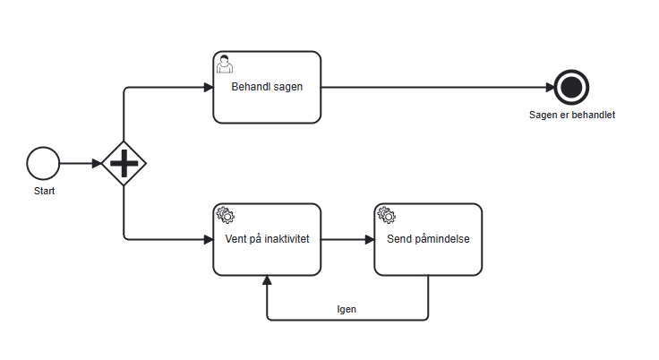

Pilen tilbage giver en ny påmindelse for hver 14 dage uden aktivitet. Grenen med sagsbehandlingen skal slutte med en **termineringssluthændelse**, så den også stopper påmindelserne – ellers venter processen for altid.

Eksempel: Trinnet nås dag 0, der oprettes et dokument dag 3, og sagen ændres dag 7. Så sendes notifikationen dag 21 (14 dage efter den seneste aktivitet).

### Opdeling i undersager

Brug en parallel gateway med et *Opret undersag*-trin i hver gren. Vælg evt. en proces, der skal starte på undersagen, og brug **Sag: Undersagen fra et tidligere trin** på de følgende trin i grenen, f.eks. *Opret dokument* på undersagen. Den parallelle gateway, hvor grenene mødes, venter på alle grene.

---

## Variabler

Når en proces startes på en sag, får den disse variabler, som kan bruges i udtryk (betingelser og timere):

| Variabel | Indhold |
|----------|---------|
| `caseResponsible` | Brugernavn på sagens ansvarlige sagsbehandler (opdateres, når sagen skifter ansvarlig) |
| `caseId`, `caseUuid`, `caseNumber` | Sagens id, uuid og sagsnummer |
| `orgUuid` | Sagens organisation |
| `kle` | Sagens KLE-nummer |
| `startedBy` | Brugernavn på den, der startede processen |
| `udfald` | Udfaldet af den senest udførte opgave med udfald eller *Send til godkendelse*-trin |

Derudover bliver hvert felt på en brugeropgave en variabel med feltets tekniske navn, når opgaven udføres.

---

## Versioner

Ændringer laves altid i en **kladde**. Hver proces har højst én kladde ad gangen.

| Status | Betydning |
|--------|-----------|
| **Kladde** | Kan redigeres. Bruges ikke på sager. |
| **Udgivet** | Den version, nye processer startes på. Kan ikke ændres. |
| **Tidligere** | En tidligere udgivet version. Processer, der allerede kører på den, fortsætter uændret. |

- Klik **Gem** (eller Ctrl+S) for at gemme kladden. Har en anden gemt kladden imens, afvises gemningen – genindlæs siden og prøv igen.
- Klik **Rediger (ny kladde)** på en udgivet version for at lave ændringer. Den nye kladde er en kopi af den nyeste version. Fra menuen kan en kladde også laves ud fra en ældre version.
- Diagrammet kan eksporteres som BPMN-fil og importeres i en kladde – f.eks. for at flytte en proces mellem en test- og en driftsinstallation.

### Udgiv

Klik **Udgiv** for at tage kladden i brug. Kladden kontrolleres først:

- Processen har en almindelig starthændelse og en sluthændelse.
- Timere er udfyldt, så procesmotoren forstår dem.
- Alle serviceopgaver har en handling med de påkrævede felter, og felter fra opgaver, som handlingerne henviser til, findes i diagrammet.
- Handlingerne er aktiveret på installationen (f.eks. Digital Post).
- Der er ingen elementtyper, som OpenCase ikke understøtter (se [Elementtyper](#elementtyper)).

Problemer vises i dialogen og skal rettes, før kladden kan udgives. Advarsler (f.eks. en opgave uden type) vises med gult, men forhindrer ikke udgivelsen. Derefter sendes diagrammet til procesmotoren, som kontrollerer resten. Angiv evt. hvad der er ændret – teksten vises ved versionen.

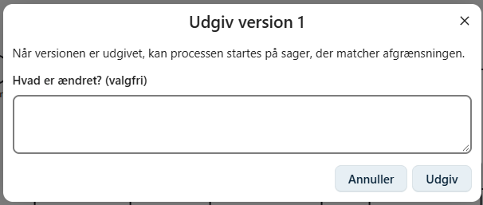

### Flyt kørende processer til en ny version

Når en ny version er udgivet, fortsætter processer, der allerede kører, som udgangspunkt på deres gamle version. Vælg **Flyt kørende processer til vN** i menuen i procesdesigneren for at flytte dem til den udgivne version – f.eks. når en fejl i processen er rettet:

- Dialogen viser, hvor mange processer der kører på hver ældre version, og hvilke trin de står ved.
- Trin, der findes i begge versioner (samme tekniske id), bevares – åbne opgaver beholdes med ansvarlig og frist.
- For trin, der er fjernet i den nye version, vælges det trin, processerne skal fortsætte ved.
- Hver proces kontrolleres af procesmotoren, før den flyttes. En proces, der ikke kan flyttes, bliver på sin version og vises med fejlen; resten flyttes.
- Op til 25 processer flyttes med det samme; flere flyttes i baggrunden, og fremdriften vises i dialogen.
- Flytningen registreres i sagens log.

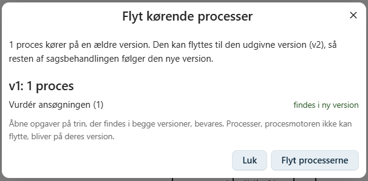

### Statistik

Klik på **Statistik** i procesdesigneren for at se tal for processen på tværs af versioner:

- hvor mange der kører, er afsluttet eller annulleret, og hvor mange der venter på et fejlet automatisk trin,
- den gennemsnitlige varighed og hvor mange der kører pr. version,
- pr. opgave: hvor mange der er åbne, over frist og udført, og hvor lang tid de tager i gennemsnit,
- pr. automatisk trin: hvor mange der er udført og fejlet.

Statistikken kan bruges til at finde flaskehalse, f.eks. en opgave, der ofte overskrider fristen.

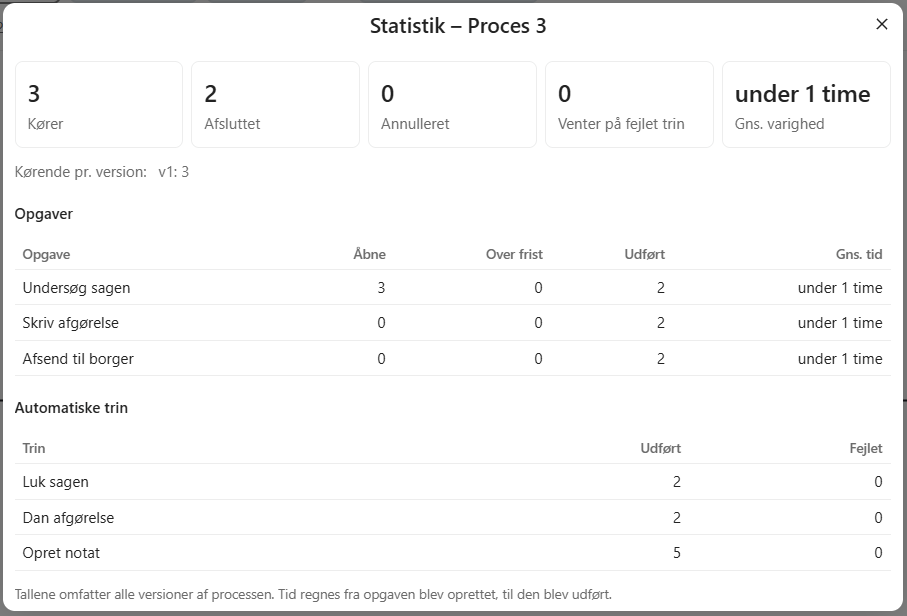

### Inaktivér eller slet

En proces kan kun slettes, hvis den aldrig har været udgivet. En udgivet proces gøres i stedet **inaktiv** under **Indstillinger**: den kan ikke startes på nye sager, men processer, der allerede kører, fortsætter.

---

## Fejlfinding

| Problem | Årsag og løsning |
|---------|------------------|
| Et automatisk trin fejler, og processen står stille | Fejlen vises på sagen under **Processer**. Ret årsagen (f.eks. en slettet skabelon eller manglende skriveadgang for den ansvarlige), og klik **Prøv igen** på sagen. Ligger fejlen i diagrammet, så ret det i en ny version, udgiv den, og flyt processen til den nye version. |
| Processen står ved *Vent på dokument* | Den venter på et dokument, der kommer **efter** trinnet blev nået, og evt. i den valgte kategori. Dokumenter, der lå på sagen i forvejen, tæller ikke. |
| En opgave kan ikke udføres, eller trinnet før en gateway fejler | Ingen betingelse efter gatewayen var opfyldt, og der er ingen standardvej. Tilføj en standardvej i en ny version, og flyt processen til den. |
| Grenene samles aldrig | En parallel gateway venter på alle indkommende grene. Kontrollér, at alle grene faktisk når frem til den – en gren, der slutter i en sluthændelse, kommer aldrig. |
| Processen kan ikke vælges på en sag | Kontrollér, at processen er aktiv, har en udgivet version, og at afgrænsningen passer til sagens sagstype, organisation og KLE-nummer. |
| Nye valgmuligheder ses ikke i designeren efter en opdatering | Genindlæs siden med Ctrl+Shift+R. |

Sådan bruges processerne på sagerne: se [Processer](../sager/processer.md).

---

## Opsætning {#opsaetning}

Procesmotoren kører som en Docker-container ved siden af Nextcloud og skal kun kunne nås fra Nextcloud-serveren. Se `process-engine/README.md` for installation og database.

Aktivér procesmodulet:

```bash
sudo -u www-data php occ opencase:config:set feature_process-engine 1
```

Forbindelsen sættes op under **Nextcloud-indstillinger → Administration → OpenCase → Processer**:

| Felt | Beskrivelse |
|------|-------------|
| **URL** | Procesmotorens adresse, f.eks. `http://127.0.0.1:8090`. |
| **Brugernavn** | Samme værdi som `FLOWABLE_REST_USER` i motorens container (standard `opencase`). |
| **Adgangskode** | Samme værdi som `FLOWABLE_REST_PASSWORD` i motorens container. |

Klik **Test forbindelse** for at kontrollere opsætningen.

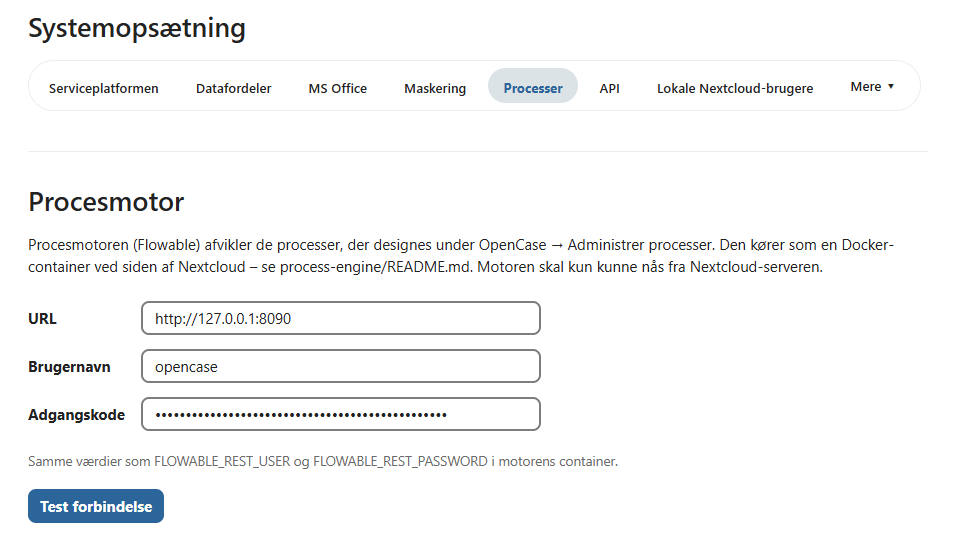

Rollen **Procesadministrator** tildeles med privilegiet `http://<domæne>/roles/usersystemrole/opencaseprocessadministrator/1`, eller for lokale brugere under **Lokale brugere**.

---

## Se også

- [Processer](../sager/processer.md) – sådan bruges processerne på sagerne
- [Administrer brevdesigner](administrer-skabeloner.md) – skabeloner til *Opret dokument*
- [Konfiguration](konfiguration.md) – tillægsfelter og Digital Post
