# Administrer brevdesigner

Brevdesigneren samler alt det, der bruges til at danne breve og andre dokumenter i OpenCase:

- **Skabeloner** — dokumentets layout med brevhoved, faste tekster og **flettefelter**.
- **Fraser** — genbrugelige tekstafsnit, som brugeren kan vælge til og fra, når et brev dannes.
- **Frasekategorier** — mapper, der holder orden i frasebiblioteket.
- **Organisationslogoer** — det logo, der automatisk indsættes i brevet.

Når en bruger opretter en ny fil fra en skabelon, udfylder OpenCase flettefelterne med oplysninger fra sagen og dokumentet, indsætter de valgte fraser og organisationens logo — og åbner det færdige dokument i Nextcloud Office.

Kun brugere med rollen **Skabelonadministrator** eller **Administrator** kan oprette og vedligeholde skabeloner, fraser og logoer. Alle brugere kan bruge dem.

Brevdesigneren åbnes fra **Administrer brevdesigner** nederst i navigationen. Siden har tre faner: **Frasekategorier**, **Fraser** og **Skabeloner**.

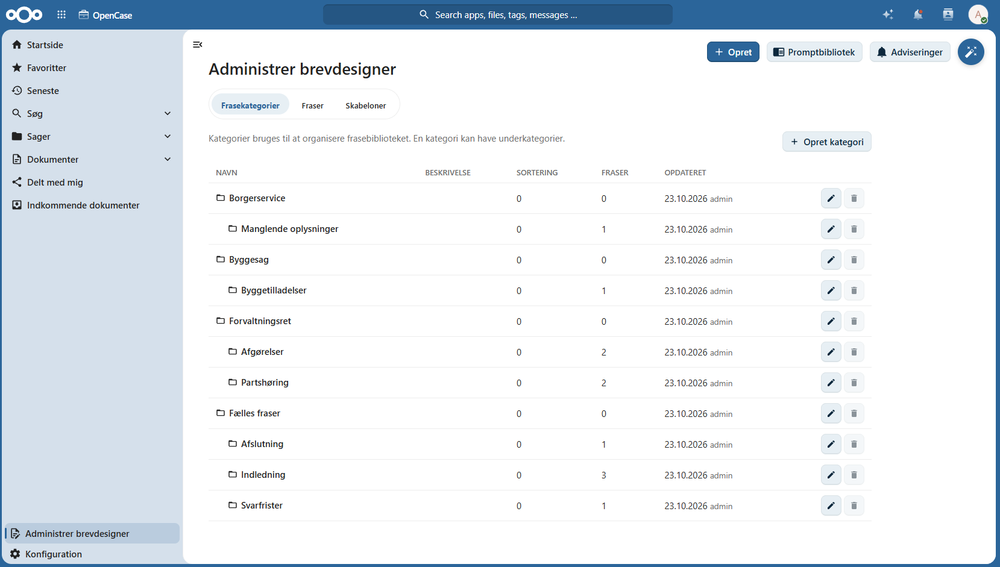

---

## Sådan hænger det sammen

1. Opret **frasekategorier**, så fraserne er nemme at finde.
2. Opret **fraser** — fx "Partshøring – indledning" eller "Klagevejledning".
3. Opret eller upload en **skabelon** med brevhoved, flettefelter og feltet `{{fraser.indhold}}` der, hvor fraserne skal stå.
4. Tilknyt fraserne til skabelonen og angiv, hvilke der er **obligatoriske** og **forudvalgte**.
5. Brugeren vælger skabelonen under **Ny fil fra skabelon**, til- og fravælger fraser og får et færdigt dokument.

---

## Frasekategorier

På fanen **Frasekategorier** opretter og vedligeholder du kategorierne. En kategori kan have underkategorier, så du kan bygge en struktur som:

- Afgørelser
    - Bevilling
    - Afslag
- Høringer
- Standardafsnit

Klik på **Opret kategori**, og angiv:

| Felt | Beskrivelse |
|------|-------------|
| **Navn** | Kategoriens navn. |
| **Beskrivelse** | Valgfri beskrivelse. |
| **Overordnet kategori** | Vælg en kategori, hvis den nye skal være en underkategori. |
| **Sortering** | Bestemmer rækkefølgen blandt kategorier på samme niveau. |

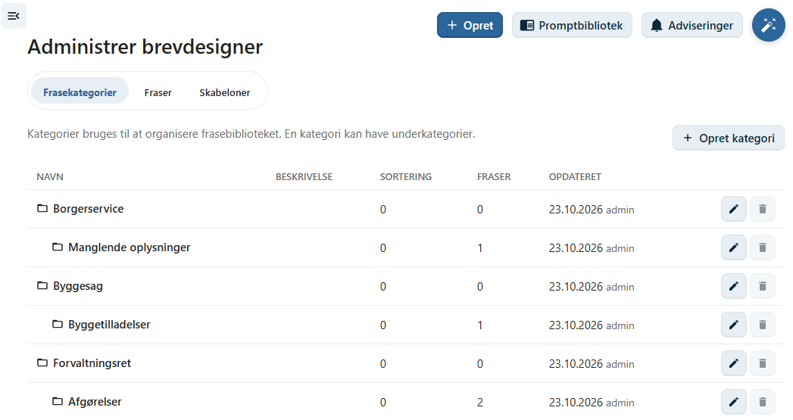

!!! info

    En kategori kan kun slettes, når den hverken har underkategorier eller fraser. Flyt eller slet dem først.

---

## Fraser

På fanen **Fraser** ses alle fraser. Listen kan filtreres på tekst, kategori og status. Under hver frase findes knapperne til at redigere, uploade fil, redigere filen i Nextcloud Office, downloade og slette.

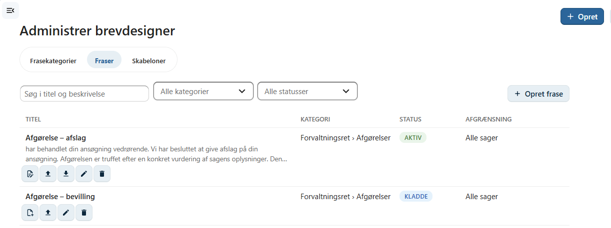

### Opret en frase

Klik på **Opret frase**, og udfyld:

| Felt | Beskrivelse |
|------|-------------|
| **Titel** | Frasens navn, som brugerne ser, når de vælger fraser. |
| **Beskrivelse** | En kort intern beskrivelse af, hvornår frasen bruges. Beskrivelsen kommer **ikke** med i brevet. |
| **Tekst** | Frasens indhold. Teksten kan formateres med fed, kursiv, understregning, overskrifter, punkt- og nummererede lister og citater. |
| **Kategori** | Den kategori, frasen hører til. |
| **Status** | **Kladde**, **Aktiv** eller **Arkiveret** — se nedenfor. |
| **Afgrænsning** | Valgfri begrænsning til sagstyper, organisationer og KLE-numre — se nedenfor. |

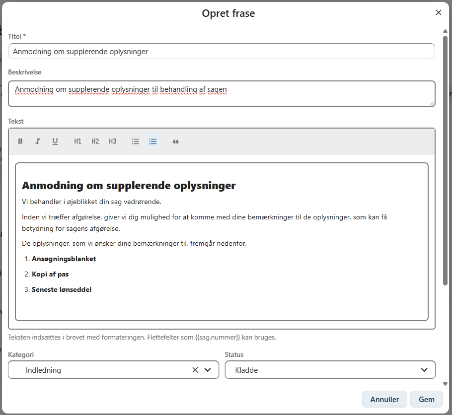

Flettefelter som `{{sag.nummer}}` og `{{adresse.navn}}` kan bruges direkte i frasens tekst. De udfyldes, når brevet dannes.

### Tekst eller fil

En frase kan have sit indhold på to måder:

- **Tekst** skrevet direkte i OpenCase. Det er den nemmeste løsning og dækker de fleste behov.
- **En fil** (`.docx` eller `.odt`). Brug en fil, hvis frasen skal indeholde tabeller, billeder eller særlig formatering. Klik på **Upload fil**, eller klik på **Opret tomt dokument** og skriv frasen i Nextcloud Office.

Har frasen en fil, bruges filen i stedet for teksten.

!!! tip "Samme format som skabelonen"

    En frasefil indsættes med sin formatering, når den har samme format som skabelonen (`.docx` i `.docx`-skabeloner, `.odt` i `.odt`-skabeloner). Ellers indsættes den som ren tekst. Fraser med tekst passer til begge formater.

### Status

| Status | Betydning |
|--------|-----------|
| **Kladde** | Frasen er under udarbejdelse. Den kan tilknyttes skabeloner, men indsættes **ikke** i breve. |
| **Aktiv** | Frasen kan vælges og indsættes i breve. |
| **Arkiveret** | Frasen bruges ikke længere. Den kan ikke tilknyttes skabeloner og indsættes ikke i breve, men kan genaktiveres. |

### Afgrænsning

En frase kan begrænses til bestemte **sagstyper**, **organisationer** og **KLE-numre** — på samme måde som tillægsfelter:

- En frase uden afgrænsning kan bruges på alle sager.
- En organisation omfatter også dens underorganisationer.
- KLE kan angives som et nummer (`27.69.00`) eller en hel gruppe (`27.%`).

Når et brev dannes, vises kun de fraser, hvis afgrænsning passer til sagen.

### Bruges i skabeloner

Når du redigerer en frase, vises en liste over de skabeloner, frasen er tilknyttet, og om den er obligatorisk eller forudvalgt dér. Ændrer du frasens afgrænsning, så den ikke længere passer til en skabelons organisationer, markeres skabelonen med rødt, allerede inden du gemmer.

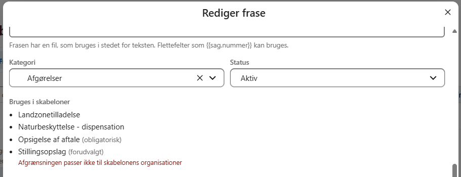

### Slet eller arkivér en frase

Er frasen ikke brugt i nogen skabeloner, slettes den efter en bekræftelse.

Bruges den i skabeloner, vises en liste over dem — med markering af, hvor frasen er obligatorisk. Du kan da vælge **Arkivér** i stedet for at slette. Så forsvinder frasen fra nye breve, men kan genaktiveres senere. Vælger du **Slet alligevel**, fjernes frasen også fra skabelonerne.

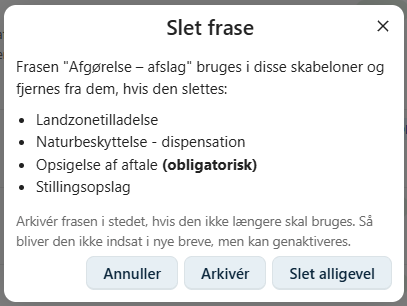

---

## Skabeloner

På fanen **Skabeloner** ses alle skabeloner med filnavn, størrelse, antal fraser og organisationer.

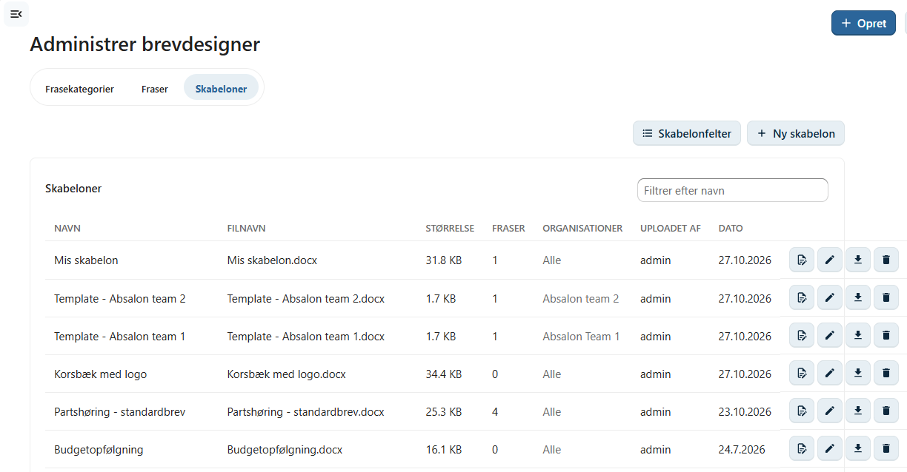

### Opret en ny skabelon

Klik på **Ny skabelon**. Dialogen har to faner.

**Generelt**

| Felt | Beskrivelse |
|------|-------------|
| **Navn** | Skabelonens navn, som brugerne ser. |
| **Organisationer** | Valgfrit. Begrænser skabelonen til sager under de valgte organisationer — se nedenfor. |
| **Fil** | **Ny fil** opretter et tomt dokument, som åbnes i Nextcloud Office. **Upload fil** bruger en eksisterende skabelon fra din computer. |

Der kan uploades Word (`.docx`), ODF-tekst (`.odt`), Excel (`.xlsx`) og ODF-regneark (`.ods`). Fraser og logo kan kun indsættes i `.docx` og `.odt`.

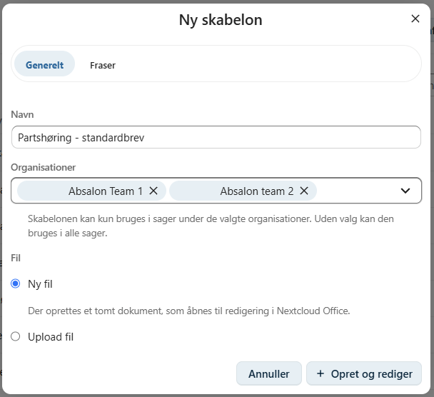

**Fraser**

Her vælger du de fraser, brugeren kan vælge imellem, når brevet dannes:

- Søg efter en frase og vælg den — den tilføjes listen.
- Markér **Obligatorisk**, hvis frasen altid skal med. Obligatoriske fraser er også altid forudvalgte.
- Markér **Forudvalgt**, hvis frasen skal være valgt på forhånd, men kan fravælges.
- Fraser uden markering kan tilvælges af brugeren.
- Brug pilene til at bestemme rækkefølgen. Fraserne indsættes i brevet i denne rækkefølge.

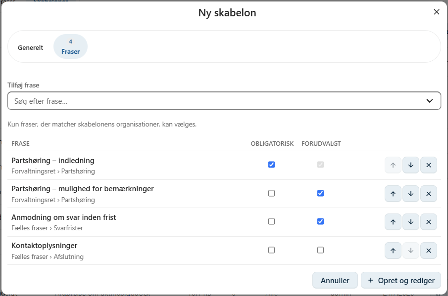

Listen viser også advarsler:

- **Kladde** — frasen indsættes ikke, før den er aktiv.
- **Matcher ikke skabelonens organisationer** — frasen skal fjernes, eller organisationerne rettes, før skabelonen kan gemmes.
- **Frasens fil er .odt, skabelonen er .docx** — frasen indsættes uden formatering.

Klik på **Opret og rediger** (Ny fil) eller **Opret** (Upload fil). Skabelon, organisationer og fraser gemmes samlet. Er noget ugyldigt, oprettes skabelonen ikke, og du får en fejlbesked.

### Begræns en skabelon til organisationer

Vælges en eller flere organisationer under **Organisationer**:

- kan skabelonen kun bruges på sager under de valgte organisationer (inkl. underorganisationer)
- kan der kun tilknyttes fraser, hvis organisationsafgrænsning passer til en af skabelonens organisationer — eller som ikke har nogen organisationsafgrænsning.

Uden valgte organisationer kan skabelonen bruges på alle sager.

### Rediger en skabelon

For hver skabelon i oversigten findes:

| Knap | Funktion |
|------|----------|
| **Rediger i Nextcloud Office** | Åbner skabelonens fil til redigering. Ændringerne gemmes direkte i skabelonen og gælder straks for nye dokumenter. |
| **Rediger info og fraser** | Åbner dialogen **Rediger skabelon** med fanerne **Generelt** (navn og organisationer) og **Fraser**. |
| **Download** | Henter skabelonfilen. |
| **Slet** | Sletter skabelonen. |

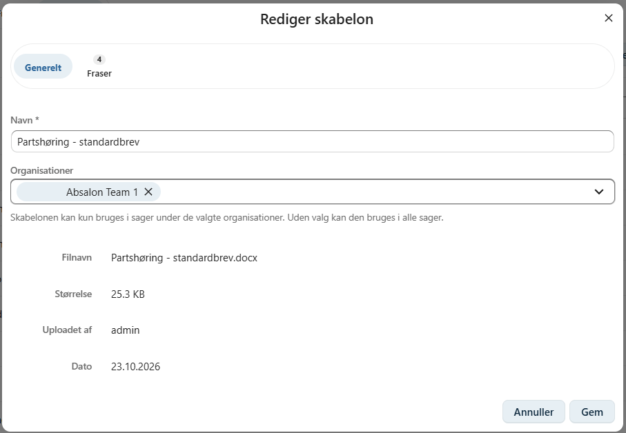

!!! info "Filerne ligger ét sted"

    Skabelon- og frasefiler gemmes kun på serveren i OpenCase. Når du redigerer en fil i Nextcloud Office, er det selve skabelonen, du redigerer — der oprettes ingen kopi i din egen Filer-app. Filerne kan heller ikke slettes eller omdøbes fra Filer-appen; det gøres i brevdesigneren.

---

## Flettefelter

Klik på **Skabelonfelter** på fanen **Skabeloner** for at se alle flettefelter. Siden viser felterne på dansk eller engelsk afhængigt af dit sprog, og hvert felt kan kopieres med et klik.

Skriv flettefeltet direkte i skabelonen, fx `Sagsnummer: {{sag.nummer}}`. Når en bruger opretter en ny fil fra skabelonen, erstattes feltet med oplysningen fra sagen eller dokumentet.

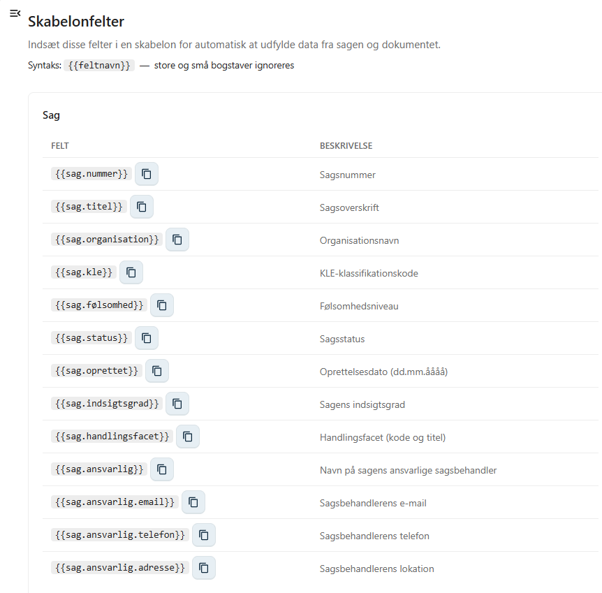

### Sag

| Flettefelt | Beskrivelse |
|------------|-------------|
| `{{sag.nummer}}` | Sagsnummer |
| `{{sag.titel}}` | Sagsoverskrift |
| `{{sag.organisation}}` | Organisationsnavn |
| `{{sag.kle}}` | KLE-klassifikationskode |
| `{{sag.følsomhed}}` | Følsomhedsniveau |
| `{{sag.status}}` | Sagsstatus |
| `{{sag.oprettet}}` | Oprettelsesdato (dd.mm.åååå) |
| `{{sag.indsigtsgrad}}` | Sagens indsigtsgrad |
| `{{sag.handlingsfacet}}` | Handlingsfacet (kode og titel) |
| `{{sag.ansvarlig}}` | Navn på sagens ansvarlige sagsbehandler |
| `{{sag.ansvarlig.email}}` | Sagsbehandlerens e-mail |
| `{{sag.ansvarlig.telefon}}` | Sagsbehandlerens telefon |
| `{{sag.ansvarlig.adresse}}` | Sagsbehandlerens lokation |

### Organisation

| Flettefelt | Beskrivelse |
|------------|-------------|
| `{{organisation.logo}}` | Organisationens logo — se [Logo i skabeloner](#logo-i-skabeloner) |
| `{{organisation.email}}` | Organisationens e-mail |
| `{{organisation.telefon}}` | Organisationens telefon |
| `{{organisation.adresse}}` | Organisationens adresse/lokation |

### Dokument

| Flettefelt | Beskrivelse |
|------------|-------------|
| `{{dokument.nummer}}` | Dokumentnummer |
| `{{dokument.type}}` | Dokumenttype |
| `{{dokument.titel}}` | Dokumenttitel |
| `{{dokument.kategori}}` | Dokumentkategori |
| `{{dokument.oprettet}}` | Oprettelsesdato (dd.mm.åååå) |
| `{{dokument.dokumentdato}}` | Dokumentdato (dd.mm.åååå) |
| `{{dokument.modtagetdato}}` | Modtaget dato (dd.mm.åååå) |
| `{{dokument.registreretdato}}` | Registreret dato (dd.mm.åååå) |
| `{{dokument.status}}` | Dokumentstatus |
| `{{dokument.indsigtsgrad}}` | Dokumentets indsigtsgrad |

### Adresse

| Flettefelt | Beskrivelse |
|------------|-------------|
| `{{adresse.cpr}}` | CPR-nummer |
| `{{adresse.navn}}` | Navn |
| `{{adresse.vejnavn}}` | Vejnavn |
| `{{adresse.husnummer}}` | Husnummer |
| `{{adresse.etage}}` | Etage |
| `{{adresse.dør}}` | Dør |
| `{{adresse.postnummer}}` | Postnummer |
| `{{adresse.postdistrikt}}` | Postdistrikt |

!!! info "Adressefelterne udfyldes ved afsendelse"

    Adressefelterne udfyldes først, når dokumentet sendes med Digital Post — med den enkelte modtagers oplysninger, så hver modtager får sin egen udgave. Når en fil oprettes fra skabelonen, står felterne derfor uændret i dokumentet. Brug dem til modtagerens navn og adresse i brevet.

### Fraser

| Flettefelt | Beskrivelse |
|------------|-------------|
| `{{fraser.indhold}}` | Indholdet af de fraser, brugeren har valgt. |

!!! tip "Placér fraserne i et afsnit for sig"

    Skriv `{{fraser.indhold}}` alene i et afsnit (en linje for sig). Så indsættes fraserne som egne afsnit med deres formatering — overskrifter, lister, tabeller og billeder. Står feltet midt i en tekst, indsættes fraserne som ren tekst.

    Fraserne får skrifttype og størrelse fra selve feltet. Formatér derfor `{{fraser.indhold}}` med brevets skrifttype (fx Calibri 11).

---

## Logo i skabeloner

Feltet `{{organisation.logo}}` indsætter logoet for sagens organisation. Har organisationen ikke selv et logo, bruges logoet fra den nærmeste overordnede organisation.

Logoet kan placeres på to måder:

- **Som tekst**: Skriv `{{organisation.logo}}` i skabelonen. Feltet erstattes af logoet i 2 cm højde.
- **Som pladsholderbillede**: Indsæt et vilkårligt billede, hvor logoet skal stå, og sæt billedets **alternative tekst** (eller titel) til `{{organisation.logo}}`. Logoet indsættes i billedets størrelse og placering — uden at blive forvrænget. Det virker også i sidehoved og sidefod.

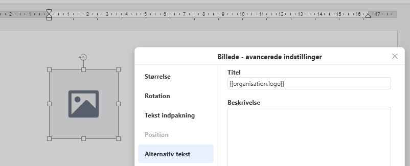

Findes der intet logo, fjernes pladsholderen fra dokumentet.

### Upload et logo

Logoer uploades på organisationens side:

1. Gå til **Søg** → **Organisationer**, og vælg organisationen.
2. Under **Logo** klikker du på **Upload logo**.
3. Vælg en PNG-, JPEG-, GIF- eller SVG-fil (højst 5 MB).

Siden viser det logo, der bruges i skabelonerne — og om det er organisationens eget eller arvet fra en overordnet organisation. Klik på **Fjern logo** for at bruge den overordnede organisations logo igen.

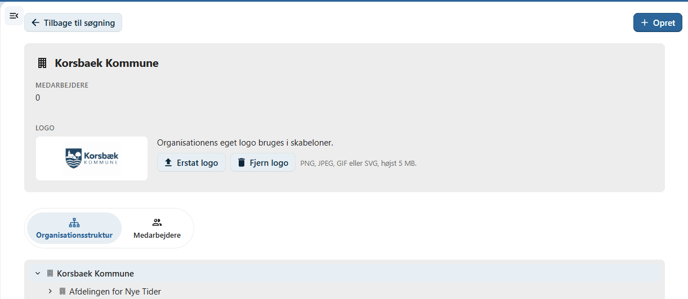

!!! tip

    Brug helst PNG til logoer, hvis brevene også skal åbnes i Microsoft Word. SVG-logoer vises skarpt i Nextcloud Office.

---

## God praksis

- Skriv faste formuleringer som fraser i stedet for at gentage dem i flere skabeloner — så skal en ændring kun laves ét sted.
- Hold nye fraser som **Kladde**, indtil de er gennemlæst, og sæt dem derefter til **Aktiv**.
- **Arkivér** fraser, der ikke længere skal bruges, i stedet for at slette dem.
- Brug afgrænsning på fraser, der kun gælder bestemte sagstyper eller KLE-områder, så brugerne kun ser relevante fraser.
- Anvend flettefelter i stedet for at skrive oplysninger manuelt.
- Test nye skabeloner ved at oprette et dokument, inden de tages i brug.

---

## Se også

- [Ny fil fra skabelon](../dokumenter/ny-fil-fra-skabelon.md)
- [Opret dokument](../dokumenter/opret-dokument.md)
- [Digital Post](../dokumenter/digital-post.md)
- [Søg efter organisationer](../soegning/organisation.md)
- [Tillægsfelter](../sager/tillaegsfelter.md)
- [AI-assistent](../aI-assistent.md)
