# Konfiguration - Microsoft Entra ID

OpenCase kan bruge **Microsoft Entra ID** (tidligere Azure AD) til log ind med single sign-on (SSO). Brugerne logger ind med deres Microsoft-konto, og deres medlemskab af grupper i Entra ID bestemmer:

- hvilke **OpenCase-roller** de har (f.eks. Bruger, OpenCase Administrator, Skabelon administrator og Procesadministrator)
- hvilke **adgangsgrupper** de er med i, og dermed hvilke sager, dokumenter og filer de har adgang til.

Log ind sker med Nextcloud-appen **OpenID Connect Login** (`oidc_login`).

Denne vejledning er til kunder, der ikke bruger Fælleskommunalt Adgangsstyring (FK Adgang). Opsætningen svarer til en af disse to kundetyper:

| Godkendelse | Adgangsstyring | Klassifikation |
|-------------|----------------|----------------|
| OpenID Connect (Entra ID) | Grupper | KLE-numre |
| OpenID Connect (Entra ID) | Grupper | Emneplan |

!!! info

    Opsætningen kræver administratoradgang til både Microsoft Entra ID (rollen *Application Administrator* eller *Cloud Application Administrator*) og til Nextcloud-serveren (kommandolinje og `occ`).

---

# Overblik

Opsætningen består af disse trin:

1. [Opret en app-registrering i Microsoft Entra ID](#1-app-registrering-i-microsoft-entra-id)
2. [Opret sikkerhedsgrupper i Entra ID og tildel dem til appen](#2-grupper-i-microsoft-entra-id)
3. [Installer appen OpenID Connect Login i Nextcloud](#3-installer-appen-openid-connect-login)
4. [Kør opsætningsscriptet setup_oidc_ms.sh](#4-opsaetning-med-setup_oidc_mssh)
5. [Konfigurer Adgangsprofiler og Klassifikationsplan i OpenCase](#5-konfiguration-i-opencase)
6. [Test log ind](#6-test-log-ind)

Du skal bruge den offentlige adresse på Nextcloud, f.eks. `https://cloud.kommune.dk`. I vejledningen skrives den som `<nextcloud>`.

---

# 1. App-registrering i Microsoft Entra ID

Log ind på [Microsoft Entra admin center](https://entra.microsoft.com) og gå til **Identitet → Applikationer → App-registreringer**.

## Opret app-registreringen

1. Klik **Ny registrering**.
2. Angiv et navn, f.eks. `OpenCase`.
3. Under **Understøttede kontotyper** vælges **Kun konti i denne organisationsmappe (enkelt lejer)**.
4. Under **Omdirigerings-URI** vælges platformen **Web**, og der indtastes:

    ```
    https://<nextcloud>/index.php/apps/oidc_login/oidc
    ```

5. Klik **Registrer**.

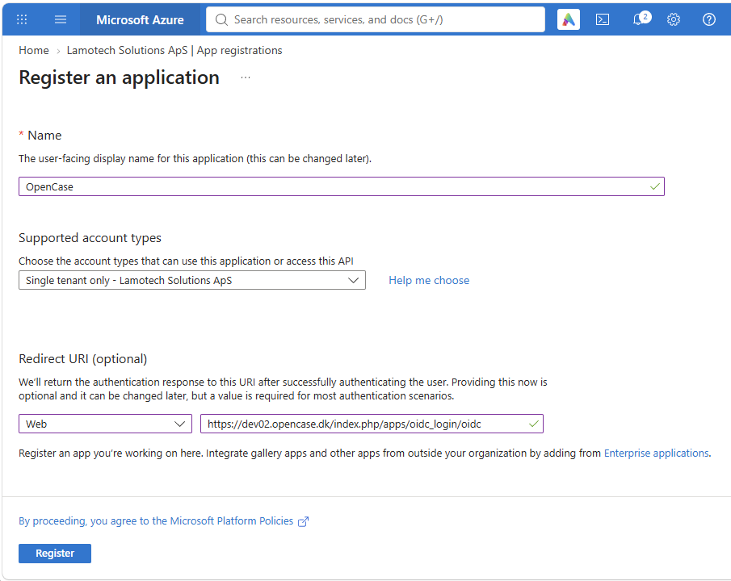

Gå derefter til **Godkendelse** (Authentication) og tilføj den anden omdirigerings-URI under platformen **Web**:

```
https://<nextcloud>/apps/oidc_login/oidc
```

Begge adresser skal være registreret. Nextcloud bruger formen med `index.php`, medmindre "pretty URLs" er slået til.

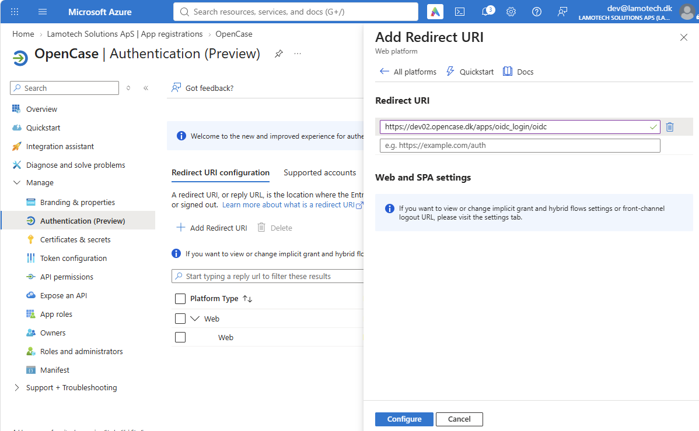

## Notér id'er

På siden **Oversigt** for app-registreringen noteres:

- **Program-id (klient-id)** – *Application (client) ID*
- **Mappe-id (lejer-id)** – *Directory (tenant) ID*

Begge skal bruges, når opsætningsscriptet køres.

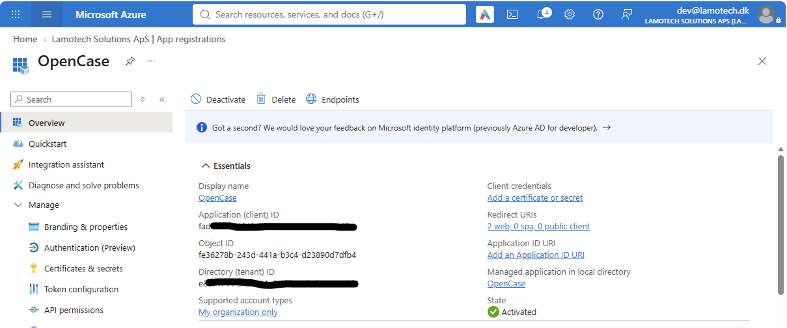

## Opret en klienthemmelighed

1. Gå til **Certifikater og hemmeligheder → Klienthemmeligheder**.
2. Klik **Ny klienthemmelighed**, angiv en beskrivelse og en udløbsperiode.
3. Kopiér **Værdi** (ikke *Hemmeligheds-id*) med det samme. Værdien vises kun én gang.

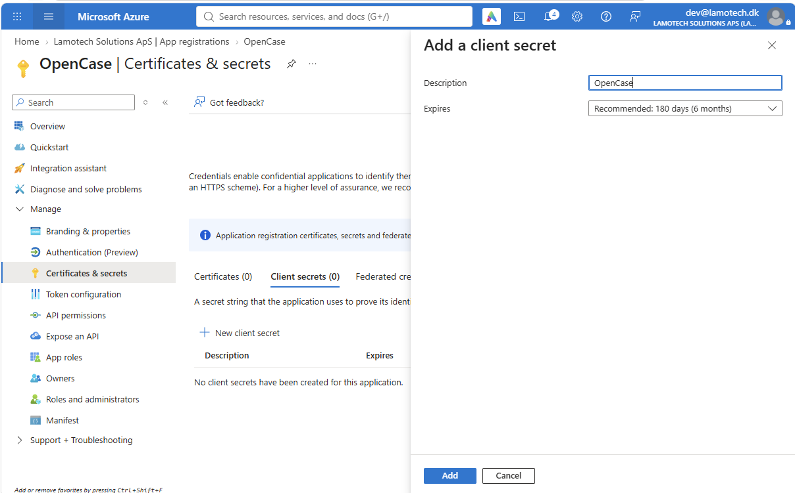

!!! warning

    Klienthemmeligheden udløber. Notér udløbsdatoen og opret en ny hemmelighed i god tid. Når den nye hemmelighed er oprettet, køres opsætningsscriptet igen, og den nye værdi indtastes. Udløber hemmeligheden, kan ingen logge ind med Microsoft.

## Tokenkonfiguration

Gå til **Tokenkonfiguration**.

**Valgfri claims:**

1. Klik **Tilføj valgfrit claim**, vælg tokentypen **ID**.
2. Markér `email`, `preferred_username`, `given_name` og `family_name`.
3. Klik **Tilføj**. Accepter, hvis du bliver spurgt om at tilføje Microsoft Graph-tilladelsen.

**Gruppe-claim:**

1. Klik **Tilføj gruppe-claim**.
2. Vælg **Grupper, der er tildelt programmet** (*Groups assigned to the application*).
3. Under **ID** vælges **Gruppe-id**.
4. Klik **Tilføj**.

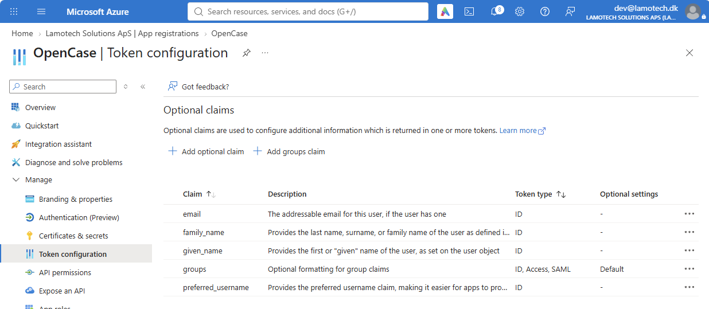

Ved kun at sende de grupper, der er tildelt appen, holdes tokenet under Entra ID's grænse på ca. 200 grupper.

## Gruppenavne i stedet for GUID'er (manifest)

Uden yderligere opsætning sender Entra ID gruppernes GUID'er, og grupperne i Nextcloud får navne som `3f2a91c0-…`. For at få gruppernes visningsnavn i stedet (f.eks. `OpenCase - Byggesager`):

1. Gå til **Manifest**.
2. Find `optionalClaims` → `idToken` og elementet med `"name": "groups"`.
3. Sæt `additionalProperties` til `["cloud_displayname"]`:

    ```json
    "optionalClaims": {
        "idToken": [
            {
                "name": "groups",
                "source": null,
                "essential": false,
                "additionalProperties": [
                    "cloud_displayname"
                ]
            }
        ]
    }
    ```

4. Klik **Gem**.

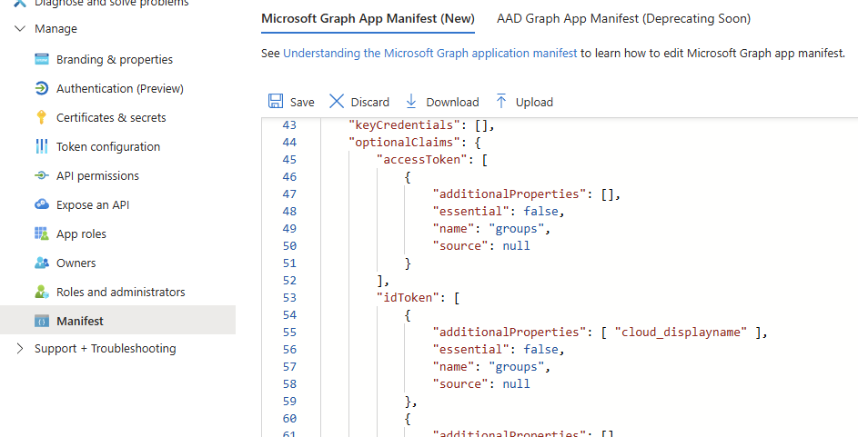

!!! info

    `cloud_displayname` virker kun sammen med **Grupper, der er tildelt programmet** og kun for grupper, der er oprettet i skyen (ikke grupper synkroniseret fra et lokalt Active Directory).

---

# 2. Grupper i Microsoft Entra ID

OpenCase genkender grupperne på deres navn. Opret sikkerhedsgrupper i Entra ID under **Identitet → Grupper → Alle grupper → Ny gruppe** (gruppetype **Sikkerhed**).

## Navngivning

| Gruppenavn i Entra ID | Betydning i OpenCase |
|-----------------------|----------------------|
| `OpenCase Role - User` | Rollen **Bruger** |
| `OpenCase Role - Administrator` | Rollen **OpenCase Administrator** |
| `OpenCase Role - Template Designer` | Rollen **Skabelon administrator** |
| `OpenCase Role - Process Designer` | Rollen **Procesadministrator** |
| `OpenCase - <navn>` | Adgangsgruppe, vises i OpenCase som `<navn>` |
| `OpenCase Org - <navn>` | Medlemmer af en organisation (anbefalet navngivning – se [Organisationsstruktur](#organisationsstruktur)) |
| `admin` | Nextcloud-administratorer |

Eksempler på adgangsgrupper: `OpenCase - Byggesager`, `OpenCase - Miljø`, `OpenCase - Sekretariatet`.

Eksempler på organisationsgrupper: `OpenCase Org - Hospitalsenhed Nord`, `OpenCase Org - Koncern HR`.

Alle brugere af OpenCase skal være med i `OpenCase Role - User`.

!!! warning

    Nextcloud kender grupperne på deres navn, og to grupper med samme navn i Entra ID bliver til én gruppe i Nextcloud. Sørg derfor for, at kun betroede personer kan oprette grupper og tildele dem til appen, og at gruppenavnene er entydige. Gruppe-claimet ovenfor sender kun grupper, der er tildelt appen, så en gruppe har ingen virkning, før den er tildelt.

!!! warning

    Når gruppesynkronisering er slået til, er Entra ID den eneste kilde til gruppemedlemskab for brugere, der logger ind med Microsoft. Ved hvert log ind fjernes brugeren fra de Nextcloud-grupper, der ikke er med i tokenet – **også Nextcloud-gruppen `admin`**. Opret derfor en gruppe i Entra ID, der hedder præcis `admin`, til Nextcloud-administratorer.

Navnene på rollegrupperne og præfikset for adgangsgrupper kan ændres i OpenCase (se [Konfiguration i OpenCase](#5-konfiguration-i-opencase)).

## Tildel grupperne til appen

1. Gå til **Identitet → Applikationer → Virksomhedsapplikationer** og åbn appen (samme navn som app-registreringen).
2. Gå til **Brugere og grupper → Tilføj bruger/gruppe** og tilføj alle grupperne fra tabellen ovenfor.
3. Gå til **Egenskaber** og sæt **Tildeling påkrævet?** (*Assignment required*) til **Ja**. Klik **Gem**.

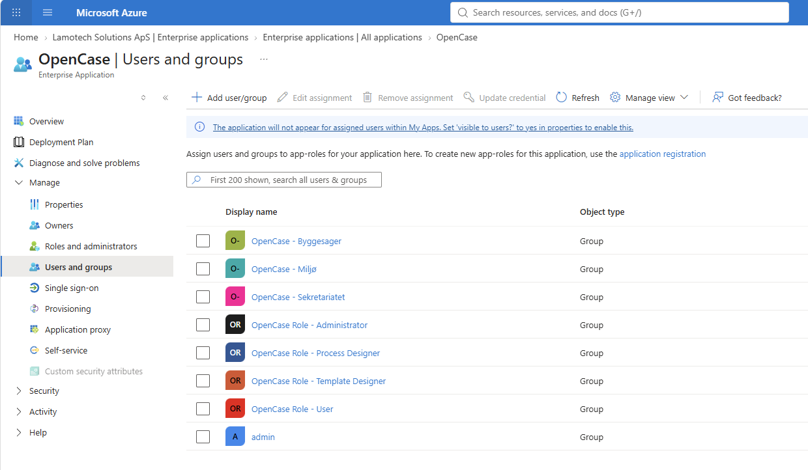

Med **Tildeling påkrævet = Ja** kan kun medlemmer af de tildelte grupper logge ind. Andre brugere i lejeren får en fejl fra Microsoft.

## Gode at vide om grupper

- **Ændringer slår først igennem ved næste log ind.** Fjernes en bruger fra en gruppe i Entra ID, opdager Nextcloud det først, når brugeren logger ind med Microsoft igen.
- **Omdøbning opretter en ny gruppe.** Nextcloud kender en gruppe på dens navn. Omdøbes en gruppe i Entra ID, oprettes en ny gruppe i Nextcloud ved næste log ind, og den gamle gruppe står tilbage uden medlemmer. Sager, der er knyttet til den gamle adgangsgruppe, skal knyttes til den nye.
- **En ny gruppe med samme navn som en slettet adgangsgruppe får ikke dens sager.** Se [Adgangsgrupper](#adgangsgrupper).
- **Maks. 64 tegn.** Nextcloud kan ikke oprette grupper med navne over 64 tegn.
- **Indlejrede grupper tæller ikke.** Kun direkte medlemmer af en tildelt gruppe får gruppen i tokenet.

---

# 3. Installer appen OpenID Connect Login

Appen **OpenID Connect Login** installeres fra Nextclouds App Store.

**Via brugerfladen:**

1. Log ind i Nextcloud som administrator.
2. Klik på profilbilledet → **Apps**.
3. Søg efter `OpenID Connect Login`.
4. Klik **Download og aktiver**.

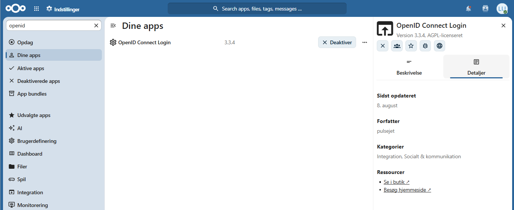

**Via kommandolinjen:**

```bash
sudo -u www-data php occ app:install oidc_login
```

!!! info

    Der findes flere OpenID Connect-apps til Nextcloud. Det skal være appen **OpenID Connect Login** (app-id `oidc_login`) – ikke *OpenID Connect user backend* (`user_oidc`).

---

# 4. Opsætning med setup_oidc_ms.sh

Scriptet `setup_oidc_ms.sh` konfigurerer appen OpenID Connect Login til Microsoft Entra ID. Det spørger efter værdierne fra app-registreringen og skriver indstillingerne i Nextclouds `config.php` med `occ config:system:set`.

Kør scriptet som root på Nextcloud-serveren:

```bash
sudo bash setup_oidc_ms.sh /var/www/nextcloud
```

Stien til Nextcloud kan udelades, hvis Nextcloud er installeret i `/var/www/nextcloud`.

Scriptet kan køres igen, f.eks. når klienthemmeligheden skal skiftes. De nuværende værdier foreslås som standard, og trykker man **Enter** ved klienthemmeligheden, beholdes den nuværende.

## Spørgsmål i scriptet

| Spørgsmål | Hvad skal du svare |
|-----------|--------------------|
| Public Nextcloud URL | Kun hvis `overwrite.cli.url` ikke er sat. F.eks. `https://cloud.kommune.dk` |
| Directory (tenant) ID | Mappe-id (lejer-id) fra app-registreringen |
| Application (client) ID | Program-id (klient-id) fra app-registreringen |
| Client secret value | Værdien af klienthemmeligheden |
| Username claim | `oid` (anbefales) eller `preferred_username` – se nedenfor |
| Username prefix | Vises kun med en tilpasset udgave af appen. Normalt tom |
| Allowed app roles | Tom, når *Tildeling påkrævet* er slået til |
| Nextcloud group every SSO user is added to | Normalt tom |
| Login button text | Teksten på knappen på log ind-siden, f.eks. `Log ind med Microsoft` |
| Create Nextcloud users automatically on first login? | **Ja** |
| Sync Entra ID groups to Nextcloud groups? | **Ja** – kræves for roller og adgangsgrupper |
| Redirect the login page straight to Microsoft? | **Nej** ved første opsætning. Slå til, når log ind er testet |
| Hide the username/password form on the login page? | **Nej** ved første opsætning |

Til sidst vises et resumé, og indstillingerne gemmes, når du bekræfter.

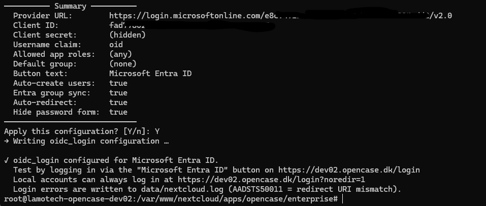

## Brugernavn: oid eller preferred_username

| Claim | Eksempel | Fordele og ulemper |
|-------|----------|--------------------|
| `oid` | `6301c9a1-63a9-4526-87ac-6bd3cf5c8006` | Ændrer sig aldrig. Ikke læsbart for mennesker |
| `preferred_username` | `jens@kommune.dk` | Læsbart. Ændres brugerens UPN (f.eks. ved navneskift), oprettes en ny Nextcloud-bruger |

Brugerens navn og e-mail hentes fra tokenet uanset valget, så brugerne vises med deres rigtige navn i OpenCase.

!!! warning

    Vælg brugernavn **før** den første bruger logger ind. Skiftes der senere, får alle brugere en ny Nextcloud-konto ved næste log ind. Det samme sker, hvis lejer-id'et skiftes.

---

# 5. Konfiguration i OpenCase

Gå til **Administrationsindstillinger → OpenCase** (`/settings/admin/opencase`).

## Kundetype

Vælg under **Version** kundetypen:

- **Kommune** – fanen **Serviceplatformen** vises. Adgangsprofiler sættes til **FK Adgang** (vælg **Grupper** for log ind med Microsoft), og sager klassificeres altid med KLE-numre, så afsnittet **Klassifikationsplan** vises ikke. Afsnittet **Organisationsstruktur** vises kun, når organisationsintegrationen på fanen **Serviceplatformen** er slået fra.
- **Anden offentlig myndighed** – fanen **Serviceplatformen** vises ikke. Adgangsprofiler er altid **Grupper**, sager klassificeres med en **Emneplan**, og organisationsstrukturen indlæses med **Upload organisationsstruktur**.

Valget sætter adgangsprofiltype og klassifikationsplan til kundetypens standard.

## Slå FK Adgang fra

For en kommune: På fanen **Serviceplatformen** i afsnittet **Access control** skal **Enable** være slået **fra**. Er den slået til, sendes brugerne til log ind via FK Adgang (SAML) i stedet for Microsoft.

## Adgangsprofiler

Gå til fanen **Adgangsprofiler** og vælg **Grupper**.

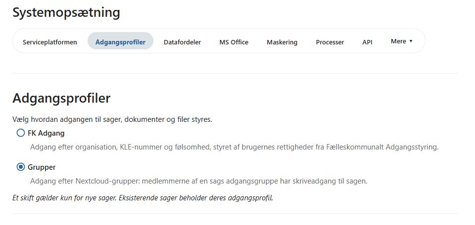

Med **Grupper** styres adgangen til sager efter Nextcloud-grupper: Medlemmerne af en sags adgangsgruppe har skriveadgang til sagen.

!!! info

    Et skift af adgangsprofiltype gælder kun for nye sager. Eksisterende sager beholder deres adgangsprofil.

### Roller fra grupper

I afsnittet **Roller fra grupper** angives for hver OpenCase-rolle, hvilke Nextcloud-grupper der giver rollen. Som standard er hver rolle knyttet til gruppen `OpenCase Role - <rolle>`, f.eks. `OpenCase Role - Process Designer`. Når der er klikket **Gem**, giver en rolle kun de grupper, der er valgt her. Med adgangsprofiltypen FK Adgang giver standardgrupperne ingen roller.

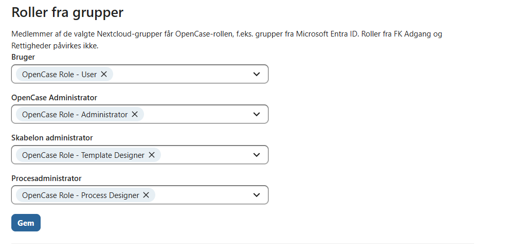

- En gruppe behøver ikke findes endnu. Grupper fra Entra ID oprettes i Nextcloud, når det første medlem logger ind, og rollen gives fra da af. Gruppen vises med teksten *Findes ikke endnu*, indtil da.
- En rolle kan knyttes til flere grupper, f.eks. hvis grupperne i Entra ID allerede har andre navne.
- Fjernes alle grupper fra en rolle og gemmes, gives rollen ikke via grupper.
- Roller, der er givet under **Lokale brugere → Rettigheder**, påvirkes ikke.

Klik **Gem** efter ændringer.

### Adgangsgrupper

I afsnittet **Adgangsgrupper** vises de Nextcloud-grupper, der kan vælges som adgangsgruppe på en sag.

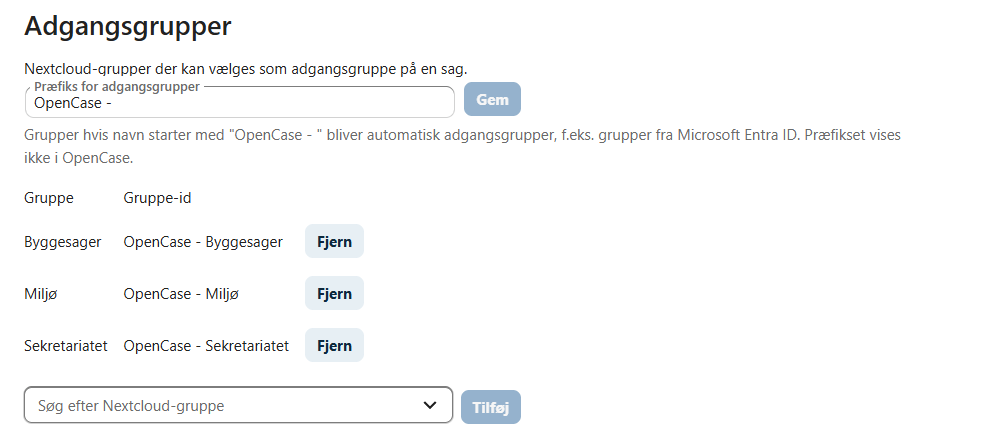

- Grupper, hvis navn starter med **Præfiks for adgangsgrupper** (standard `OpenCase - `), bliver automatisk adgangsgrupper. Præfikset vises ikke i OpenCase, så `OpenCase - Byggesager` vises som `Byggesager`.
- Med et tomt præfiks bliver alle grupper adgangsgrupper, undtagen `admin`, `org_`-grupper og grupper, der giver roller.
- Andre grupper kan tilføjes manuelt med **Tilføj**.
- En adgangsgruppe kan kun fjernes, hvis den ikke bruges af sager.
- Slettes en adgangsgruppe, der bruges af sager, bliver sagerne på den gamle adgangsgruppe, og ingen får adgang til dem via gruppen. Oprettes en ny gruppe med samme navn, får den ikke sagerne, da det kan være en anden gruppe. Er det den samme gruppe, tilføjes den med **Tilføj**, så dens medlemmer får sagerne tilbage. Ellers kan sagerne knyttes til en anden adgangsgruppe.

Nye grupper registreres, når de oprettes i Nextcloud, og medlemskaber opdateres løbende. Derudover kører et baggrundsjob hver time, som afstemmer adgangsgrupper og roller med gruppemedlemskaberne. Afstemningen kan også køres manuelt:

```bash
sudo -u www-data php occ opencase:access:sync-groups
sudo -u www-data php occ opencase:access:sync-groups --group="OpenCase - Byggesager"
```

## Klassifikationsplan

Sager klassificeres efter kundetypen:

- **KLE** (kommuner) – sager klassificeres med KLE-numre. Når en sag oprettes, angives KLE-nummer, handlingsfacet og følsomhed ud over adgangsgruppen. Med grupper styrer KLE-nummer og følsomhed ikke adgangen – det gør adgangsgruppen – men de bruges til fx kassation, tillægsfelter, fraser, processer, søgning og brevskabeloner.
- **Emneplan** (andre offentlige myndigheder) – sager klassificeres med kundens egen emneplan, der vedligeholdes i afsnittet **Klassifikationsplan** på samme fane. KLE-nummer, handlingsfacet og følsomhed bruges ikke.

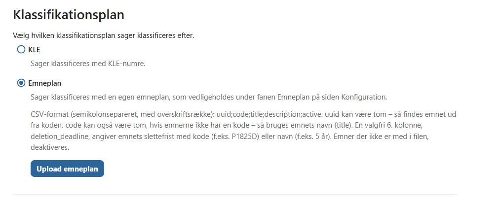

### Upload af emneplan

Når **Emneplan** er valgt, vises knappen **Upload emneplan**. Emneplanen uploades som en CSV-fil:

- semikolonsepareret, med overskriftsrække
- kolonnerne `uuid;code;title;description;active`
- `uuid` kan være tom – så findes emnet ud fra koden
- `code` kan være tom, hvis emnerne ikke har en kode – så bruges emnets navn (`title`)
- `description` og `active` kan udelades (`active` er som standard 1)
- en valgfri 6. kolonne, `deletion_deadline`, angiver emnets slettefrist med kode (f.eks. `P1825D`) eller navn (f.eks. `5 år`). En tom værdi fjerner slettefristen. Uden kolonnen beholder emnerne deres slettefrist.
- filen kan være gemt som UTF-8 eller som Excels standard-CSV (Windows-1252)

Emner, der ikke er med i filen, deaktiveres.

Eksempel:

```csv
"uuid";"code";"title";"description";"active";"deletion_deadline"
"";"01";"Byggesager";"Sager om byggetilladelser";1;"P1825D"
"";"02";"Miljøsager";"Sager om miljøgodkendelser";1;"P3650D"
```

[Download eksempel på CSV fil med emneplan](../../administrator/Emneplan-region.csv){ .md-button .md-button--primary }

Efter upload vises, hvor mange emner der er oprettet, opdateret og deaktiveret.

Emneplanen kan også vedligeholdes manuelt på siden **Konfiguration** under fanen **Emneplan**, hvor emner kan tilføjes, rettes og slettes.

Et emne kan kun slettes, hvis det ikke er i brug på sager, fraser, skabeloner, processer, tillægsfelter, separationsark eller i indstillingen for indkommende dokumenter. Ellers vises, hvad der bruger emnet, og emnet skal deaktiveres i stedet. Sager beholder et deaktiveret emne og kan stadig redigeres, og fraser og processer knyttet til emnet gælder fortsat for dem.

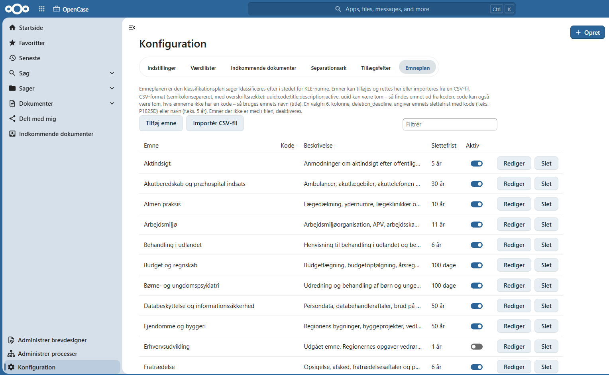

## Organisationsstruktur

Uden integrationen til Serviceplatformens organisationsservice indlæses organisationsstrukturen fra en CSV-fil med knappen **Upload organisationsstruktur** i afsnittet **Organisationsstruktur** på samme fane:

- semikolonsepareret, med overskriftsrække
- kolonnerne `uuid;name;parent;group;email;phone;location` – kun `name` er påkrævet
- `parent` er den overordnede organisations `uuid` eller navn og skal også være med i filen. Tom betyder øverste niveau.
- `group` er den gruppe i Entra ID, hvis medlemmer hører til organisationen, f.eks. `OpenCase Org - Hospitalsenhed Nord`. Gruppen behøver ikke findes i Nextcloud endnu – den oprettes, når det første medlem logger ind. Tom betyder, at organisationen ikke får medlemmer fra en gruppe.
- `uuid` kan være tom – så genkendes organisationen på navnet. En omdøbning opretter så en ny organisation, så brug helst `uuid`.
- filen kan være gemt som UTF-8 eller som Excels standard-CSV (Windows-1252)

Organisationer, der ikke er med i filen, deaktiveres. Hele filen kontrolleres, før noget gemmes, så en fejl (f.eks. en ukendt overordnet organisation) afviser filen uden ændringer.

Eksempel:

```csv
"uuid";"name";"parent";"group";"email";"phone";"location"
"";"Region Korsbæk";"";"";"kontakt@regionkorsbaek.dk";"70 11 22 00";"Regionshuset"
"";"Sundhed";"Region Korsbæk";"OpenCase Org - Sundhed";"sundhed@regionkorsbaek.dk";"";""
"";"Hospitalsenhed Nord";"Sundhed";"OpenCase Org - Hospitalsenhed Nord";"";"";"Hospitalsvej 10, 4700 Korsbæk"
```

[Download eksempel på CSV fil med organisationsstruktur](../../administrator/Organisation-region.csv){ .md-button .md-button--primary }

Filen kan også indlæses fra kommandolinjen. Med `--dry-run` vises først, hvad der ville blive ændret:

```bash
sudo -u www-data php occ opencase:import-organisations /sti/til/organisationer.csv --dry-run
sudo -u www-data php occ opencase:import-organisations /sti/til/organisationer.csv
```

### Brugernes organisationer

En bruger hører til de organisationer, hvis gruppe (`group`) brugeren er medlem af i Entra ID. En bruger kan høre til flere organisationer. Medlemskabet:

- vises på organisationen og bruges ved søgning efter medarbejdere
- bestemmer brugerens primære organisation (*Min afdeling*), som foreslås, når brugeren opretter en sag
- giver adgang til organisationens teammappe, når teammapper er slået til

Medlemskabet opdateres, når brugeren logger ind, og automatisk hver time. Kun direkte medlemskab tæller: et medlem af en overordnet organisations gruppe hører ikke automatisk til de underordnede organisationer.

Organisationsgrupper bliver aldrig adgangsgrupper, heller ikke hvis præfikset for adgangsgrupper er tomt. Opret dem i Entra ID og tildel dem til appen som de øvrige grupper (se [Grupper i Microsoft Entra ID](#2-grupper-i-microsoft-entra-id)).

---

# 6. Test log ind

1. Åbn et privat browservindue og gå til `https://<nextcloud>/login`.
2. Klik på knappen **Log ind med Microsoft** (eller den tekst, du valgte).
3. Log ind med en testbruger, der er medlem af `OpenCase Role - User` og en adgangsgruppe.
4. Første gang skal brugeren eventuelt give samtykke til, at appen må læse profilen.


Kontrollér som administrator:

- at brugeren er oprettet under **Brugere** med navn og e-mail
- at brugeren er medlem af de rigtige grupper
- at grupperne har læsbare navne (ikke GUID'er)
- at adgangsgruppen vises under **Adgangsgrupper** på fanen **Adgangsprofiler**
- at brugeren har adgang til OpenCase og kan oprette en sag med adgangsgruppen

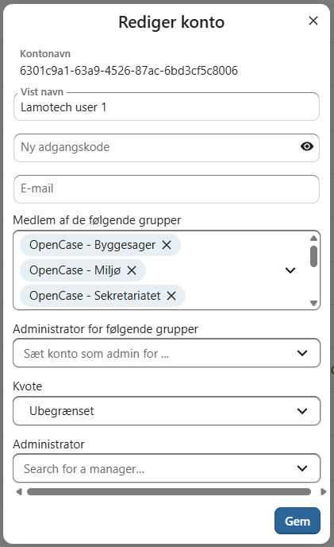

## Slå direkte omdirigering til

Når log ind virker, kan scriptet køres igen, og **Redirect the login page straight to Microsoft?** sættes til **Ja**. Så sendes brugerne direkte til Microsoft uden at se Nextclouds log ind-side. Eventuelt kan formularen til brugernavn og adgangskode også skjules.

---

# Lokal administrator som nødadgang

Behold altid mindst én lokal Nextcloud-administrator med adgangskode. Lokale brugere er ikke berørt af gruppesynkroniseringen.

Lokale brugere kan altid logge ind på:

```
https://<nextcloud>/login?noredir=1
```

Adressen virker også, når direkte omdirigering til Microsoft er slået til. Brug den, hvis log ind med Microsoft holder op med at virke, f.eks. fordi klienthemmeligheden er udløbet.

---

# Fejlfinding

Fejl ved log ind skrives i Nextclouds log (`data/nextcloud.log`, se [Logfiler](logfiler.md)).

| Fejl | Årsag og løsning |
|------|------------------|
| `AADSTS50011` – redirect URI mismatch | Omdirigerings-URI'en er ikke registreret. Kontrollér, at begge adresser fra [trin 1](#opret-app-registreringen) er tilføjet under **Godkendelse**, og at adressen matcher præcist (https, værtsnavn, ingen afsluttende `/`). |
| `AADSTS7000215` – invalid client secret | Der er indtastet *Hemmeligheds-id* i stedet for *Værdi*, eller hemmeligheden er udløbet. Opret en ny og kør scriptet igen. |
| `AADSTS50105` – user not assigned | Brugeren er ikke medlem af en gruppe, der er tildelt virksomhedsapplikationen. |
| Grupper har GUID-navne | `cloud_displayname` mangler i manifestet, eller gruppe-claimet er ikke sat til *Grupper, der er tildelt programmet*. Grupper, der er synkroniseret fra lokalt AD, sendes altid som GUID. |
| Brugeren får ikke en OpenCase-rolle | Kontrollér, at gruppen er knyttet til rollen under **Roller fra grupper**, og at brugeren er direkte medlem af gruppen i Entra ID. Bed brugeren logge ud og ind igen, eller kør `occ opencase:access:sync-groups`. |
| Administrator har mistet administratorrettigheder | Brugeren er ikke med i en Entra ID-gruppe ved navn `admin`. Log ind som lokal administrator via `/login?noredir=1`. |
| Brugeren sendes til FK Adgang | **Access control** på fanen **Serviceplatformen** er slået til. Slå den fra. |
| Brugere får en ny konto | Lejer-id eller brugernavn-claim er ændret, eller brugerens UPN er ændret med `preferred_username`. |

---

## Se også

- [Installation – Enterprise-version](./installation-enterprise-version.md)
- [Konfiguration](./konfiguration.md)
- [Lokale brugere](./lokale-brugere.md)
- [OCC-kommandoer](./occ-kommandoer.md)
- [Fejlfinding](./fejlfinding.md)
