# Konfiguration

OpenCase indeholder en række konfigurationsmuligheder, som gør det muligt at tilpasse systemet til organisationens arbejdsgange.

Kun brugere med rollen **OpenCase administrator** kan ændre konfigurationen.

Konfigurationen er opdelt i faner, som hver styrer forskellige dele af systemet.

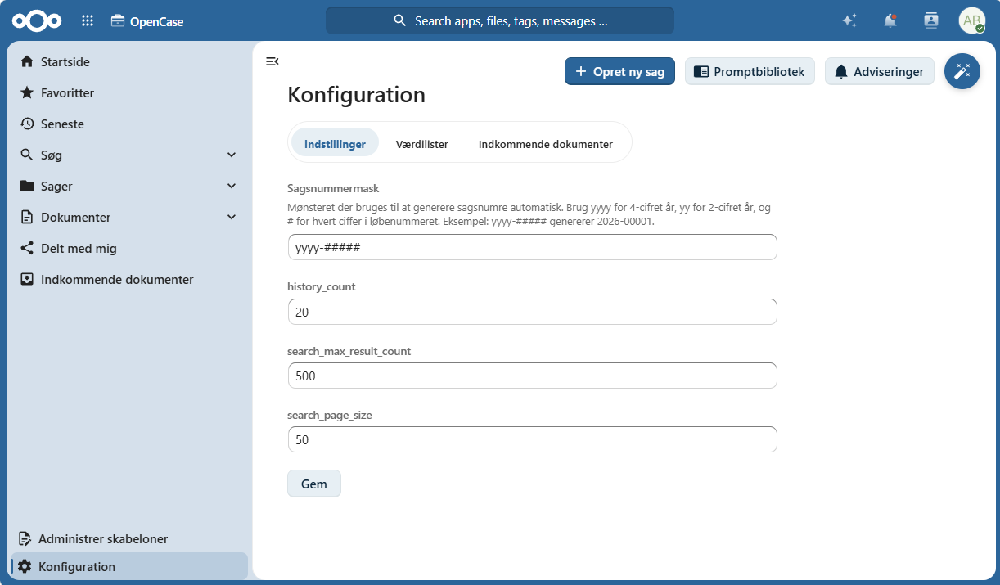

---

# Indstillinger

På fanen **Indstillinger** konfigureres de generelle indstillinger for OpenCase.

| Indstilling | Beskrivelse |
|-------------|-------------|
| **Sagsnummermaske** | Mønsteret, der anvendes ved automatisk generering af sagsnumre. |
| **Antal elementer i Seneste** | Antallet af sager og dokumenter, der vises i listerne *Seneste*. |
| **Maksimalt antal søgeresultater** | Det maksimale antal resultater, der kan vises ved søgninger. |
| **Sidevisning – søgeresultater** | Antallet af rækker, der vises pr. side i søgeresultater og sagslister. |

---

## Sagsnummermaske

Sagsnummermasken bestemmer, hvordan nye sagsnumre opbygges.

Der kan anvendes følgende pladsholdere:

| Pladsholder | Betydning |
|-------------|-----------|
| `yyyy` | Firecifret år |
| `yy` | Tocifret år |
| `#` | Ét ciffer i løbenummeret |

Eksempel:

```text
yyyy-#####
```

genererer sagsnumre som:

```text
2026-00001
2026-00002
2026-00003
```

!!! tip

    Vælg en sagsnummermaske, der passer til organisationens journaliseringspraksis.

---

## Antal elementer i Seneste

Angiver hvor mange sager og dokumenter der vises i:

- Seneste sager
- Seneste dokumenter
- Dashboard-widgeten **Seneste**

Et højere antal giver et større overblik, mens et lavere antal giver en mere kompakt visning.

---

## Maksimalt antal søgeresultater

Denne indstilling begrænser det maksimale antal resultater, som OpenCase returnerer ved søgninger.

Indstillingen gælder blandt andet:

- Fritekstsøgning
- Søg efter sager
- Søg efter dokumenter
- Alle sager

Brugeren kan bladre gennem søgeresultaterne op til den konfigurerede grænse.

---

## Sidevisning

Bestemmer hvor mange rækker der vises pr. side i:

- søgeresultater
- sagslister
- dokumentlister

Et passende antal giver en god balance mellem overblik og ydeevne.

---

# Værdilister

På fanen **Værdilister** administreres de værdier, som brugerne kan vælge i OpenCase.

Administrator kan oprette, redigere og deaktivere værdier.

Der kan konfigureres følgende værdilister:

- Sagsstatus
- Sagstyper
- Partsroller
- Kontaktroller
- Dokumentkategorier
- Dokumentstatus
- Indsigtsgrader

Ændringer træder i kraft med det samme og bliver tilgængelige for alle brugere.

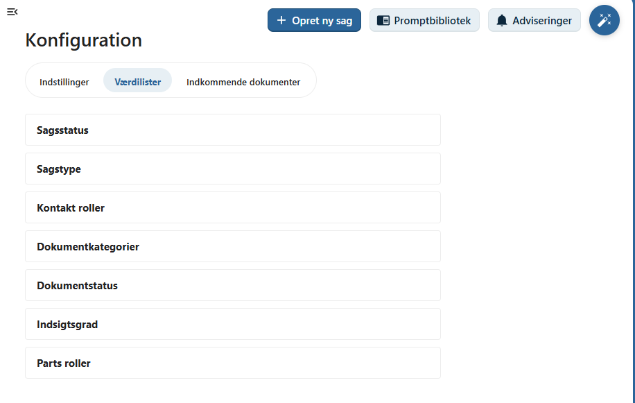

!!! info

    Det anbefales kun at ændre værdilister efter aftale med organisationens systemansvarlige, da ændringer kan påvirke eksisterende arbejdsgange.

---

# Indkommende dokumenter

På fanen **Indkommende dokumenter** konfigureres standardværdierne for den **indbakke-sag**, som anvendes til dokumenter, der ikke automatisk kan placeres på en eksisterende sag.

Følgende standardværdier kan angives:

- Organisation
- Følsomhed
- KLE-nummer
- Handlingsfacet
- Indsigtsgrad

Når et indgående dokument modtages uden en kendt sag, oprettes dokumentet automatisk på indbakke-sagen med disse værdier.

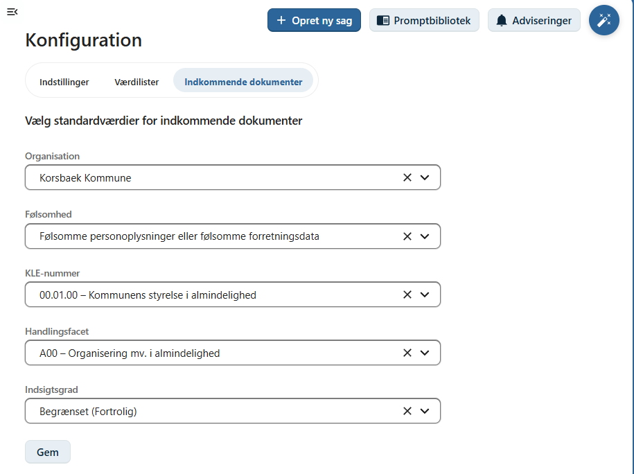

Dette sikrer, at alle modtagne dokumenter registreres ensartet og kan behandles efterfølgende.

---

# Separationsark

På fanen **Separationsark** kan man oprette separationsark, som anvendes ved import af filer. Filer kan importeres fra et fileshare eller en mailboks.

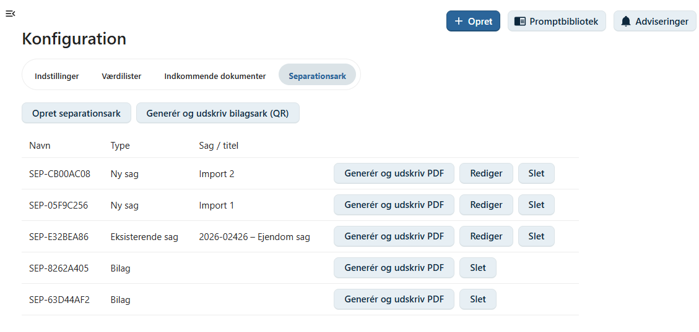

Separationsark kan anvendes ved scanning af dokumenter til en pdf fil for at opdelede den samlede pdf i flere separate filer eller bilag.

Separationsark kan definere en ny sag, en eksisterende sag, en indbakke sag eller et bilag.

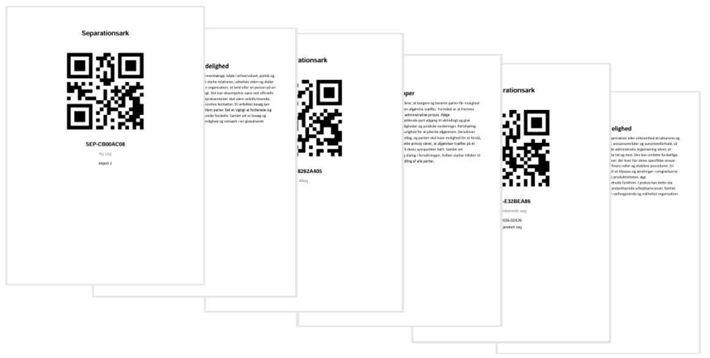

For oprettelse af en sag kan sagens metadata defineres.

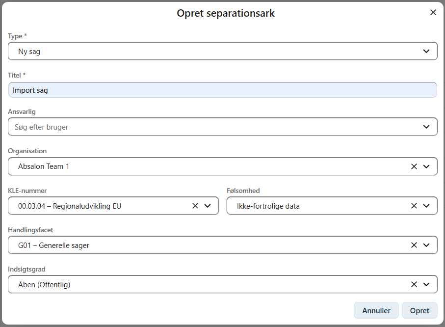

---

# Maskeringsregler

!!! info "Enterprise"
    ## Maskeringstjeneste

    Maskeringstjenesten finder personoplysninger i filer under aktindsigt og laver maskerede PDF-versioner, hvor oplysningerne er fjernet fra filen – ikke blot dækket til. Tjenesten er valgfri og en del af Enterprise-versionen; uden den maskeres filer manuelt ved upload.

    Forbindelsen sættes op under **Nextcloud-indstillinger → Administration → OpenCase → Maskering**:

    | Indstilling | Beskrivelse |
    |---|---|
    | **URL** | Adressen på tjenesten, f.eks. `http://127.0.0.1:8080`. Tom = funktionen er slået fra. |
    | **API-nøgle** | Den delte nøgle, der også er sat som `REDACTION_API_KEY` i tjenesten. |

    Klik **Test forbindelse** for at kontrollere, at tjenesten kan nås, og at nøglen passer.

    Tjenesten kører som en Docker-container ved siden af Nextcloud. Den følger med Enterprise-installationspakken – se `redaction-service/README.md` i pakken for opsætning.

    !!! note

        Tjenesten kører typisk på samme server eller på et internt netværk. OpenCase tillader derfor kald til lokale adresser for netop denne tjeneste.

    ---
    ## Maskeringsregler

    Under fanen **Maskeringsregler** bestemmes, hvad **Foreslå maskering** finder i filer under aktindsigt. Fra start findes fire regler: CPR-nr., E-mail, Kontonr. og Telefon.

    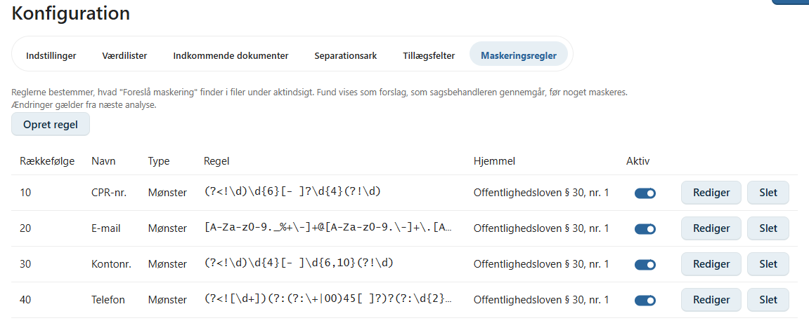

    Hver regel har:

    | Felt | Beskrivelse |
    |---|---|
    | **Navn** | Vises som type ud for hvert fund. |
    | **Type** | **Ordliste** – ord og udtryk, ét pr. linje, der findes som hele ord uanset store og små bogstaver. **Mønster** – et regulært udtryk (Python-syntaks). |
    | **Ekstra kontrol** | Kun for mønstre: *CPR* kræver, at de første 6 cifre er en gyldig dato. *Spring datoer over* ignorerer 8 cifre i træk, der ligner en dato. |
    | **Hjemmel** | Valgfri, f.eks. *Offentlighedsloven § 30, nr. 1*. Vises ud for hvert fund. |
    | **Rækkefølge** | Reglerne køres i stigende rækkefølge. Tekst, som en tidligere regel har fundet, findes ikke igen af en senere regel. |
    | **Aktiv** | Inaktive regler bruges ikke. |

    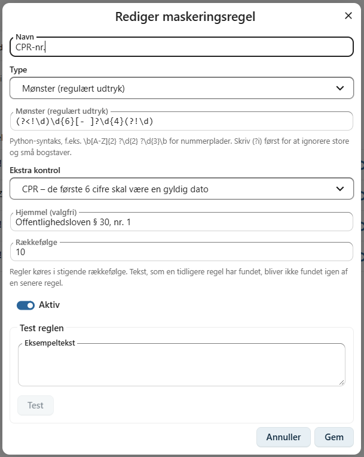

    Brug **Test reglen** i dialogen til at prøve en regel på en eksempeltekst, før den gemmes. Et ugyldigt mønster kan ikke gemmes.

    Eksempler:  

    - **Nummerplader** (mønster): `\b[A-Z]{2} ?\d{2} ?\d{3}\b`
    - **IBAN** (mønster): `\bDK\d{2} ?(?:\d{4} ?){3}\d{2}\b`
    - **Følsomme ord** (ordliste): `misbrug`, `anbringelse`, `diagnose`

    Ændringer gælder fra næste analyse. Sagsbehandleren gennemgår altid fundene, før noget maskeres.

---

# SAPA

!!! info "Enterprise"
    OpenCase kan overføre sager til KOMBITs **Sags- og Dokumentindeks** (SAPA), så de kan ses i andre systemer, der anvender indekset. Integrationen er en del af Enterprise-versionen.

    Når en sag overføres, sendes:

    - sagens stamdata – titel, sagsnummer, resumé, status, følsomhed, KLE-nummer og handlingsfacet
    - ejer, ansvarlig organisation og ansvarlig sagsbehandler
    - sagens parter (borgere og virksomheder)
    - sagens dokumenter, som knyttes til sagen
    - sagens journalnotater

    ## Forudsætninger

    Forbindelsen sættes op under **Nextcloud-indstillinger → Administration → OpenCase → Serviceplatformen → Sag- og dokumentindeks**:

    | Indstilling | Beskrivelse |
    |---|---|
    | **Entity id for sag- og dokumentindeks** | Standard: `http://entityid.kombit.dk/service/sdi/sagdokumentindeks/6` |
    | **Endpoint for sag- og dokumentindeks** | Adressen på tjenesten. Standard er KOMBITs eksterne testmiljø. |
    | **Kommunenummer** | Kommunens nummer, f.eks. `101`. |
    | **Kommune navn** | Kommunens navn, som det skal vises i indekset. |
    | **Kommune CVR nummer** | Kommunens CVR-nummer (8 cifre). |
    | **IT system UUID** | UUID for OpenCase som IT-system i Fælleskommunalt Administrationsmodul. **Skal udfyldes.** |
    | **IT system navn** | Navnet på IT-systemet, f.eks. `OpenCase`. **Skal udfyldes.** |

    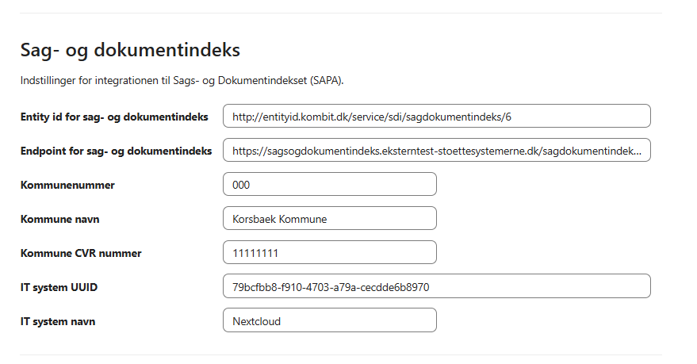

    Derudover skal:

    - organisationens FK Organisation-certifikat være installeret, og der skal være givet adgang til Sags- og Dokumentindekset i Fælleskommunalt Administrationsmodul
    - alle brugere, der opretter eller ændrer sager, findes i FK Organisation, så de har en UUID i OpenCase. Overførslen fejler for sager, hvor sidst ændrede bruger eller ansvarlig sagsbehandler ikke har en UUID

    ## Regler for overførsel

    Under fanen **SAPA** bestemmes, hvilke sager der overføres. En sag overføres, hvis den matcher **mindst én aktiv regel**. Findes der ingen aktive regler, overføres ingen sager.

    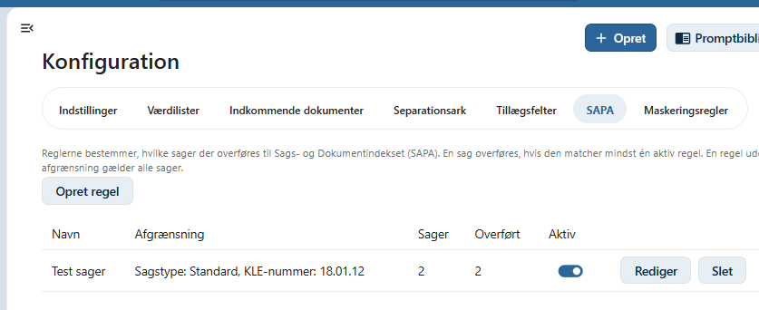

    Oversigten viser for hver regel:

    | Kolonne | Beskrivelse |
    |---|---|
    | **Navn** | Reglens navn. |
    | **Afgrænsning** | Hvilke sager reglen gælder for. *Alle sager*, hvis reglen ikke er afgrænset. |
    | **Sager** | Antal sager, der matcher reglen. |
    | **Overført** | Hvor mange af disse sager der er overført til SAPA – også hvis de er overført via en anden regel. |
    | **Aktiv** | Inaktive regler bruges ikke. |

    Antallene hentes, efter oversigten er vist, og kan tage et øjeblik på store installationer. Indbakkesager og slettede sager tælles ikke med og overføres aldrig.

    ### Opret eller rediger en regel

    Klik **Opret regel** eller **Rediger** ud for en eksisterende regel.

    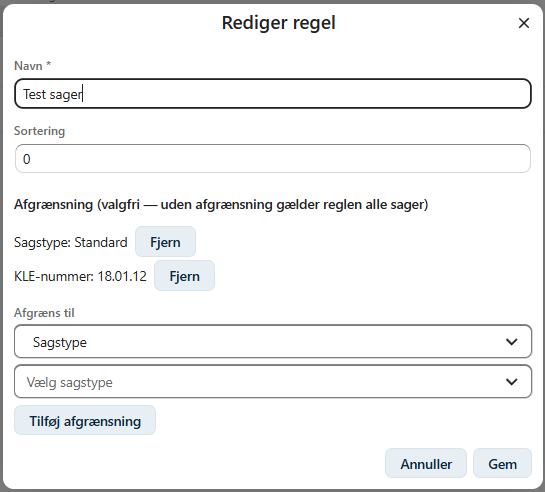

    | Felt | Beskrivelse |
    |---|---|
    | **Navn** | Et beskrivende navn, f.eks. *Børne- og familiesager*. |
    | **Sortering** | Reglerne behandles i stigende rækkefølge. Sager fra regler med lav sortering overføres først. |
    | **Afgrænsning** | Valgfri. Uden afgrænsning gælder reglen alle sager. |

    En regel kan afgrænses til:

    | Afgrænsning | Beskrivelse |
    |---|---|
    | **Sagstype** | F.eks. *Borgersag*. |
    | **Organisation** | En organisation gælder også for alle dens underliggende enheder. |
    | **KLE-nummer** | Et bestemt KLE-nummer, f.eks. `27.69.00`, eller en hel gruppe, f.eks. `27.%` eller `27.69.%`. |

    Tilføjes flere afgrænsninger af **samme** slags, skal sagen matche én af dem. Tilføjes afgrænsninger af **forskellig** slags, skal sagen matche dem alle.

    Eksempel: En regel med *Sagstype: Borgersag*, *KLE-nummer: 27.%* og *KLE-nummer: 28.%* gælder borgersager inden for KLE-gruppe 27 eller 28.

    ## Sådan overføres sagerne

    Overførslen sker automatisk i baggrunden hvert 5. minut:

    1. Sager, der matcher en aktiv regel, og som ikke er overført, oprettes i SAPA.
    2. Sager, der er ændret, siden de blev overført, slettes i SAPA og oprettes igen med de nye oplysninger. En sag regnes for ændret, når dens metadata ændres, og når der tilføjes, ændres eller slettes dokumenter, journalnotater eller parter.

    Der overføres højst 50 sager pr. kørsel. Antallet kan ændres med `occ opencase:config:set sagdokumentindeks_batch_size <antal>`.

    Når en sag eller et dokument er overført, vises feltet **Overført til SAPA** med tidspunktet på sagens og dokumentets informationsside.

    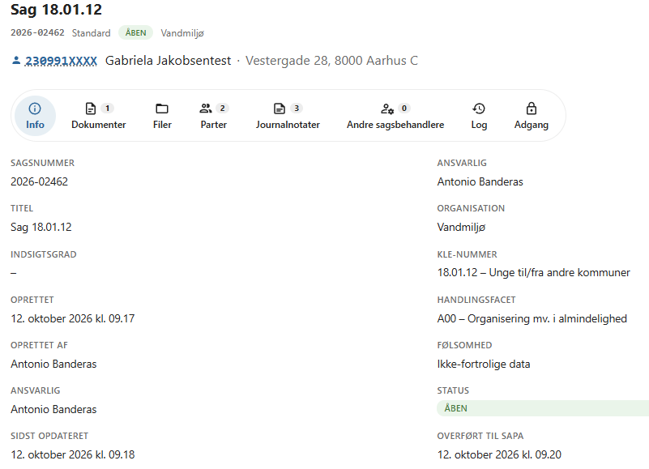

    Fejler overførslen af en sag, forsøges den ikke igen, før sagen ændres. Alle overførsler og fejl logges i databasetabellen `oc_opencase_casedocindex_log`.

    !!! warning

        Når den første regel oprettes, begynder OpenCase at overføre alle sager, der matcher den. En regel uden afgrænsning omfatter alle sager. Start derfor med en snæver regel – f.eks. én sagstype eller én KLE-gruppe – og kontrollér resultatet i SAPA, før reglen udvides.

    ## Manuel overførsel

    Sager og dokumenter kan også overføres manuelt med occ-kommandoer, f.eks. ved fejlsøgning:

    | Kommando | Beskrivelse |
    |---|---|
    | `occ opencase:create-case-document-index <sags-id>` | Overfør en sag med dokumenter og journalnotater. |
    | `occ opencase:get-case-document-index <sags-uuid>` | Hent en sag fra SAPA. |
    | `occ opencase:remove-case-document-index <sags-uuid>` | Slet en sag i SAPA. |
    | `occ opencase:create-document-document-index <dokument-id>` | Overfør et dokument og knyt det til sagen. |
    | `occ opencase:get-document-document-index <dokument-uuid>` | Hent et dokument fra SAPA. |
    | `occ opencase:remove-document-document-index <dokument-uuid>` | Slet et dokument i SAPA. |
    | `occ opencase:add-journalnote-to-case-document-index <journalnotat-id>` | Tilføj et journalnotat til sagen i SAPA. |

---

# God praksis

Det anbefales at:

- fastlægge organisationens sagsnummermaske inden systemet tages i brug
- begrænse antallet af værdier i værdilisterne til det nødvendige
- anvende ensartede navne på statusser og roller
- gennemgå standardværdierne for indkommende dokumenter, så de passer til organisationens arbejdsgange

!!! tip

    Undgå at ændre eller slette værdier, som allerede anvendes på eksisterende sager og dokumenter. Opret i stedet nye værdier og udfas de gamle over tid.

---

## Se også

- [Administrer skabeloner](./administrer-skabeloner.md)
- [Installation – Basic-version](./installation-basic-version.md)
- [Indkommende dokumenter](../dokumenter/indkommende-dokumenter.md)