# Euro-Office

OpenCase-pluginet til **Euro-Office** giver adgang til OpenCase direkte fra tekstbehandling, regneark, præsentationer og PDF i Euro-Office. Det virker både i Euro-Office-programmet på computeren og når dokumenter fra OpenCase redigeres i browseren.

Pluginet tilføjer fanen **OpenCase** i båndet. Herfra kan du blandt andet:

- åbne dine seneste dokumenter, favoritter og egne dokumenter
- søge efter dokumenter
- gemme en lokal fil som et dokument på en sag
- oprette nye filer ud fra skabeloner
- se og ændre dokumentets oplysninger, kontakter og noter
- sende dokumentet med Digital Post eller e-mail
- oprette og redigere skabeloner og fraser

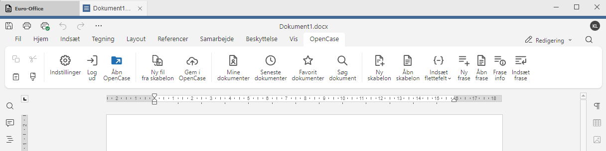

---

## Fanen OpenCase

Knapperne på fanen er delt i grupper:

| Gruppe | Knapper |
|---|---|
| OpenCase | **Indstillinger**, **Log ind** / **Log ud**, **Åbn OpenCase** |
| Dokumentet | **Ny fil fra skabelon**, **Gem i OpenCase** eller **Dokument info** |
| Dokumentlister | **Mine dokumenter**, **Seneste dokumenter**, **Favorit dokumenter**, **Søg dokument** |
| Send | **Send Digital post**, **Send link med email**, **Send PDF med email** |
| Skabelon | **Ny skabelon**, **Åbn skabelon**, **Indsæt flettefelt**, **Ny frase**, **Åbn frase**, **Frase info**, **Indsæt frase** |

Hvilke knapper du ser, afhænger af dokumentet og af dine rettigheder:

- Før du er logget ind, vises kun **Indstillinger**, **Log ind** og **Åbn OpenCase**.
- **Gem i OpenCase** vises for filer, der ligger på din computer. **Dokument info** og knapperne under **Send** vises for dokumenter, der er åbnet fra OpenCase.
- **Send Digital post** vises kun, når Digital Post er sat op i OpenCase.
- Gruppen **Skabelon** vises kun for brugere, der må administrere skabeloner.

---

## Kom i gang

### Indstil adressen på OpenCase

Første gang skal pluginet vide, hvilken OpenCase-server det skal bruge. Klik på **Indstillinger**, og skriv adressen på OpenCase, fx `https://opencase.kommune.dk/`. Klik på **Save**.

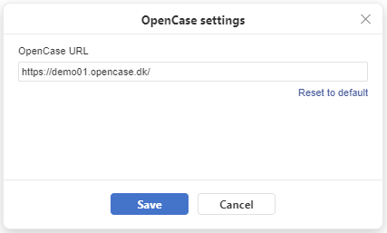

Ofte har administratoren allerede sat adressen, når pluginet blev installeret.

### Log ind

Klik på **Log ind**. Din browser åbner OpenCase's login-side, hvor du logger ind, som du plejer, og klikker på **Giv adgang**.

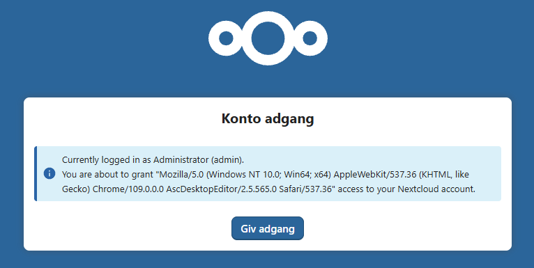

Når du har givet adgang, er du logget ind i Euro-Office, og resten af knapperne vises på fanen. Du forbliver logget ind, til du klikker på **Log ud**, eller til dit login udløber. Som standard skal du logge ind igen efter 30 dage.

!!! info "Ingen adgang"

    Hvis du er logget ind, men ikke har adgang til OpenCase, vises meddelelsen **Du har ikke adgang til OpenCase**, og fanen viser knappen **Ingen adgang**. En administrator skal give dig adgang. Klik derefter på **Ingen adgang** for at tjekke igen. Du behøver ikke logge ind igen.

    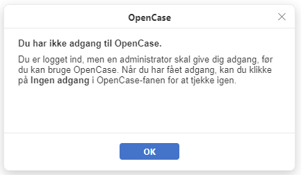

### Åbn OpenCase

**Åbn OpenCase** åbner OpenCase i din browser.

---

## Find og åbn dokumenter

### Mine dokumenter, Seneste dokumenter og Favorit dokumenter

De tre knapper åbner en liste med henholdsvis dine egne dokumenter, de dokumenter du senest har arbejdet med, og dine [favoritter](../favoritter.md).

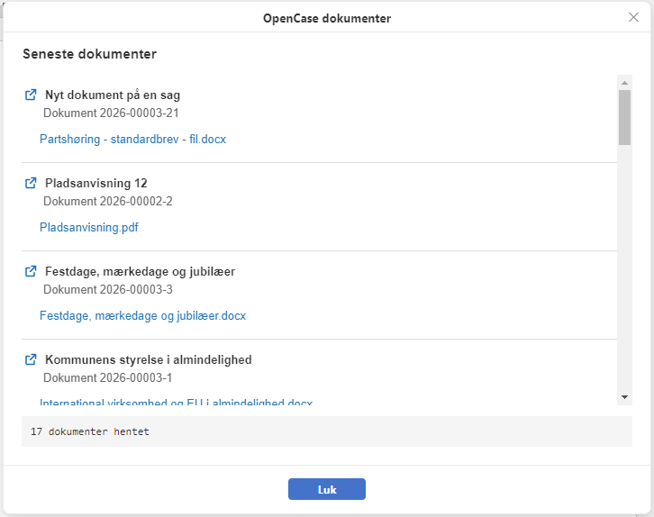

Klik på en fil for at åbne den i Euro-Office. Dokumenter, du åbner eller opretter i Euro-Office, kommer øverst på listen over seneste dokumenter, ligesom når du åbner dem i OpenCase.

### Søg dokument

**Søg dokument** søger i både filernes indhold og dokumenternes oplysninger, fx titel og dokumentnummer. Åbn en fil fra søgeresultatet med et klik.

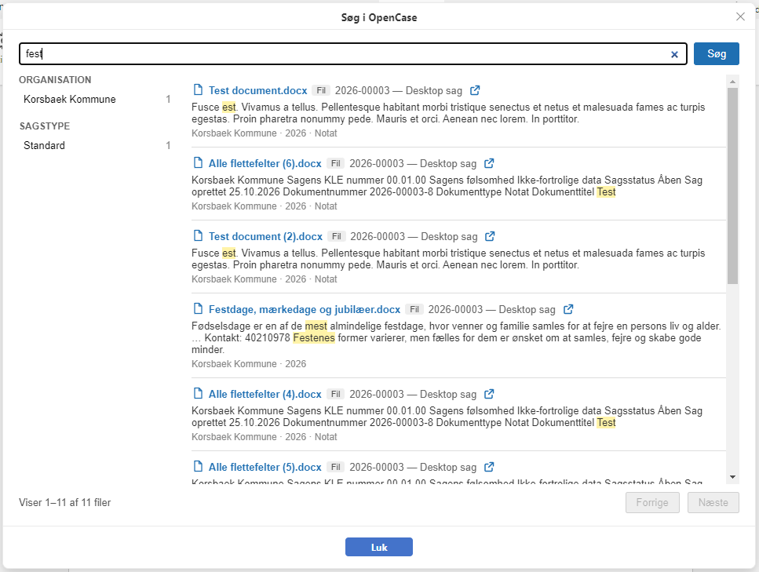

---

## Gem i OpenCase

En fil, der ligger på din computer, kan gemmes som et nyt dokument på en sag. Klik på **Gem i OpenCase**.

Dialogen har to faner:

- **Info**: vælg sagen (søg på sagsnummer eller titel), og udfyld titel, dokumentkategori, dokumenttype, indsigtsgrad, datoer og resumé.
- **Afsendere/modtagere**: tilføj borgere, virksomheder eller andre kontakter til dokumentet, se [Kontakter](../dokumenter/kontakter.md).

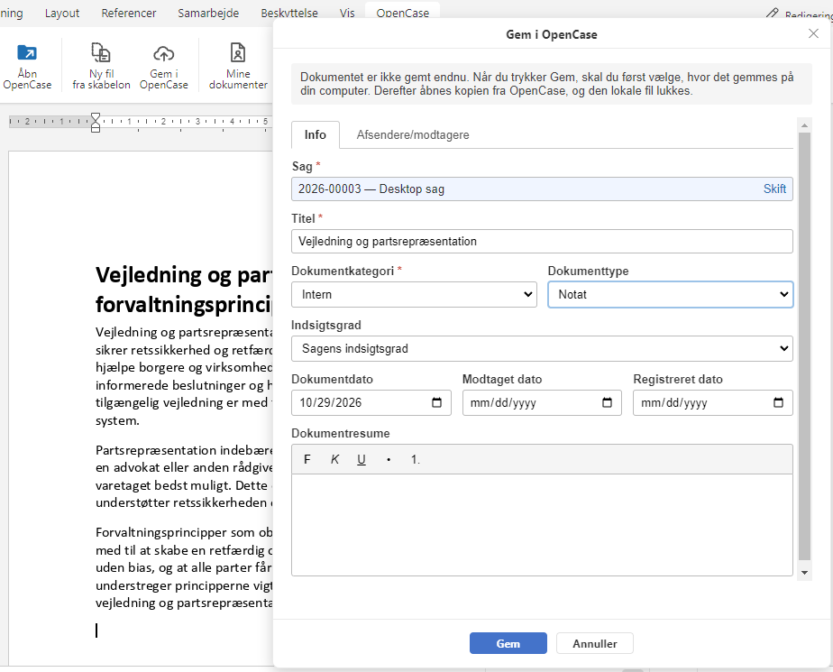

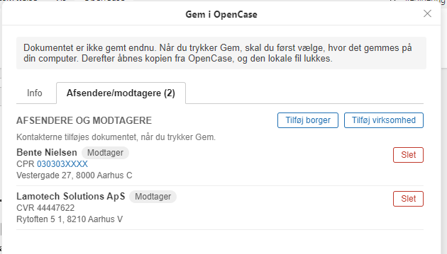

Klik på **Gem**. Dokumentet oprettes på sagen, og filen åbnes fra OpenCase, så du fortsætter i den gemte fil. Den lokale fil lukkes, så du ikke kommer til at arbejde videre i den forkerte kopi.

---

## Ny fil fra skabelon

**Ny fil fra skabelon** opretter en ny fil ud fra en af OpenCase's skabeloner. Felterne i skabelonen bliver udfyldt med oplysninger fra sagen og dokumentet. Se også [Ny fil fra skabelon](../dokumenter/ny-fil-fra-skabelon.md).

Vælg først, hvilket dokument filen skal oprettes på:

- **Det åbne dokument**, når dokumentet er åbnet fra OpenCase
- **Et eksisterende dokument**, som du finder blandt seneste dokumenter og favoritter eller ved at søge
- **Nyt dokument på en sag**, hvor du udfylder de samme faner **Info** og **Afsendere/modtagere** som i **Gem i OpenCase**

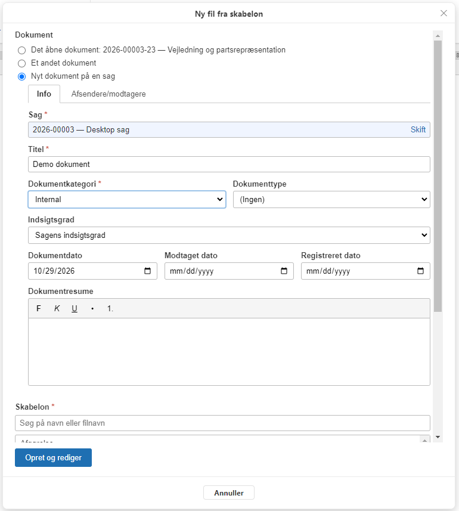

Vælg derefter skabelonen. Filnavnet foreslås ud fra skabelonens navn. Har skabelonen fraser, kan du vælge, hvilke der skal med. Obligatoriske fraser kan ikke fravælges.

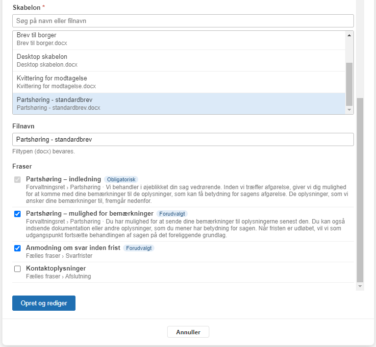

Klik på **Opret og rediger**. Filen oprettes i OpenCase og åbnes i Euro-Office.

---

## Dokument info

For et dokument, der er åbnet fra OpenCase, viser **Dokument info** dokumentets oplysninger i OpenCase.

Øverst ses dokumentnummer og titel, en **favoritstjerne** og dokumentets **status**.

- Klik på stjernen for at tilføje dokumentet til eller fjerne det fra dine favoritter.
- Vælg en ny status i listen. Gøres dokumentet endeligt, bliver du bedt om at bekræfte, fordi et endeligt dokument ikke kan ændres bagefter. Den åbne fil gemmes, før status skiftes, så dine sidste ændringer kommer med.

Resten af oplysningerne er fordelt på fire faner:

| Fane | Indhold |
|---|---|
| **Info** | Sag, titel, kategori, type, indsigtsgrad, datoer, resumé, og hvem der har oprettet og ændret dokumentet |
| **Filer** | Dokumentets filer. Klik på en fil for at åbne den |
| **Afsendere/modtagere** | Dokumentets kontakter. Tilføj borgere og virksomheder ved at søge eller oprette dem manuelt, og slet kontakter. Kræver skriveadgang til dokumentet |
| **Noter** | Dokumentets [noter](../dokumenter/noter.md). Opret, ret og slet noter |

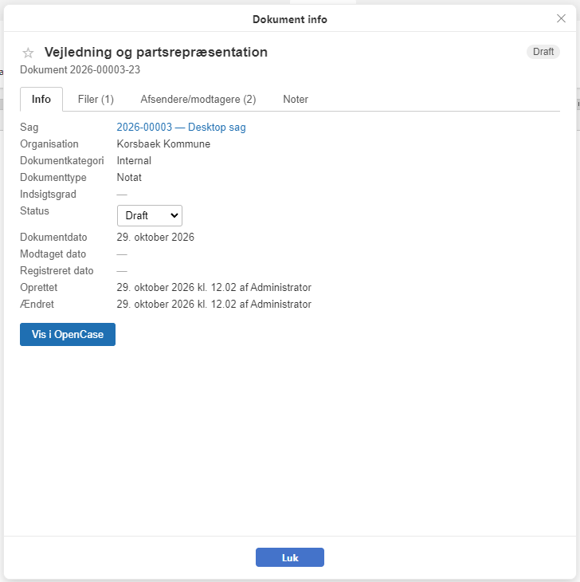

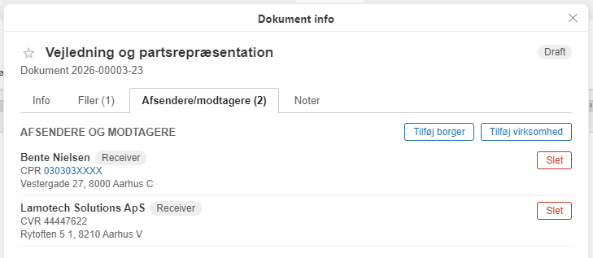

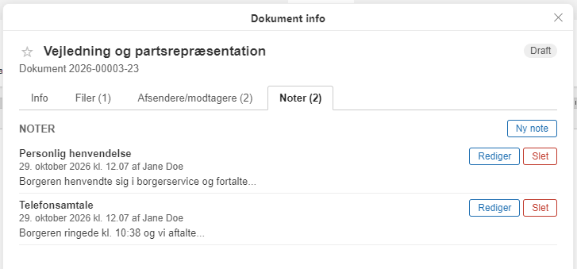

!!! info "Personnumre og beskyttede adresser"

    CPR-numre vises delvist skjult. Klik på nummeret for at se det hele. En beskyttet adresse vises kun, når du klikker på **Beskyttet adresse**, og opslaget bliver logget.

---

## Send dokumentet

Et dokument, der er åbnet fra OpenCase, kan sendes direkte fra Euro-Office.

### Send Digital post

**Send Digital post** sender dokumentet til dokumentets modtagere med Digital Post. Se også [Send Digital post](../dokumenter/digital-post.md).

I dialogen vælger du:

- om modtageren må svare (**Kan besvares**)
- hvilken fil der er **hoveddokument**, og hvilke filer der skal med som **bilag**

For hver modtager vises, om forsendelsen leveres digitalt eller som fysisk brev. Mangler dokumentet modtagere, kan de tilføjes under **Dokument info** → **Afsendere/modtagere**.

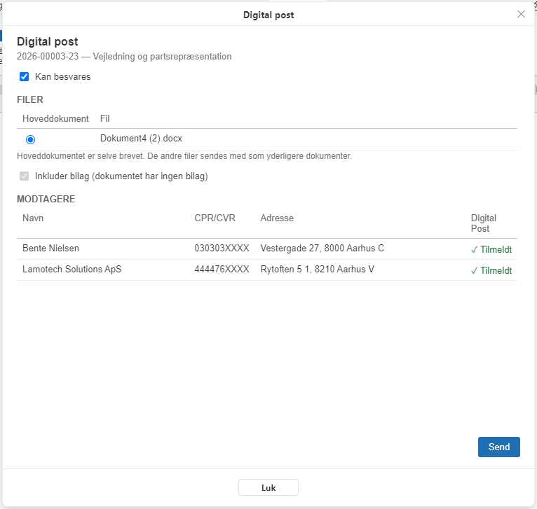

Når dokumentet er sendt, viser knappen i stedet forsendelsens status, som opdateres løbende. Herfra kan den sendte forsendelse også hentes.

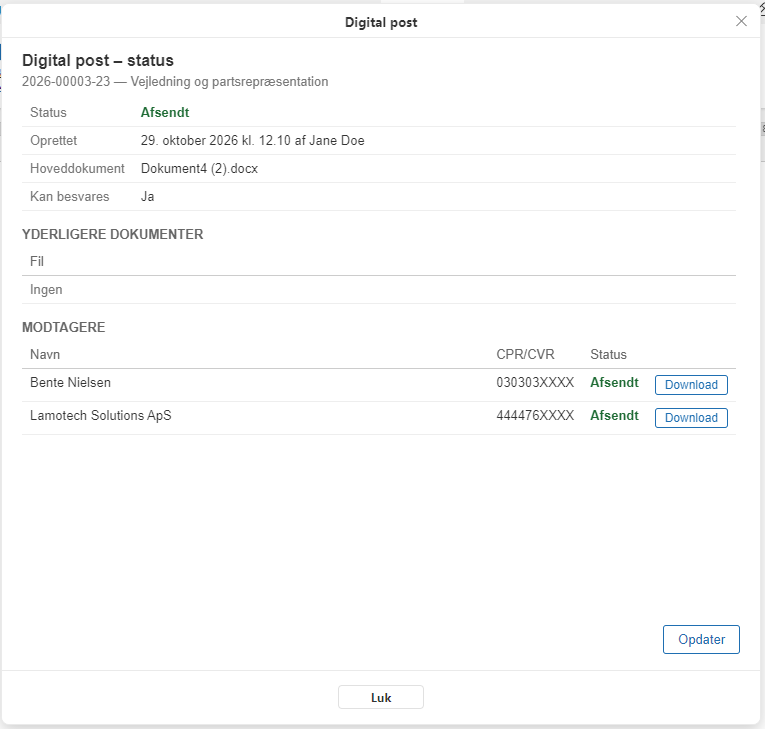

### Send link med email

**Send link med email** sender en e-mail med et link til dokumentet i OpenCase. Se også [Send med email](../dokumenter/send-med-email.md).

Skriv modtagere i **Til**, **Cc** og **Bcc**. Du kan søge blandt brugere, sagsparter og dokumentets kontakter eller skrive en e-mailadresse. Skriv emne og tekst, og klik på **Send**.

Inden e-mailen sendes, kontrolleres det, om modtagerne kan åbne linket. Hvis nogen ikke kan, får du besked og kan vælge at sende alligevel.

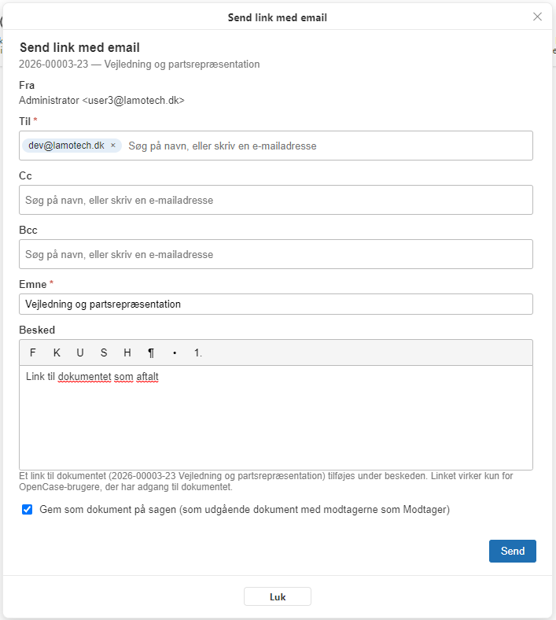

### Send PDF med email

**Send PDF med email** fungerer på samme måde, men sender dokumentets filer som PDF-vedhæftninger. Vælg, hvilke filer der skal med.

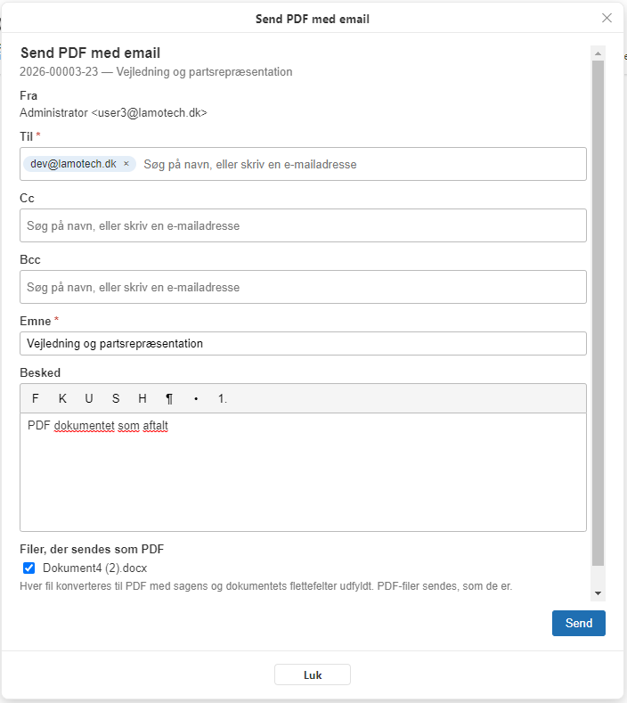

---

## Skabeloner

Gruppen **Skabelon** er kun synlig for brugere, der må administrere skabeloner. Se også [Administrer skabeloner](../administrator/administrer-skabeloner.md).

### Ny skabelon

**Ny skabelon** opretter en ny dokumentskabelon i OpenCase. Dialogen har to faner:

- **Generelt**: navn, de organisationer skabelonen gælder for, og om skabelonen skal være en ny tom fil (**Ny fil**) eller en fil, du uploader (**Upload fil**)
- **Fraser**: de fraser, der kan indsættes, når der oprettes en fil fra skabelonen. Fraserne kan sorteres, gøres obligatoriske eller forudvælges

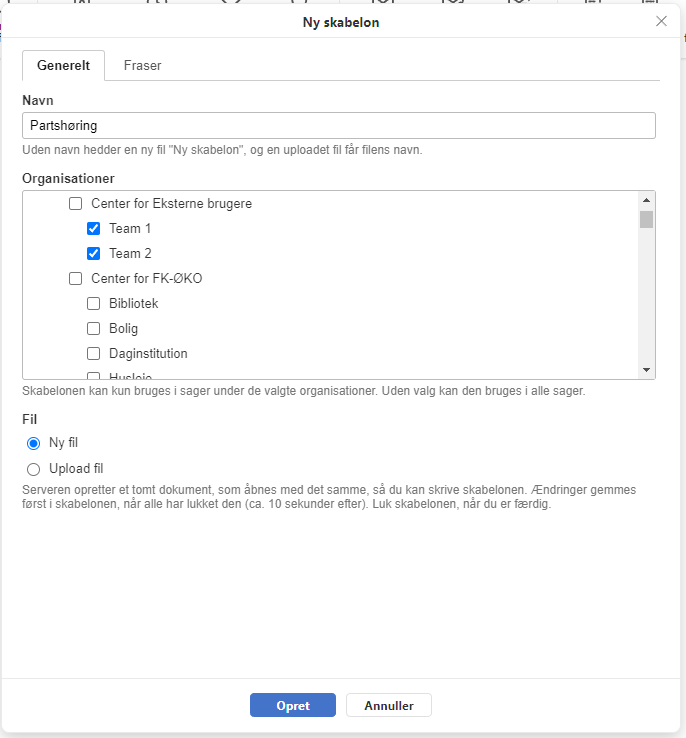

Vælger du en ny tom fil, åbnes den i Euro-Office, så du kan skrive skabelonen med det samme.

### Åbn skabelon

**Åbn skabelon** viser OpenCase's skabeloner. Klik på **Rediger** for at åbne en skabelon i Euro-Office.

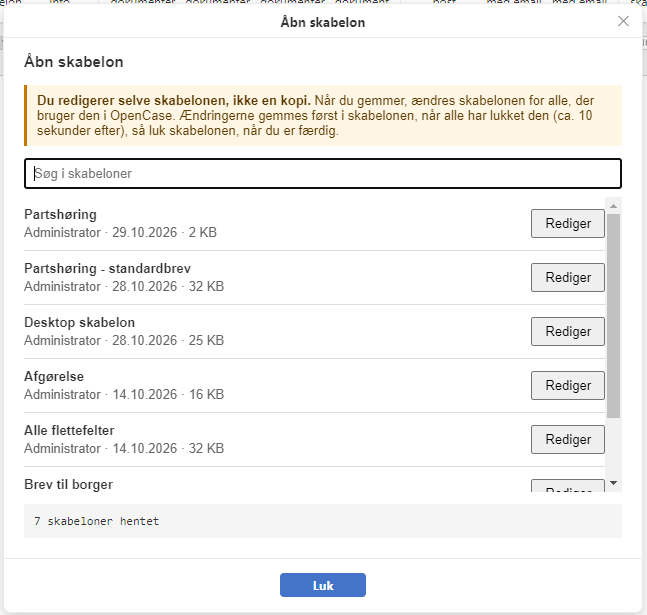

!!! warning

    Ændrer du en skabelon, ændres den for alle brugere.

### Indsæt flettefelt

**Indsæt flettefelt** er en menu med de flettefelter, som kan bruges i skabeloner, ordnet i grupper som sag, dokument og organisation. Vælg et felt for at indsætte det ved markøren, fx `{{organisation.logo}}`. Felterne udfyldes, når der oprettes en fil fra skabelonen.

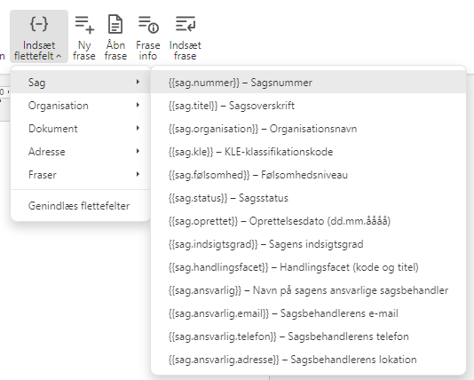

Feltet for organisationens logo indsættes som et eksempelbillede. Det erstattes af organisationens rigtige logo, når skabelonen flettes. Billedet kan flyttes og skaleres som andre billeder.

---

## Fraser

Fraser er tekststykker, som kan genbruges i skabeloner og breve. En frase kan være ren tekst eller have sin egen fil med formatering. Knapperne til fraser ligger i gruppen **Skabelon**.

### Ny frase

**Ny frase** opretter en frase. Udfyld titel, beskrivelse, kategori og status (**Kladde**, **Aktiv** eller **Arkiveret**). Kun aktive fraser kommer med i breve.

Under **Afgrænsning** kan du begrænse, hvor frasen kan bruges, fx til bestemte organisationer eller KLE-numre. Uden afgrænsning kan frasen bruges i alle sager.

Frasens indhold kan være:

- tekst, som skrives direkte i dialogen
- en ny tom fil, som åbnes i Euro-Office, så du kan skrive og formatere frasen dér
- en fil (.docx eller .odt), som du uploader

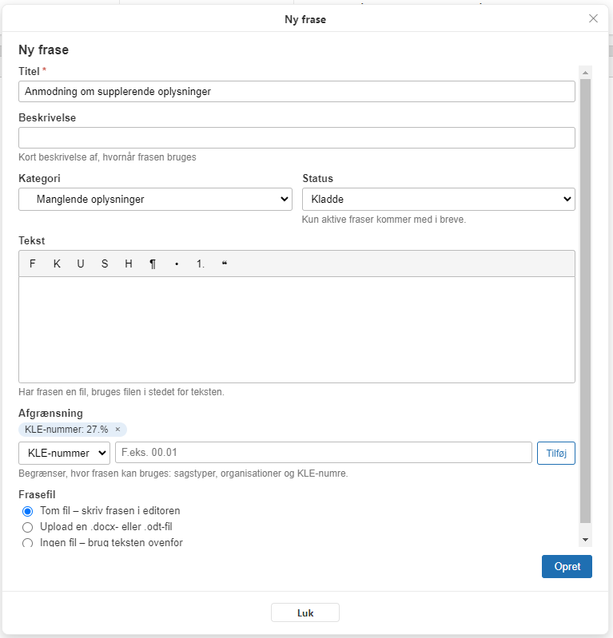

### Åbn frase

**Åbn frase** viser fraserne grupperet efter kategori. Vælg en frase med en fil for at åbne filen i Euro-Office og redigere den.

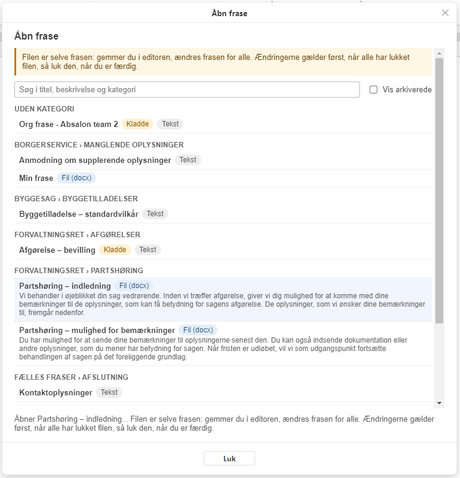

### Frase info

**Frase info** viser og retter en frases oplysninger. Er den åbne fil en frasefil, vises den frase med det samme.

Under **Bruges i skabeloner** ses, hvilke skabeloner frasen indgår i. Passer frasens afgrænsning ikke til en skabelons organisationer, bliver du gjort opmærksom på det.

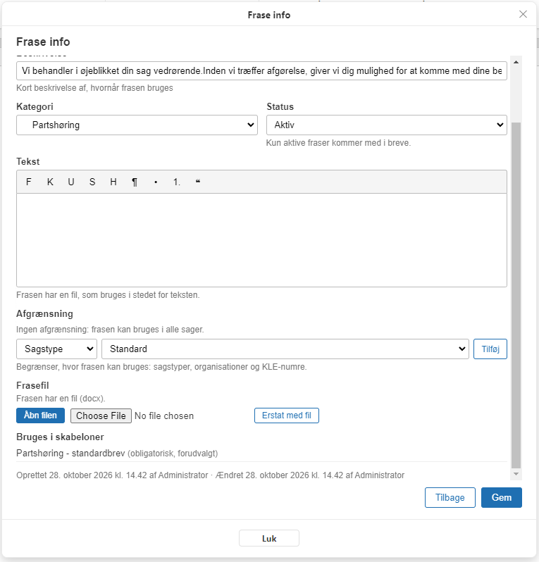

### Indsæt frase

**Indsæt frase** indsætter en frase ved markøren. Vælg frasen, se en forhåndsvisning, og klik på **Indsæt**.

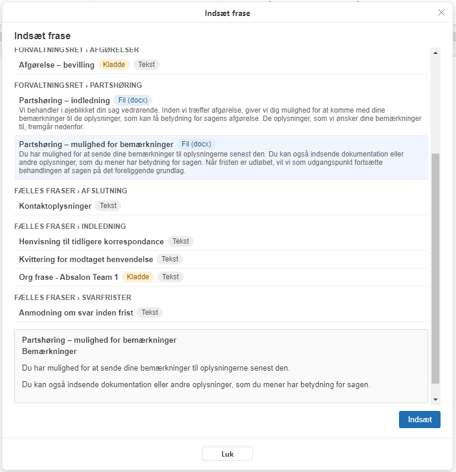

Har frasen en fil, indsættes filens indhold:

- I dokumenter, der er åbnet fra OpenCase, indsættes filen præcis som den er, med skrifttyper, farver, tabeller og billeder.
- I filer, der ligger på din computer, beholdes overskrifter, fed og kursiv, lister og tabeller, men teksten får dokumentets egne skrifttyper og farver.

Forhåndsvisningen viser kun teksten. Teksten under forhåndsvisningen fortæller, hvordan frasen bliver indsat.

---

## Se også

- [Microsoft Office](../dokumenter/ms-office.md)
- [Rediger fil](../dokumenter/rediger-fil.md)
- [Ny fil fra skabelon](../dokumenter/ny-fil-fra-skabelon.md)
- [Send Digital post](../dokumenter/digital-post.md)
- [Send med email](../dokumenter/send-med-email.md)
- [Administrer skabeloner](../administrator/administrer-skabeloner.md)
