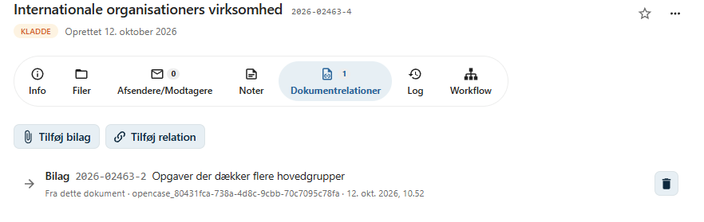
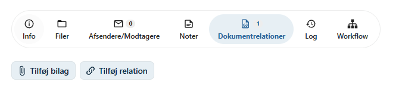
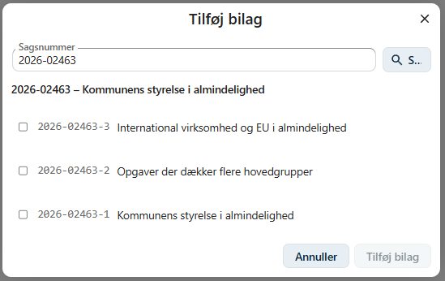
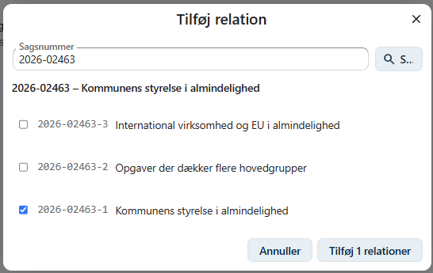
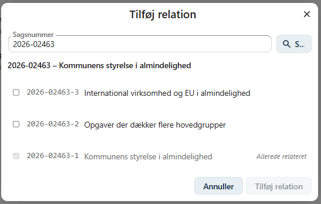
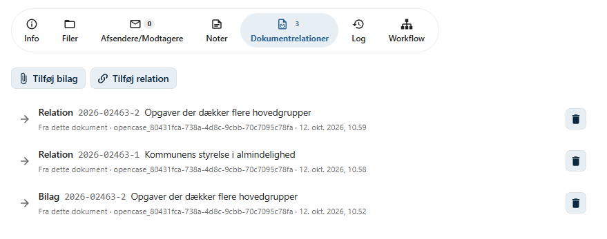
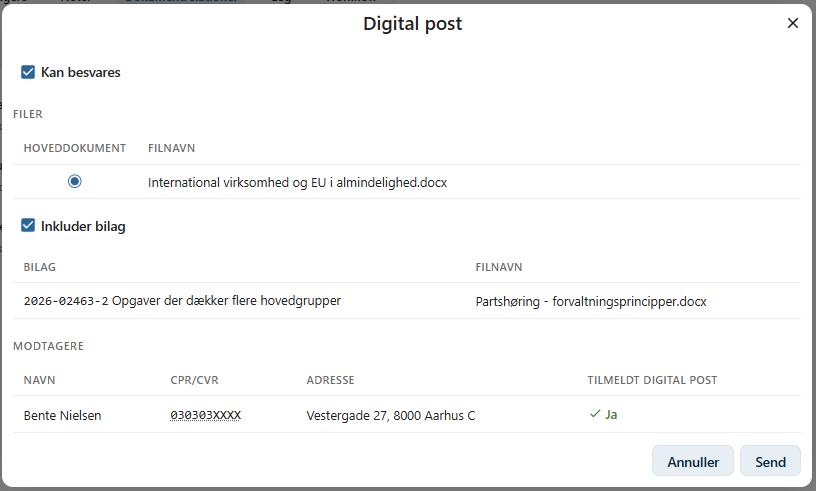
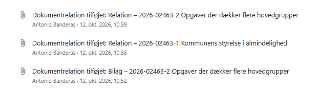

# Dokumentrelationer

På fanen **Dokumentrelationer** kan du knytte et dokument sammen med andre dokumenter.

En dokumentrelation viser, at to dokumenter hører sammen – for eksempel at et dokument er bilag til et andet, eller at et dokument er en besvarelse af en henvendelse.

De relaterede dokumenter kan ligge på samme sag eller på en anden sag.

Eksempler på anvendelse:

- bilag til en afgørelse eller et brev
- et svar på en indgående henvendelse
- et dokument, som en sagsbehandling tager udgangspunkt i
- dokumenter på forskellige sager, der vedrører samme forhold

---

## Relationstyper

Hver relation har en type, der beskriver, hvordan dokumenterne hænger sammen.

| Relationstype | Beskrivelse |
|---------------|-------------|
| **Bilag** | Det relaterede dokument er bilag til dette dokument. |
| **Besvarelse** | Det ene dokument er en besvarelse af det andet. |
| **Udgangspunkt** | Det ene dokument er udgangspunkt for det andet. |
| **Relation** | En generel sammenhæng mellem to dokumenter. |

I brugergrænsefladen kan du oprette relationer af typen **Bilag** og **Relation**. Relationer af de øvrige typer kan oprettes via OpenCase' API.

---

## Retning

En relation går altid **fra** ét dokument **til** et andet. Det dokument, du opretter relationen fra, er altid fra-siden.

Når du for eksempel tilføjer et bilag til et brev, går relationen fra brevet til bilaget.

Relationen vises på begge dokumenter:

- På brevet vises bilaget med en pil mod højre og teksten **Fra dette dokument**.
- På bilaget vises brevet med en pil mod venstre og teksten **Til dette dokument**.

---

## Tilføj bilag

1. Åbn det dokument, som bilagene skal knyttes til.
2. Gå til fanen **Dokumentrelationer**.
3. Klik på **Tilføj bilag**.
4. Angiv sagsnummeret på den sag, hvor bilagene ligger, og klik på **Søg**.
5. Markér de dokumenter, der skal tilføjes som bilag.
6. Klik på **Tilføj** for at oprette relationerne.

Sagsnummeret er på forhånd udfyldt med nummeret på dokumentets egen sag, og sagens dokumenter vises med det samme.

Knappen viser, hvor mange dokumenter der er valgt, for eksempel **Tilføj 3 bilag**.

---

## Tilføj relation

En generel relation tilføjes på samme måde som et bilag.

Klik på **Tilføj relation** i stedet for **Tilføj bilag**, søg sagen frem, markér dokumenterne, og klik på **Tilføj**.

---

## Søg efter dokumenter

I dialogen søger du på **sagsnummer**. Sagsnummeret skal angives præcist, for eksempel `2026-00004`.

Når sagen er fundet, vises sagens nummer og titel samt en liste over sagens dokumenter med dokumentnummer og titel.

- Listen viser kun dokumenter, du har adgang til at se.
- Det dokument, du står på, vises ikke i listen.
- Dokumenter, der allerede har en relation af samme type, er markeret og kan ikke vælges igen. De vises med teksten **Allerede bilag** eller **Allerede relateret**.
- Hvis sagen har mange dokumenter, vises de 10 ad gangen. Brug **Forrige** og **Næste** til at bladre.

Hvis sagen ikke findes, eller du ikke har adgang til den, vises meddelelsen *Sagen blev ikke fundet eller du har ikke adgang.*

!!! tip "Dokumenter fra flere sager"

    Dine valg huskes, når du bladrer eller søger en ny sag frem. Du kan derfor vælge dokumenter fra flere sager og tilføje dem alle på én gang.

---

## Oversigt over relationer

Alle dokumentets relationer vises på fanen **Dokumentrelationer**. Antallet af relationer vises ved fanens navn.

For hver relation vises:

- **Relationstype** – for eksempel Bilag eller Relation.
- **Dokumentnummer** på det relaterede dokument.
- **Titel** på det relaterede dokument. Klik på titlen for at åbne dokumentet.
- **Retning** – *Fra dette dokument* eller *Til dette dokument*.
- Hvem der har oprettet relationen, og hvornår.

Relationer vises fra begge dokumenters side. En relation, der er oprettet på et andet dokument, vises derfor også her.

---

## Fjern en relation

Klik på skraldespandsikonet ud for relationen, og bekræft, at relationen skal fjernes.

Når en relation fjernes, slettes kun sammenhængen mellem dokumenterne. Selve dokumenterne og deres filer bevares.

En relation kan fjernes fra begge de relaterede dokumenter, uanset hvilket dokument den blev oprettet fra.

---

## Rettigheder

| Handling | Krav |
|----------|------|
| Se relationer | Læseadgang til dokumentet |
| Tilføje relationer | Skriveadgang til dokumentet og læseadgang til de dokumenter, der relateres til |
| Fjerne relationer | Skriveadgang til dokumentet |

Knapperne **Tilføj bilag**, **Tilføj relation** og **Fjern relation** vises kun, hvis du har skriveadgang til dokumentet, og dokumentet ikke har en afsluttende status.

---

## Bilag ved Digital Post

Når du sender et dokument med [Digital Post](digital-post.md), kan dokumentets bilag sendes med.

Indstillingen **Inkluder bilag** er slået til som standard. Dialogen viser en liste over bilagenes filer, og filerne vedlægges forsendelsen sammen med dokumentets egne filer.

Kun relationer af typen **Bilag**, som går fra det dokument, der sendes, medtages. Bilag, du ikke har adgang til at se, medtages ikke.

---

## Dokumentlog

Oprettelse og fjernelse af relationer registreres i [dokumentloggen](dokumentlog.md) med relationstype samt nummer og titel på det relaterede dokument.

---

## Eksport og API

Dokumentrelationer indgår i [eksport af sager](../administrator/eksport-af-sager.md) og kan læses, oprettes og fjernes via OpenCase' [API](../api.md).

---

## Hvornår skal jeg bruge dokumentrelationer?

Brug dokumentrelationer, når det er vigtigt at kunne se, at dokumenter hører sammen – også på tværs af sager.

!!! tip "God praksis"

    Brug **Bilag**, når et dokument skal sendes eller læses sammen med et andet dokument. Brug **Relation**, når der blot er en sammenhæng mellem dokumenterne, som er relevant for sagsbehandlingen.
