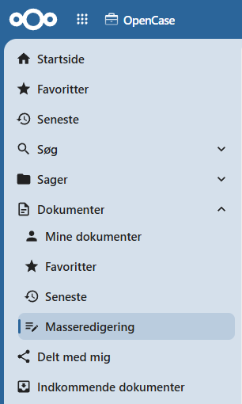
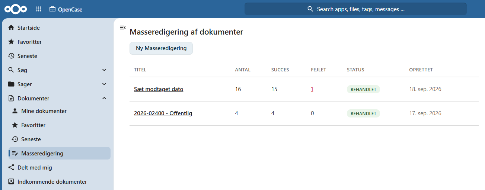
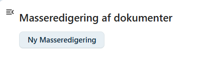
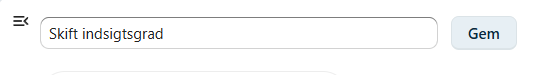
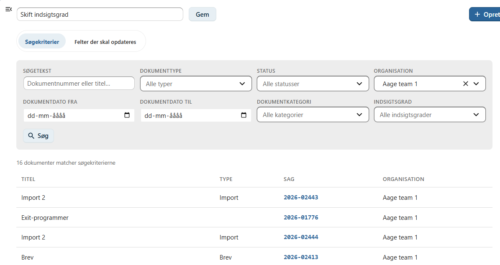
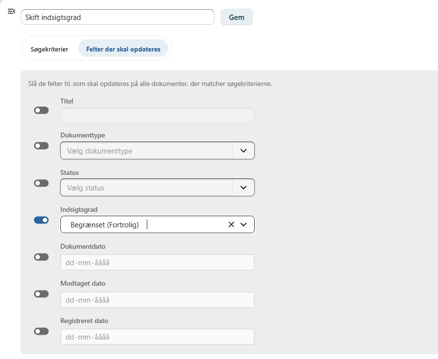
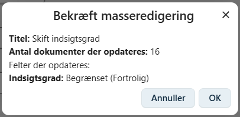
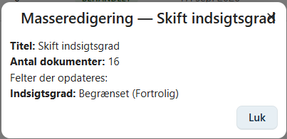
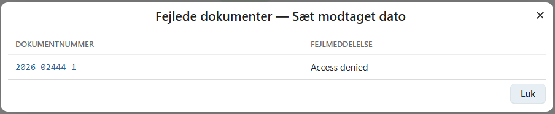
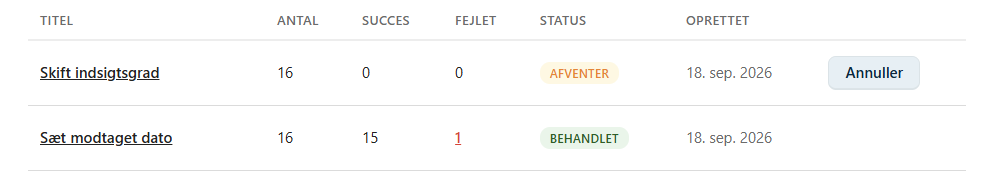

# Masseredigering

Masseredigering gør det muligt at opdatere et bestemt felt på **mange dokumenter samtidig**, i stedet for at åbne og rette hvert dokument enkeltvis. Du angiver et sæt søgekriterier, som udpeger de dokumenter, der skal opdateres, og de felter og værdier, der skal sættes på dem.

Masseredigeringer behandles i baggrunden og gennemføres typisk inden for en time efter, de er gemt.

---

## Hvor finder du masseredigering

Under menupunktet **Dokumenter** i venstre navigation findes underpunktet **Masseredigering**.

Siden viser en liste over alle masseredigeringer, du selv har oprettet, nyeste øverst.

For hver masseredigering vises:

| Kolonne | Beskrivelse |
|---------|-------------|
| **Titel** | Titlen, du selv gav masseredigeringen. Klik på titlen for at se detaljerne — se afsnittet **Se detaljer** nedenfor. |
| **Antal** | Antal dokumenter, der matchede søgekriterierne, da masseredigeringen blev gemt. |
| **Succes** | Antal dokumenter, der er opdateret uden fejl. |
| **Fejlet** | Antal dokumenter, der fejlede under opdatering. Er tallet større end 0, kan der klikkes på det — se afsnittet **Se fejlede dokumenter** nedenfor. |
| **Status** | Se afsnittet **Status og forløb** nedenfor. |
| **Oprettet** | Tidspunktet, masseredigeringen blev gemt. |

---

## Opret en ny masseredigering

Klik på knappen **Ny Masseredigering** under overskriften på listesiden.

Øverst på siden angives en **titel** for masseredigeringen. Titlen bruges udelukkende til at genkende masseredigeringen i listen bagefter og har ingen betydning for, hvilke dokumenter der opdateres.

Under titelfeltet findes to faner: **Søgekriterier** og **Felter der skal opdateres**.

### Fanen Søgekriterier

På fanen **Søgekriterier** angives, hvilke dokumenter der skal indgå i masseredigeringen. Kriterierne fungerer på samme måde som på siden **Søg → Søg efter dokumenter**:

| Felt | Beskrivelse |
|------|-------------|
| **Søgetekst** | Søger i dokumentnummer og titel. |
| **Dokumenttype** | Dokumentets type. |
| **Status** | Dokumentets status. |
| **Organisation** | Afgræns til én organisation. |
| **Dokumentdato fra / til** | Afgræns til dokumenter med dokumentdato i et bestemt interval. |
| **Dokumentkategori** | Dokumentets kategori. |
| **Indsigtsgrad** | Dokumentets indsigtsgrad. |

Klik på **Søg** for at se, hvor mange og hvilke dokumenter der matcher de angivne kriterier. Resultatet vises som en liste nederst på siden.

!!! tip

    Søg gerne igennem et par gange, og kig efter i resultatlisten, at det er de rigtige dokumenter, der bliver ramt, inden du går videre til fanen **Felter der skal opdateres**. Der er ingen fortrydelsesmulighed, når masseredigeringen først er gemt og behandlet.

### Fanen Felter der skal opdateres

På fanen **Felter der skal opdateres** vælges, hvilke felter der skal ændres på alle de dokumenter, der matcher søgekriterierne. Hvert felt har en kontakt (til/fra) foran sig — kun de felter, hvor kontakten er slået **til**, bliver ændret. Felter, hvor kontakten er slået fra, røres ikke.

| Felt | Beskrivelse |
|------|-------------|
| **Titel** | Dokumentets titel. |
| **Dokumenttype** | Dokumentets type. |
| **Status** | Dokumentets status. |
| **Indsigtsgrad** | Dokumentets indsigtsgrad. |
| **Dokumentdato** | Dokumentets dato. |
| **Modtaget dato** | Dato for modtagelse. |
| **Registreret dato** | Dato for registrering. |

!!! warning "Vælg felter med omtanke"

    Alle dokumenter, der matcher søgekriterierne, får de samme nye værdier på de valgte felter. Sørg for, at søgekriterierne er præcise nok til, at kun de ønskede dokumenter rammes.

---

## Gem og bekræft

Når søgekriterier og felter er udfyldt, klikkes på **Gem** øverst på siden.

Inden masseredigeringen gemmes, vises en bekræftelsesdialog med et resume:

- titlen på masseredigeringen
- antal dokumenter, der opdateres
- de felter, der opdateres, og deres nye værdier

Klik **OK** for at gemme masseredigeringen, eller **Annuller** for at gå tilbage og rette i kriterier eller felter.

Når masseredigeringen er gemt, føres du tilbage til listen, hvor den nye masseredigering nu fremgår med status **Afventer**.

---

## Status og forløb

En masseredigering gennemgår følgende statusser:

| Status | Beskrivelse |
|--------|-------------|
| **Oprettet** | Masseredigeringen er ved at blive gemt. |
| **Afventer** | Masseredigeringen er gemt og venter på at blive behandlet. |
| **Behandler** | Masseredigeringen er i gang med at blive gennemført. |
| **Behandlet** | Alle dokumenter er forsøgt opdateret. Se kolonnerne **Succes** og **Fejlet** for resultatet. |
| **Annulleret** | Masseredigeringen er annulleret, før den blev færdigbehandlet — se afsnittet **Annuller en masseredigering** nedenfor. |

Masseredigeringer behandles automatisk af et baggrundsjob, der kører **hver time**. Der skal derfor ikke foretages sig noget, efter en masseredigering er gemt — den skifter selv status, efterhånden som den behandles.

### Se detaljer

Klik på **titlen** på en masseredigering i listen for at se, hvilke felter der blev sat, og med hvilke værdier.

### Se fejlede dokumenter

Hvis et eller flere dokumenter fejlede under behandlingen, vises antallet i kolonnen **Fejlet** som et klikbart tal. Klik på tallet for at se en liste over de fejlede dokumenter med dokumentnummer og fejlmeddelelse.

Klik på et dokumentnummer i listen for at åbne dokumentet i en ny fane og undersøge årsagen til fejlen.

---

## Annuller en masseredigering

Så længe en masseredigering har status **Oprettet**, **Afventer** eller **Behandler**, kan den annulleres via knappen **Annuller** ud for masseredigeringen i listen.

Der bedes om en bekræftelse, inden masseredigeringen annulleres.

!!! info "Allerede opdaterede dokumenter berøres ikke"

    Bliver en masseredigering annulleret, mens den er i gang (status **Behandler**), forbliver de dokumenter, der allerede er nået at blive opdateret, opdaterede. Kun de dokumenter, der endnu ikke var behandlet, springes over.

---

## God praksis

- Brug fanen **Søgekriterier** og knappen **Søg** til at kontrollere antallet og listen af dokumenter, **inden** felterne udfyldes og masseredigeringen gemmes.
- Slå kun kontakten til på de felter, der rent faktisk skal ændres — felter med kontakten slået fra røres ikke.
- Giv masseredigeringen en titel, der gør det let at genkende den i listen senere, fx med dato eller formålet med ændringen.
- Tjek altid kolonnerne **Succes** og **Fejlet**, når status er skiftet til **Behandlet**, og undersøg eventuelle fejlede dokumenter via fejllisten.

---

## Se også

- [Masseredigering af sager](../sager/masseredigering.md)
- [Søgning efter dokumenter](../soegning/dokument.md)
- [Opret et dokument](./opret-dokument.md)
