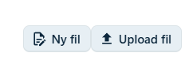
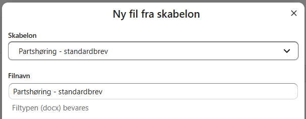
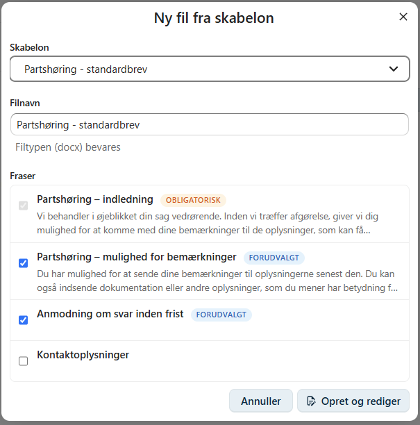
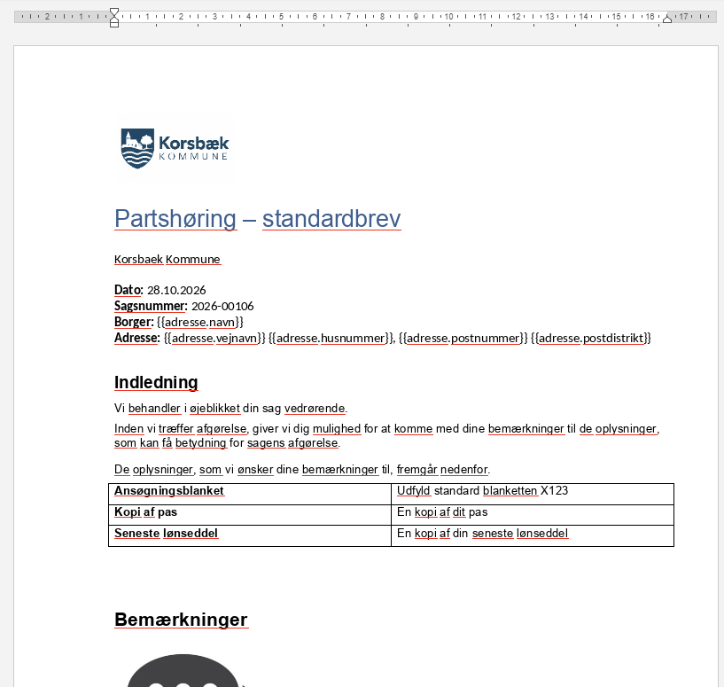
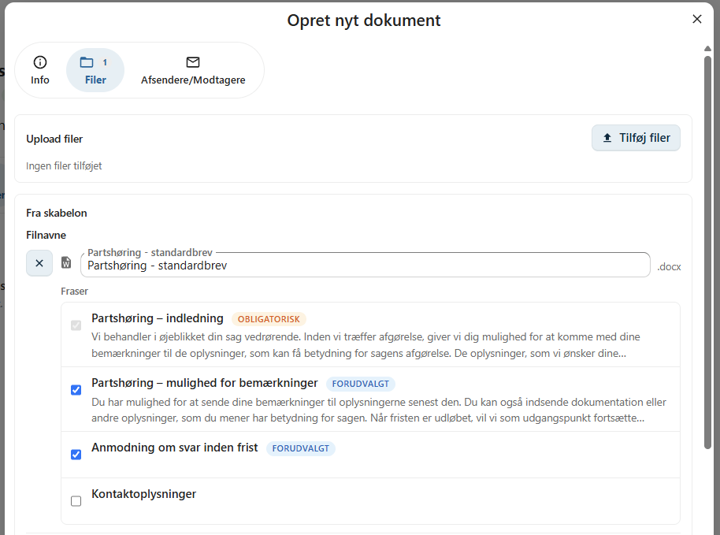

# Ny fil fra skabelon

OpenCase gør det muligt at oprette nye dokumenter — fx breve og afgørelser — ud fra skabeloner.

Ved at anvende skabeloner sikres en ensartet udformning af dokumenterne. Oplysninger fra sagen og dokumentet indsættes automatisk, og du kan vælge, hvilke **fraser** (standardafsnit) brevet skal indeholde.

Nye filer oprettes på fanen **Filer** ved at klikke på **Ny fil**.

---

## Vælg en skabelon

Dialogen **Ny fil fra skabelon** åbnes. Vælg skabelonen i feltet **Skabelon**. Du kan søge på skabelonens navn eller filnavn.

Listen viser kun de skabeloner, der kan bruges på sagen. En skabelon kan være begrænset til bestemte organisationer — så vises den kun på sager under disse organisationer.

Eksempler på skabeloner kan være:

- Brev
- Afgørelse
- Partshøring
- Referat
- Notat

---

## Navngiv filen

Feltet **Filnavn** udfyldes med skabelonens navn, så du blot kan rette det til. Vælger du en anden skabelon, følger filnavnet med — medmindre du selv har skrevet et navn.

Filtypen (fx `.docx`) bevares altid, uanset hvad du skriver i feltet.

!!! tip "Genkendelige filnavne"

    Giv filen et navn, der beskriver indholdet — fx `Afgørelse om aktindsigt` —
    frem for skabelonens standardnavn. Det gør filen lettere at finde igen.

Har filen allerede fået et forkert navn, kan den omdøbes fra filens menu på
fanen **Filer**. Læs mere i [Rediger fil](../dokumenter/rediger-fil.md).

---

## Vælg fraser

Har skabelonen fraser, vises de under **Fraser** i den rækkefølge, de indsættes i brevet:

| Markering | Betydning |
|-----------|-----------|
| **Obligatorisk** | Frasen kommer altid med og kan ikke fravælges. |
| **Forudvalgt** | Frasen er valgt på forhånd, men du kan fjerne fluebenet. |
| *(ingen markering)* | Frasen kan tilvælges ved at sætte et flueben. |

Under titlen vises frasens beskrivelse, så du kan se, hvornår den bruges.

Listen viser kun fraser, der kan bruges på sagen — dvs. fraser, der er aktive, og som passer til sagens sagstype, organisation og KLE-nummer. Mangler du en frase, kan den være afgrænset til andre sager eller endnu være en kladde.

Er en frase markeret **Intet indhold – indsættes ikke**, er den endnu ikke skrevet færdig. Kontakt din administrator.

Klik på **Opret og rediger**.

---

## Automatisk udfyldelse

Når filen oprettes, gør OpenCase følgende:

- **Flettefelter** udfyldes med oplysninger fra sagen og dokumentet — fx sagsnummer, sagens titel, dokumentdato, organisationens kontaktoplysninger og den ansvarlige sagsbehandlers navn, e-mail og telefon.
- **De valgte fraser** indsættes med deres formatering, fx overskrifter, punktlister og tabeller. Flettefelter i fraserne udfyldes også.
- **Organisationens logo** indsættes, hvis skabelonen har en plads til det. Har sagens organisation ikke sit eget logo, bruges den overordnede organisations logo.

Hvilke oplysninger der indsættes, afhænger af den valgte skabelon.

!!! info "Modtagerens adresse"

    Felter med modtagerens navn og adresse udfyldes først, når dokumentet sendes med [Digital Post](../dokumenter/digital-post.md) — med hver modtagers egne oplysninger. Indtil da står felterne fx som `{{adresse.navn}}` i dokumentet. Lad dem stå, så de kan blive udfyldt ved afsendelsen.

---

## Rediger filen

Når filen er oprettet, åbnes den i Nextcloud Office til redigering. Du kan tilføje eller ændre indholdet — fx tilpasse en frase til den konkrete sag.

Den oprettede fil bliver automatisk tilknyttet dokumentet.

---

## Filer fra skabeloner ved oprettelse af et dokument

Opretter du et nyt dokument, kan du allerede i dialogen **Opret nyt dokument** vælge en eller flere skabeloner på fanen **Filer**. For hver valgt skabelon angiver du filnavnet og vælger fraser på samme måde som beskrevet ovenfor. Filerne oprettes, når dokumentet gemmes.

---

## Fordele ved skabeloner og fraser

- Ensartet layout og opbygning.
- Automatisk udfyldelse af kendte oplysninger.
- Godkendte standardformuleringer, der kun skal vedligeholdes ét sted.
- Mindre risiko for fejl.
- Hurtigere oprettelse af dokumenter.

---

## Administration af skabeloner og fraser

Skabeloner og fraser vedligeholdes af organisationens skabelonadministrator under **Administrer brevdesigner**.

Hvis du mangler en skabelon eller en frase, eller ønsker ændringer til en eksisterende, skal du kontakte din OpenCase-administrator.

Læs mere i **Administratorvejledningen** under [Administrer brevdesigner](../administrator/administrer-skabeloner.md).

---

## Se også

- [Administrer brevdesigner](../administrator/administrer-skabeloner.md)
- [Opret dokument](../dokumenter/opret-dokument.md)
- [Digital Post](../dokumenter/digital-post.md)
- [Upload fil](../dokumenter/upload-fil.md)
- [Rediger fil](../dokumenter/rediger-fil.md)
- [Filversioner](../dokumenter/filversioner.md)
