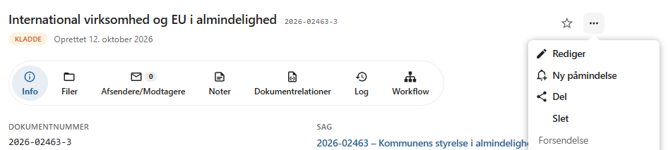
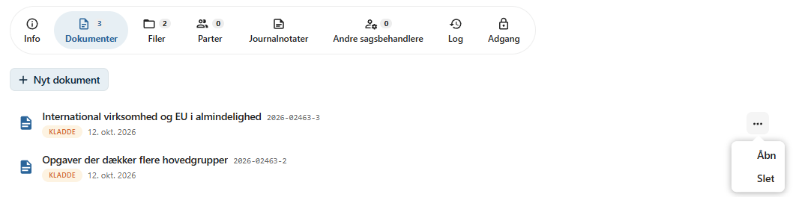
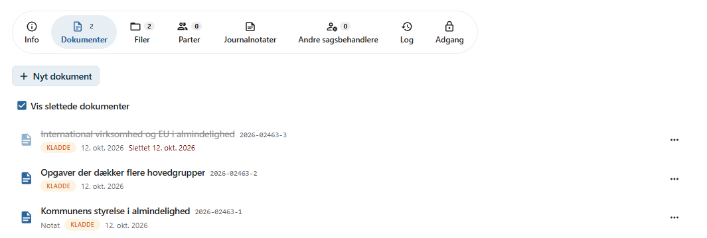
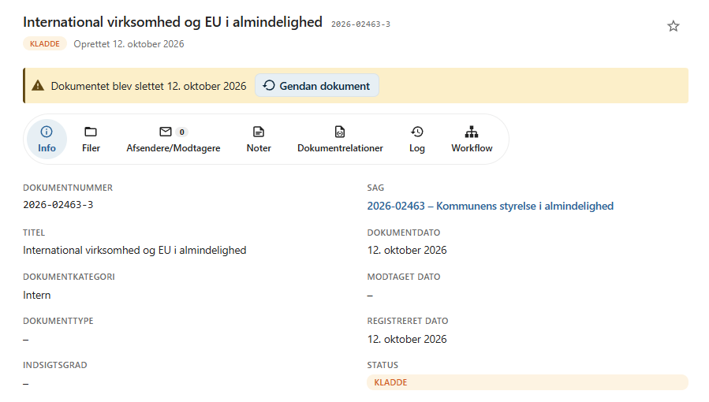
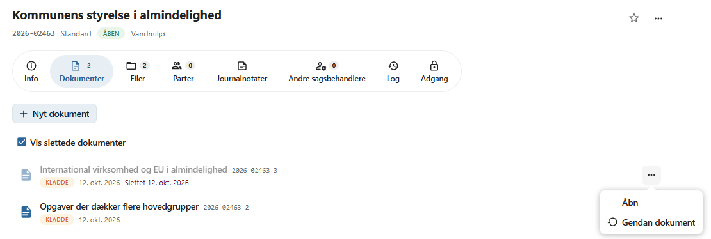
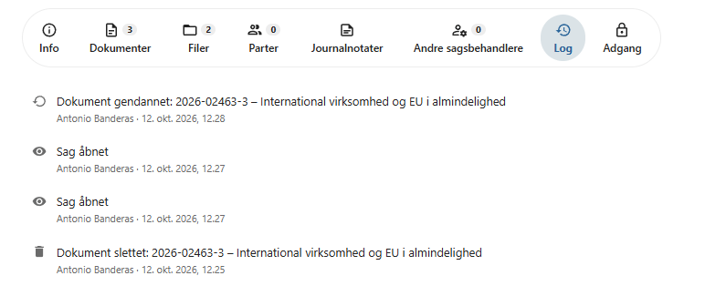

# Slet dokument

Dokumenter, der er oprettet ved en fejl, eller som ikke længere skal indgå i sagen, kan slettes, så længe de har status **Kladde**.

OpenCase understøtter to måder at slette dokumenter på:

- **Blød sletning** – dokumentet markeres som slettet, men gemmes stadig og kan gendannes.
- **Permanent sletning** – dokumentet og alt, hvad der hører til det, fjernes helt og kan ikke gendannes.

Hvilken af de to måder der anvendes, bestemmes af en administrator for hele installationen. Du vælger det altså ikke selv, når du sletter et dokument.

---

## Hvilke dokumenter kan slettes?

Et dokument kan kun slettes, når:

- dokumentet har status **Kladde**
- du har skriveadgang til dokumentet

Dokumenter med andre statusser kan ikke slettes, og menupunktet **Slet** vises ikke. Hvis et dokument med en anden status skal slettes, skal status først ændres til **Kladde**.

!!! info "Hvorfor kun kladder?"

    Et dokument, der er færdigbehandlet, journaliseret eller afsendt, er en del af sagens dokumentation og skal bevares. Derfor kan kun dokumenter under udarbejdelse slettes.

---

## Slet et dokument

Et dokument kan slettes fra to steder.

### Fra dokumentet

1. Åbn dokumentet.
2. Klik på menuen **⋯** øverst til højre.
3. Vælg **Slet**.
4. Bekræft, at dokumentet skal slettes.



Når dokumentet er slettet, vises meddelelsen **Dokument slettet**, og du sendes tilbage til sagen.

### Fra sagens dokumentliste

1. Åbn sagen, og gå til fanen **Dokumenter**.
2. Klik på menuen **⋯** ud for det dokument, der skal slettes.
3. Vælg **Slet**.



Dokumentet slettes, og meddelelsen **Dokument slettet** vises. Dokumentets filer forsvinder samtidig fra sagens filliste.

!!! warning "Ingen bekræftelse i dokumentlisten"

    Når du sletter fra sagens dokumentliste, vises der ikke en bekræftelsesdialog. Kontroller derfor, at du har valgt det rigtige dokument.

---

## Blød sletning

Når blød sletning er slået til, bliver dokumentet ikke fjernet. Det markeres i stedet som slettet med dato og tidspunkt.

Et blødt slettet dokument:

- skjules i sagens dokumentliste
- vises ikke i søgeresultater
- fjernes fra listerne over seneste dokumenter og vises ikke i favoritter
- vises ikke som opgave i workflows
- vises ikke som relation på andre dokumenter
- får sine filer fjernet fra søgeindekset og den virtuelle filstruktur i Nextcloud
- bevarer sine filer, kontakter, noter, relationer og workflows, så de er intakte, hvis dokumentet gendannes
- kan gendannes

### Vis slettede dokumenter

Hvis sagen indeholder slettede dokumenter, vises kontakten **Vis slettede dokumenter** over sagens dokumentliste.

Når kontakten er slået til, vises de slettede dokumenter i listen sammen med de øvrige dokumenter. Et slettet dokument er markeret med teksten **Slettet** og datoen for sletningen.



### Åbn et slettet dokument

Et slettet dokument kan åbnes fra dokumentlisten. Øverst på dokumentet vises en advarsel med teksten **Dokumentet blev slettet** og datoen for sletningen.



Et slettet dokument kan ikke ændres:

- dokumentets menu **⋯** vises ikke
- filerne kan ikke åbnes, redigeres, slettes eller gendannes enkeltvis
- filerne kan stadig downloades, og deres log kan ses

### Gendan et dokument

Et slettet dokument kan gendannes på to måder:

- Åbn dokumentet, og klik på **Gendan dokument** i advarslen øverst på dokumentet.
- Slå **Vis slettede dokumenter** til på sagen, klik på menuen **⋯** ud for dokumentet, og vælg **Gendan dokument**.



Når dokumentet er gendannet, vises meddelelsen **Dokument gendannet**. Dokumentet og dets filer vender tilbage til sagen, søgningen og den virtuelle filstruktur.

Filer, der var slettet hver for sig, før dokumentet blev slettet, forbliver slettede. De kan gendannes enkeltvis som beskrevet under [Slet fil](slet-fil.md#gendan-en-fil).

!!! info "Afsluttede sager"

    Et dokument kan ikke gendannes fra sagens dokumentliste, hvis sagen er afsluttet.

---

## Permanent sletning

Når blød sletning ikke er slået til, slettes dokumentet permanent.

Ved permanent sletning fjernes:

- selve dokumentet
- alle dokumentets filer og deres [versioner](filversioner.md)
- alle [delinger](del-fil.md) af dokumentets filer
- dokumentets [kontakter](kontakter.md) og [noter](noter.md)
- alle [dokumentrelationer](dokumentrelationer.md), som dokumentet indgår i – også relationer, der er oprettet fra andre dokumenter
- dokumentets [workflows](workflow.md) og [påmindelser](paamindelser.md)
- dokumentet fra alle brugeres favoritter og lister over seneste dokumenter
- filerne fra søgeindekset og den virtuelle filstruktur i Nextcloud

Dokumentet forsvinder straks fra sagen og kan **ikke** gendannes.

!!! danger "Kan ikke fortrydes"

    Et permanent slettet dokument kan ikke gendannes af hverken brugere eller administratorer.

---

## Log

Sletning og gendannelse af dokumenter registreres i sagens log med teksterne **Dokument slettet** og **Dokument gendannet** efterfulgt af dokumentnummer og titel.

Det fremgår også af loggen, hvem der har slettet eller gendannet dokumentet, og hvornår. Loggen bevares, også når dokumentet slettes permanent.



---

## For administratorer

Blød sletning slås til og fra med konfigurationsværdien `use_softdelete`:

```bash
# Slå blød sletning til
php occ opencase:config:set use_softdelete 1

# Slå blød sletning fra (permanent sletning)
php occ opencase:config:set use_softdelete 0
```

Som standard er blød sletning slået fra, og dokumenter slettes permanent.

Indstillingen gælder også for [sletning af filer](slet-fil.md). Se også [occ-kommandoer](../administrator/occ-kommandoer.md).

!!! tip "Anbefaling"

    Slå blød sletning til, hvis brugerne skal kunne fortryde en sletning, eller hvis organisationen ønsker at bevare slettede dokumenter af hensyn til dokumentation og revision.
