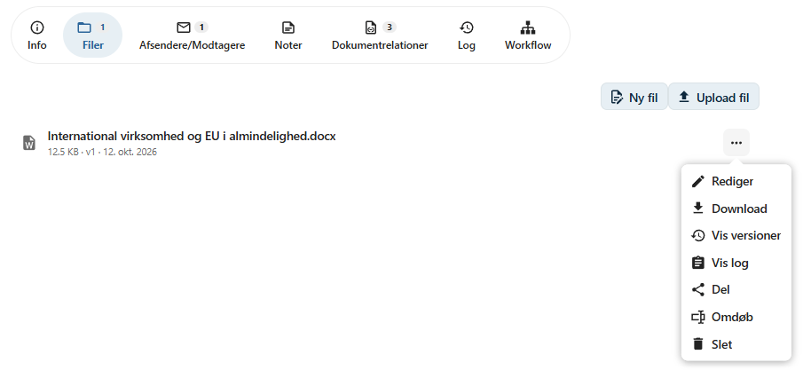
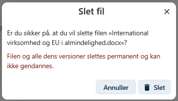
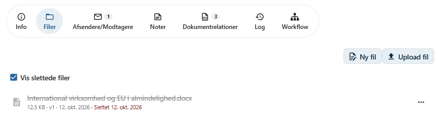
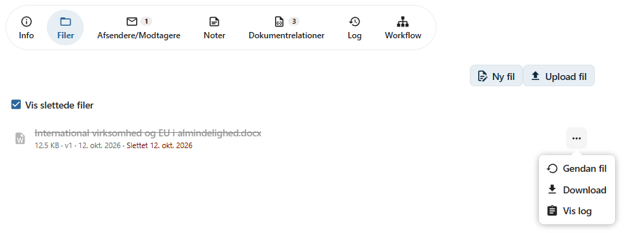
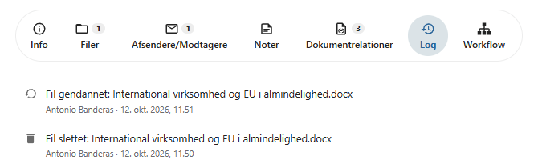

# Slet fil

Filer, der ikke længere skal være en del af et dokument, kan slettes fra dokumentets fane **Filer**.

OpenCase understøtter to måder at slette filer på:

- **Blød sletning** – filen markeres som slettet, men gemmes stadig og kan gendannes.
- **Permanent sletning** – filen fjernes helt og kan ikke gendannes.

Hvilken af de to måder der anvendes, bestemmes af en administrator for hele installationen. Du vælger det altså ikke selv, når du sletter en fil.

---

## Slet en fil

1. Åbn dokumentet, og gå til fanen **Filer**.
2. Klik på menuen **⋯** ud for den fil, der skal slettes.
3. Vælg **Slet**.
4. Bekræft sletningen ved at klikke på **Slet** i dialogen.



### Bekræft sletning

Før filen slettes, åbnes dialogen **Slet fil**, hvor du skal bekræfte, at filen skal slettes. Dialogen viser navnet på filen, så du kan kontrollere, at du har valgt den rigtige fil.

Dialogen fortæller også, hvad der sker med filen:

- Hvis blød sletning er slået til, vises teksten *Filen kan gendannes efterfølgende.*
- Hvis filen slettes permanent, vises advarslen *Filen og alle dens versioner slettes permanent og kan ikke gendannes.* med rød skrift.



Klik på **Slet** for at slette filen. Meddelelsen **Fil slettet** vises, når filen er slettet.

Klik på **Annuller** eller luk dialogen, hvis filen ikke skal slettes.

Du kan kun slette filer, hvis du har skriveadgang til dokumentet, og dokumentet ikke har en afsluttende status. Ellers vises menupunktet **Slet** ikke.

---

## Blød sletning

Når blød sletning er slået til, bliver filen ikke fjernet fysisk. Den markeres i stedet som slettet med dato og tidspunkt.

En blødt slettet fil:

- skjules i dokumentets filliste
- kan ikke åbnes eller redigeres
- vises ikke i søgeresultater
- fjernes fra den virtuelle filstruktur i Nextcloud
- kan ikke tilgås via eventuelle delinger
- kan stadig downloades fra fillisten, og dens log kan ses
- kan gendannes

### Vis slettede filer

Hvis dokumentet indeholder slettede filer, vises kontakten **Vis slettede filer** over fillisten.

Når kontakten er slået til, vises de slettede filer i listen sammen med de øvrige filer. En slettet fil vises med gennemstreget og nedtonet filnavn samt teksten **Slettet** og datoen for sletningen.



For en slettet fil indeholder menuen kun:

- **Gendan fil**
- **Download**
- **Vis log**

### Gendan en fil

1. Slå **Vis slettede filer** til.
2. Klik på menuen **⋯** ud for den slettede fil.
3. Vælg **Gendan fil**.



Filen bliver igen en almindelig fil på dokumentet. Den kommer tilbage i den virtuelle filstruktur og i søgningen, og eventuelle delinger af filen virker igen.

!!! info "Slettede dokumenter"

    Hvis hele dokumentet er slettet, kan de enkelte filer ikke gendannes. Gendan først dokumentet med **Gendan dokument**. Derefter kan filerne gendannes.

---

## Permanent sletning

Når blød sletning ikke er slået til, slettes filen permanent.

Ved permanent sletning fjernes:

- selve filen
- alle tidligere [filversioner](filversioner.md)
- alle [delinger](del-fil.md) af filen
- filen fra søgeindekset og den virtuelle filstruktur i Nextcloud

Filen forsvinder straks fra fillisten og kan **ikke** gendannes.

!!! danger "Kan ikke fortrydes"

    En permanent slettet fil kan ikke gendannes af hverken brugere eller administratorer.

---

## Dokumentlog

Sletning og gendannelse af filer registreres i [dokumentloggen](dokumentlog.md) med teksterne **Fil slettet** og **Fil gendannet** efterfulgt af filnavnet.

Det fremgår også af loggen, hvem der har slettet eller gendannet filen, og hvornår.



---

## For administratorer

Blød sletning slås til og fra med konfigurationsværdien `use_softdelete`:

```bash
# Slå blød sletning til
php occ opencase:config:set use_softdelete 1

# Slå blød sletning fra (permanent sletning)
php occ opencase:config:set use_softdelete 0
```

Som standard er blød sletning slået fra, og filer slettes permanent.

Indstillingen gælder også for sletning af dokumenter. Se også [occ-kommandoer](../administrator/occ-kommandoer.md).

!!! tip "Anbefaling"

    Slå blød sletning til, hvis brugerne skal kunne fortryde en sletning, eller hvis organisationen ønsker at bevare slettede filer af hensyn til dokumentation og revision.
