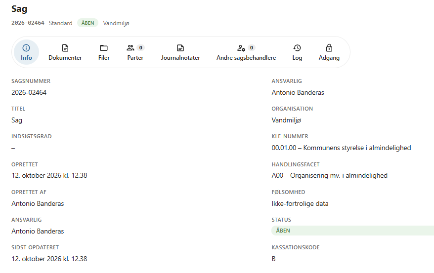
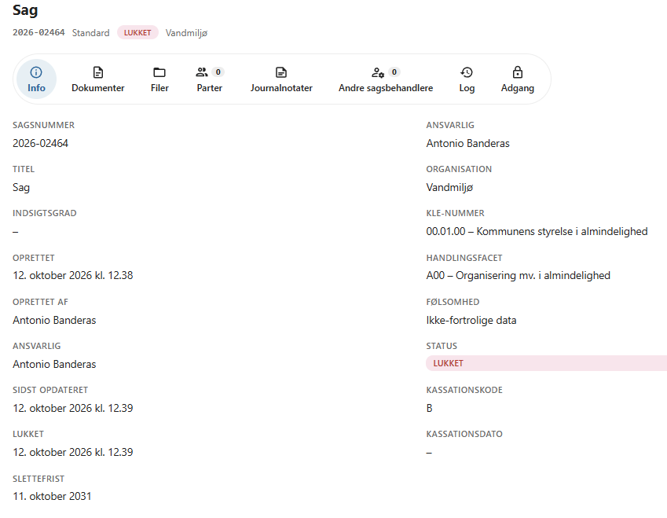

# Kassation

OpenCase holder styr på, hvor længe en sag skal opbevares, efter at den er lukket.

Hver sag får en **kassationskode**, som angiver, om sagen skal bevares, eller om den kan kasseres efter en given periode. Når sagen lukkes, beregner OpenCase ud fra kassationskoden en **kassationsdato** og eventuelt en **slettefrist**.

Kassationskode og slettefrist bestemmes automatisk ud fra sagens klassifikation. Du skal derfor ikke selv vælge dem.

---

## Kassationskoder

| Kode | Betydning | Kassationsdato |
|------|-----------|----------------|
| **B** | Bevaring – sagen skal bevares og må ikke kasseres. | Ingen |
| **K** | Kassation – sagen kan kasseres, når den er lukket. | Samme dag som sagen lukkes |
| **K5** | Kassation efter 5 år. | 5 år efter, at sagen er lukket |
| **K10** | Kassation efter 10 år. | 10 år efter, at sagen er lukket |

---

## Sådan bestemmes kassationskoden

Kassationskoden hentes fra sagens klassifikation:

- **emnet** i KLE-emneplanen (via sagens adgangsprofil)
- **handlingsfacetten**

Både emnet og handlingsfacetten kan have en kassationskode tilknyttet. Hvis de har forskellige koder, vælges den strengeste kode i denne rækkefølge:

1. **B** (bevaring)
2. **K10**
3. **K5**

Hvis hverken emnet eller handlingsfacetten har en af disse koder, får sagen kassationskoden **K**.

!!! example "Eksempel"

    En sag er klassificeret med et emne, der har kassationskoden K5, og en handlingsfacet, der har kassationskoden B. Sagen får kassationskoden **B**, fordi bevaring går forud for kassation.

Kassationskoden beregnes, når sagen oprettes, og beregnes igen, hvis sagens emne eller handlingsfacet ændres.

!!! info "Kassationskoder fra KLE"

    Kassationskoder og slettefrister på emner og handlingsfacetter hentes fra den fælleskommunale klassifikationsservice, når KLE synkroniseres. Ved manuel upload af emneplan og handlingsfacetter som CSV-filer bevares de koder, der blev hentet ved den seneste synkronisering.

---

## Slettefrist

Ud over kassationskoden kan emnet og handlingsfacetten have en **slettefrist**. Slettefristen angiver, hvor længe efter lukning sagen senest skal slettes – for eksempel af hensyn til databeskyttelsesreglerne.

Mulige slettefrister er:

100 dage · 1 år · 5 år · 6 år · 9 år · 10 år · 11 år · 15 år · 30 år · 35 år · 45 år · 50 år

Hvis både emnet og handlingsfacetten har en slettefrist, anvendes den **korteste**.

Hvis hverken emnet eller handlingsfacetten har en slettefrist, får sagen ingen slettefrist.

---

## Når sagen lukkes

Når en sag skifter fra en åben til en lukket status (for eksempel **Lukket**), sker følgende:

- Lukkedatoen registreres.
- **Kassationsdatoen** beregnes som lukkedatoen plus det antal år, kassationskoden angiver. Sager med kassationskode **B** får ingen kassationsdato.
- **Slettefristen** beregnes som lukkedatoen plus det antal dage, slettefristen angiver.

Hvis sagen senere flyttes mellem to lukkede statusser – for eksempel fra **Lukket** til **Arkiveret** – ændres datoerne ikke.

### Genåbning af en sag

Hvis en lukket sag genåbnes, nulstilles lukkedato, kassationsdato og slettefrist. En genåbnet sag bliver derfor aldrig kasseret eller slettet.

Når sagen lukkes igen, beregnes datoerne på ny ud fra den nye lukkedato.

---

## Se kassationsoplysninger på sagen

Kassationsoplysningerne vises på sagens fane **Info**.

| Felt | Vises | Beskrivelse |
|------|-------|-------------|
| **Kassationskode** | Altid | Sagens kassationskode (B, K, K5 eller K10). |
| **Lukket** | Når sagen er lukket | Dato og tidspunkt for, hvornår sagen blev lukket. |
| **Kassationsdato** | Når sagen er lukket | Datoen, hvor sagen kan kasseres. Vises som *–* for sager, der skal bevares. |
| **Slettefrist** | Når sagen er lukket | Datoen, hvor sagen senest skal slettes. Vises som *–*, hvis sagen ikke har en slettefrist. |

!!! info "Kassation udføres ikke automatisk"

    OpenCase beregner og viser kassationsdato og slettefrist, men kasserer eller sletter ikke selv sager, når datoerne er nået.

---

## God praksis

!!! tip "Klassificer sagen korrekt"

    Da kassationskoden afhænger af sagens emne og handlingsfacet, er korrekt klassifikation afgørende. Kontroller derfor klassifikationen, inden sagen lukkes, så sagen får den rigtige kassationskode og de rigtige frister.

---

## Se også

- [Opret sag](opret-sag.md)
- [Masseredigering](masseredigering.md)
