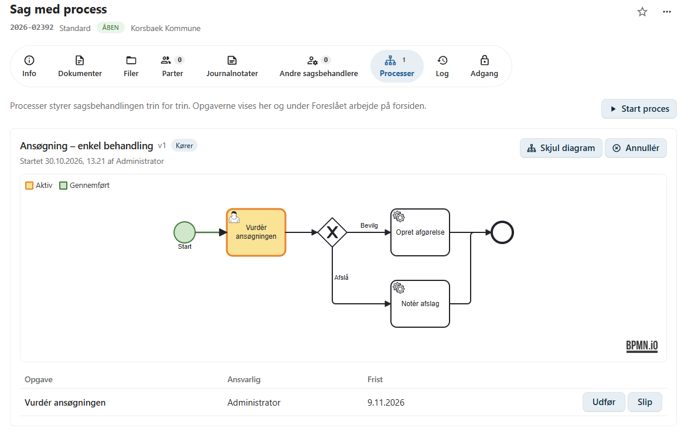
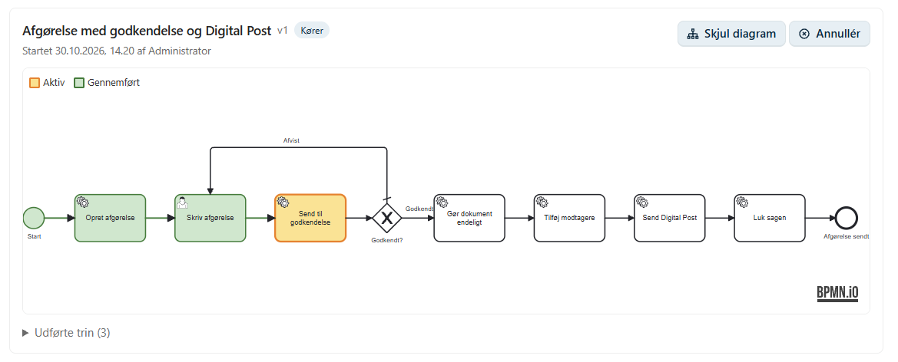
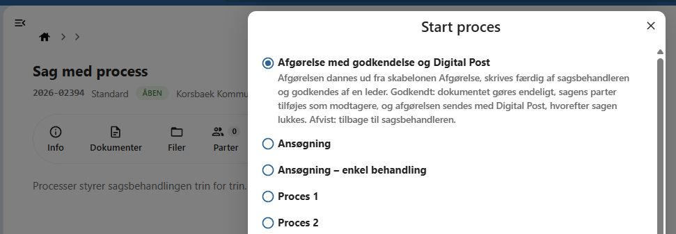
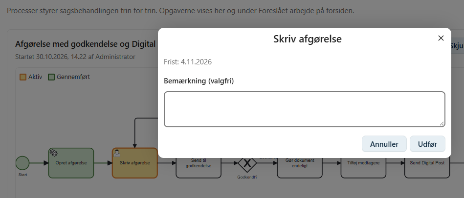
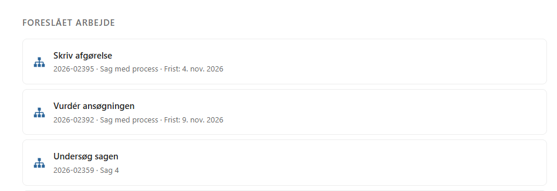
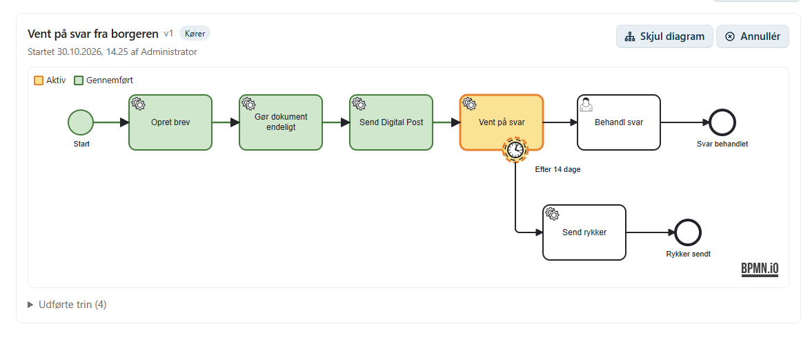
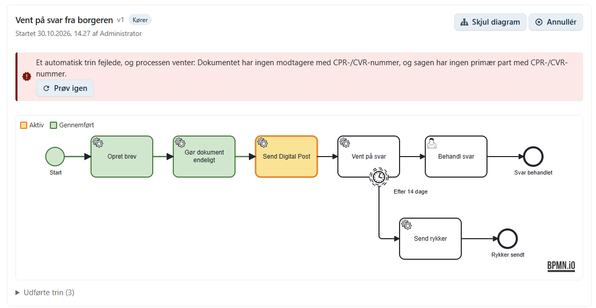
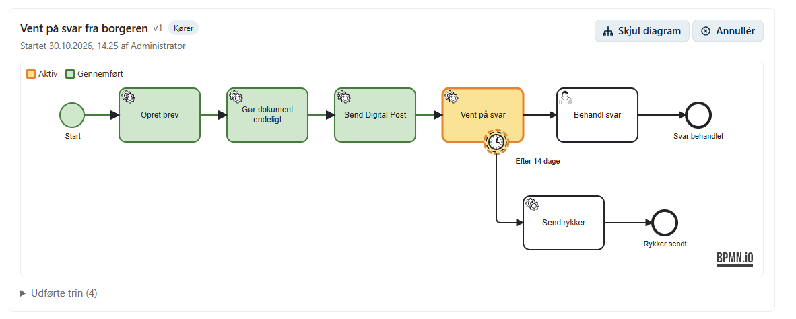
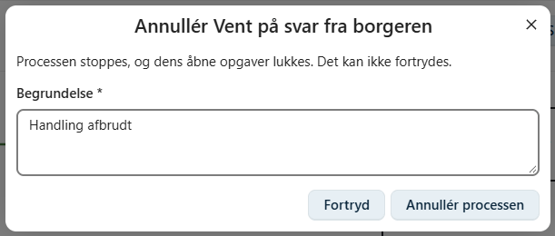
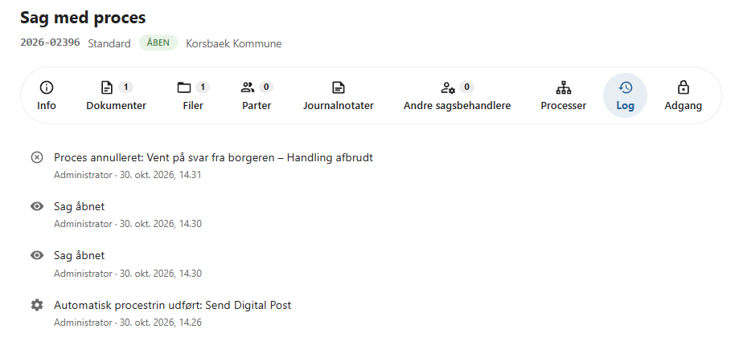

# Processer

En proces beskriver sagsbehandlingen trin for trin, f.eks. *vurdér ansøgningen → skriv afgørelse → få den godkendt → send den til borgeren*. Processen holder styr på, hvad der er det næste trin, hvem der skal udføre det, og hvornår fristen er. Nogle trin udfører OpenCase selv – f.eks. at danne et brev ud fra en skabelon eller sende det med Digital Post.

Processerne designes af en procesadministrator (se [Administrer processer](../administrator/administrer-processer.md)). Som sagsbehandler starter du dem på sagen og udfører opgaverne undervejs.

Fanen **Processer** vises på sagen, når procesmodulet er aktiveret. Tallet på fanen er antallet af processer, der kører på sagen.

---

## Sådan ser en proces ud på sagen

Hver proces på sagen vises som et kort med:

- **Navn og status** – *Kører*, *Afsluttet* eller *Annulleret* – samt hvornår og af hvem den blev startet.
- **Opgaver** – processens åbne opgaver med ansvarlig og frist og knapper til at tage, udføre eller slippe dem.
- **Udførte trin** – historikken: opgaver, der er udført, og automatiske trin, OpenCase har udført.
- **Vis diagram** – processen tegnet som diagram med det trin, den er nået til.
- **Annullér** – stop processen.

Afsluttede og annullerede processer bliver stående på sagen, så historikken kan ses.

---

## Start en proces

1. Åbn sagen, og vælg fanen **Processer**.
2. Klik på **Start proces**, og vælg processen i listen.
3. Klik **Start**.

Processen går straks i gang. Den første opgave vises på kortet, og automatiske trin i begyndelsen af processen udføres med det samme.

En proces kan også vælges allerede når sagen oprettes – i feltet **Proces** i dialogen *Ny sag* (se [Opret sag](opret-sag.md)). Processen startes, når sagen er oprettet, og sagen åbnes på fanen **Processer**.

Kun processer, der passer til sagens sagstype, organisation og KLE-nummer, kan vælges. Finder du ikke den proces, du forventer, så kontrollér sagens metadata, eller kontakt procesadministratoren.

- En proces kan kun køre én gang ad gangen på samme sag.
- Der kan ikke startes processer på en afsluttet sag.
- Du skal have skriveadgang til sagen.

---

## Opgaver

Processens åbne opgaver vises i en tabel med ansvarlig og frist. En overskredet frist vises med rødt.

| Knap | Betydning |
|------|-----------|
| **Tag opgaven** | Opgaven er ikke tildelt nogen. Du tager den, så de andre kandidater kan se, at du arbejder på den. |
| **Udfør** | Opgaven er udført. Har opgaven et udfald (f.eks. *Godkend* / *Afvis*), skal du vælge det, og har den felter (f.eks. et beløb eller en dato), skal de påkrævede udfyldes. Du kan skrive en bemærkning. |
| **Slip** | Giv opgaven tilbage, så en anden kan tage den. |

### Hvem kan udføre opgaven?

En opgave kan være tildelt:

- **en bestemt sagsbehandler** – ofte sagens ansvarlige sagsbehandler. Kun vedkommende kan udføre den.
- **en eller flere organisationer** – medarbejdere i organisationerne (og deres underenheder) kan tage opgaven. I kolonnen *Ansvarlig* står *Ikke taget* og organisationerne.
- **ingen** – alle med skriveadgang til sagen kan tage opgaven.

Skifter sagen ansvarlig sagsbehandler, går nye opgaver for *sagens ansvarlige* til den nye ansvarlige. Opgaver, der allerede er oprettet, beholder deres ansvarlige – brug **Slip** og **Tag opgaven**, hvis en anden skal overtage.

### Udfør en opgave

Klik **Udfør** for at åbne dialogen:

1. Vælg **udfaldet**, hvis opgaven har et – f.eks. *Godkend* eller *Afvis*. Udfaldet bestemmer, hvilken vej processen fortsætter.
2. Udfyld **felterne**, hvis opgaven har nogen. Påkrævede felter er markeret med \*. Felterne kan være tekst, tal, dato, ja/nej eller en medarbejder (søg på navn eller brugernavn).
3. Skriv evt. en **bemærkning**.
4. Klik **Udfør**.

Processen fortsætter med det samme til næste trin. Kommer der automatiske trin, udføres de straks, og sagen opdateres – f.eks. med et nyt dokument eller journalnotat.

Udfald, felter og bemærkning kan ikke ændres bagefter; de vises under **Udførte trin** og i sagens log.

### Dine opgaver på forsiden

Dine procesopgaver vises sammen med dine øvrige opgaver under **Foreslået arbejde** på forsiden, sorteret efter frist. Opgaver, som ingen har taget, og som du er kandidat til, vises med *Ikke taget*. Klik på opgaven for at gå til sagen.

---

## Automatiske trin

Nogle trin udfører OpenCase selv. De vises under **Udførte trin** med mærket *Automatisk*, hvem de blev udført som, og hvad der kom ud af dem:

| Trin | Det ser du ved trinnet |
|------|------------------------|
| Opret dokument / journalnotat | Dokumentet eller notatet findes på sagen. |
| Opret undersag | Et link til undersagen. |
| Send Digital Post | Forsendelsen ses på dokumentet. |
| Send notifikation | Hvem der fik notifikationen, og hvem der blev sprunget over (ingen adgang til sagen). |
| Tildel sag | Hvem der blev ansvarlig eller tilføjet som sagsbehandler. |
| Udfyld tillægsfelt | Tillægsfeltet og den nye værdi. |
| Tilføj modtager | Hvilke parter der blev tilføjet som modtagere. |
| Opret påmindelse | Hvem påmindelsen gik til, og fristen. |
| Gør dokument endeligt | At dokumentet er gjort endeligt. |
| Send til godkendelse | Hvem dokumentet er sendt til, og bagefter udfaldet (*Godkendt*, *Afvist* …). |

Automatiske trin udføres som sagens ansvarlige sagsbehandler.

### Trin, der venter

Nogle automatiske trin venter på noget, før processen fortsætter. Mens de venter, står der *venter* ved trinnet og hvad der ventes på:

| Trin | Venter på |
|------|-----------|
| **Vent på dokument** | At der kommer et dokument på sagen – f.eks. borgerens svar via Digital Post, et dokument flyttet hertil fra indbakken, eller et dokument du selv opretter – evt. i en bestemt kategori. |
| **Send til godkendelse** | At godkenderen godkender eller afviser dokumentet. Godkendelsen ses også på dokumentet. |
| **Vent på inaktivitet** | At der ikke har været aktivitet på sagen i et antal dage. Der står, hvornår der ventes til; laver du noget på sagen, rykkes tidspunktet. |

### Når et automatisk trin fejler {#naar-et-automatisk-trin-fejler}

Fejler et automatisk trin, vises fejlen øverst på processen:

- Skyldes fejlen noget midlertidigt (f.eks. at et andet system ikke svarer), står der, at trinnet **prøves igen automatisk**. Du behøver ikke gøre noget.
- Skyldes fejlen opsætningen eller sagens data, venter processen. Ret årsagen, og klik på **Prøv igen**.

Typiske årsager:

| Fejl | Gør dette |
|------|-----------|
| *Dokumentet har ingen filer at sende* | Upload eller dan filen på dokumentet, og klik **Prøv igen**. |
| *Sagen har ingen primær part med CPR-/CVR-nummer* | Tilføj den primære part på sagen. |
| *Brugeren har ikke skriveadgang til sagen* | Sagens ansvarlige sagsbehandler mangler adgang – giv adgang, eller skift ansvarlig. |
| *Skabelonen findes ikke* eller lignende | Fejlen ligger i processen – kontakt procesadministratoren. |

---

## Frister og notifikationer

Du får en notifikation i Nextcloud:

- når en procesopgave bliver **tildelt** dig (*Ny opgave: …*),
- når fristen for en af dine opgaver **nærmer sig** (2 dage før),
- når fristen er **overskredet**.

For en opgave, som ingen har taget, går fristnotifikationerne til sagens ansvarlige sagsbehandler. Processen kan også selv sende notifikationer og påmindelser, f.eks. hvis der ikke er sket noget på sagen i et stykke tid.

---

## Diagram

Klik på **Vis diagram** for at se processen tegnet:

- Det trin, processen er nået til, er markeret med **gult**.
- De trin, der er gennemført, og vejen processen har fulgt, er markeret med **grønt**.

Diagrammet viser den version af processen, sagen kører på. Det er nyttigt for at se, hvad der kommer efter den aktuelle opgave, og hvilke veje processen kan tage.

---

## Annullér en proces

Klik på **Annullér**, og angiv en begrundelse. Processen stoppes, og dens åbne opgaver lukkes. Det kan ikke fortrydes – start processen igen, hvis den er annulleret ved en fejl.

Når sagen lukkes, annulleres dens kørende processer automatisk med begrundelsen *Sagen er lukket*. Genåbnes sagen, startes de ikke igen – start dem på ny, hvis det er nødvendigt. Er processens sidste trin *Luk sagen*, afsluttes processen normalt.

---

## Log

Start af processer, opgaver, der tages og udføres (med udfald, felter og bemærkning), automatiske trin, flytning til en ny version, afslutning og annullering registreres i sagens [log](sagslog.md).

---

## Spørgsmål og svar

**Jeg kan ikke se knappen Udfør.**
Opgaven er tildelt en anden, eller den er ikke taget endnu – klik **Tag opgaven** først. Du skal også have skriveadgang til sagen.

**Processen står stille, men der er ingen opgave.**
Den er ved et automatisk trin. Står der *venter*, venter den på noget (se [Trin, der venter](#trin-der-venter)). Står der en fejl, se [Når et automatisk trin fejler](#naar-et-automatisk-trin-fejler).

**Kan jeg gå tilbage til et tidligere trin?**
Kun hvis processen er designet med en vej tilbage – f.eks. udfaldet *Afvis*, der sender sagen tilbage til sagsbehandleren. Ellers kan processen annulleres og startes forfra.

**Processen er ændret – hvad sker der med min sag?**
Processer, der kører, fortsætter på den version, de blev startet på, medmindre procesadministratoren flytter dem til den nye version. Flytningen ses i sagens log.
