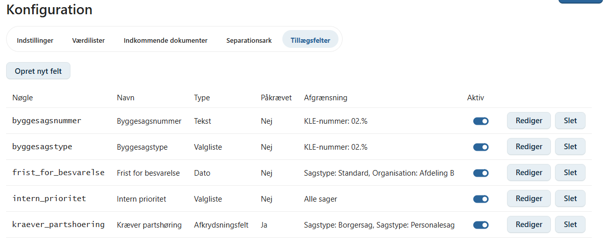
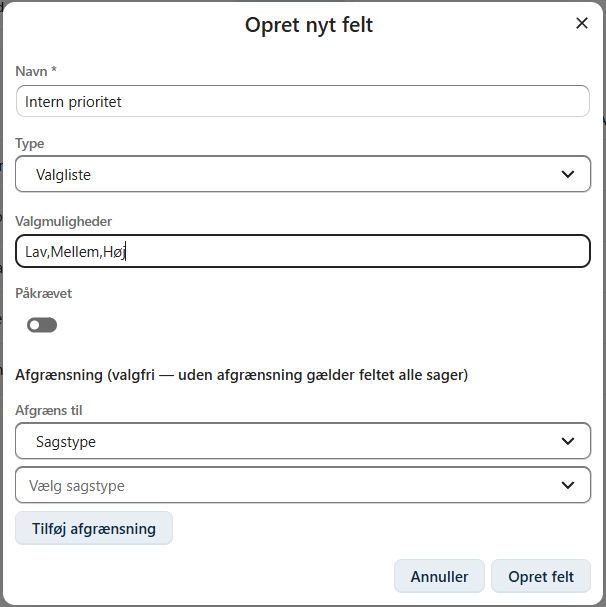
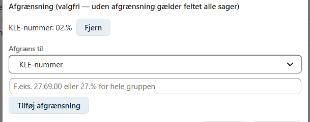
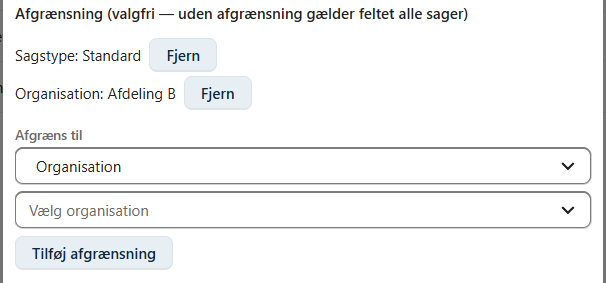
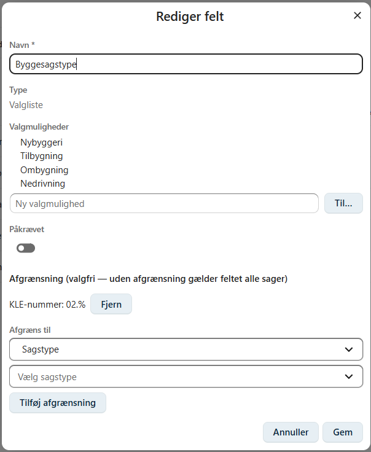
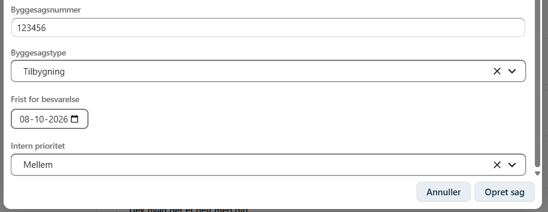
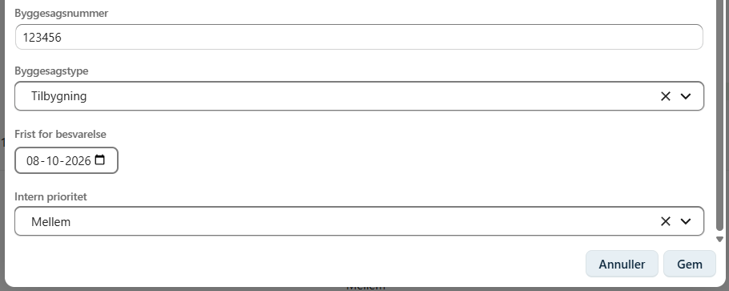
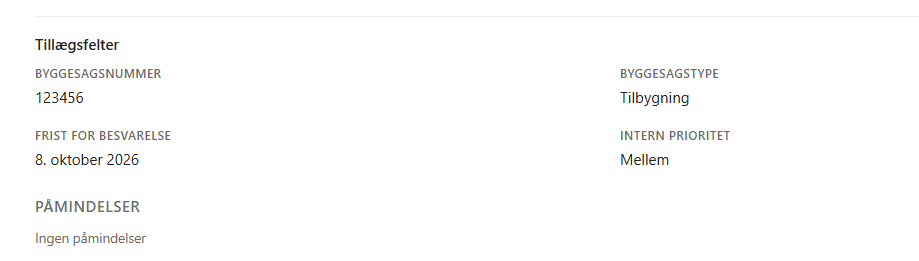
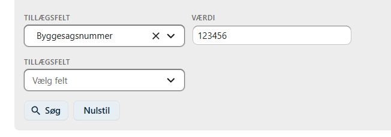
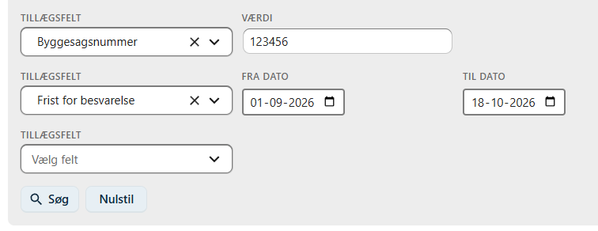

# Tillægsfelter

Tillægsfelter gør det muligt at tilføje organisationsspecifikke oplysninger til sager, som ikke i forvejen findes som standardfelter i OpenCase — for eksempel et internt referencenummer, en byggesagstype eller en dato for et bestemt sagsskridt.

En **OpenCase administrator** opretter tillægsfelterne centralt, hvorefter de automatisk vises på de sager, de er relevante for.

---

## Om tillægsfelter

Et tillægsfelt har en **type**, som bestemmer, hvordan feltet vises og udfyldes:

| Type | Beskrivelse |
|------|-------------|
| **Tekst** | Fritekstfelt. |
| **Valgliste** | En liste af foruddefinerede valgmuligheder, hvor brugeren vælger én værdi. |
| **Afkrydsningsfelt** | Et ja/nej-felt (til/fra). |
| **Dato** | Et datofelt. |

Et tillægsfelt kan afgrænses, så det kun vises på bestemte sager — se afsnittet **Afgrænsning** nedenfor. Et felt uden afgrænsning vises på **alle** sager.

---

## Opret et tillægsfelt

Tillægsfelter oprettes og administreres under **Konfiguration → Tillægsfelter**.

!!! info "Kræver administratorrettigheder"

    Kun brugere med rollen **OpenCase administrator** kan oprette, redigere og slette tillægsfelter.

Klik på **Opret nyt felt** for at åbne dialogen til oprettelse af et nyt tillægsfelt.

Udfyld følgende:

| Felt | Beskrivelse |
|------|-------------|
| **Navn** | Feltets label, som vises for brugerne på sagen. |
| **Type** | Tekst, Valgliste, Afkrydsningsfelt eller Dato. |
| **Valgmuligheder** | Kun for typen Valgliste. Angiv de mulige værdier adskilt af komma, fx `Rød,Gul,Grøn`. |
| **Påkrævet** | Om feltet skal udfyldes, før en sag kan oprettes. |

!!! warning "Typen kan ikke ændres senere"

    Feltets type vælges ved oprettelsen og kan **ikke** ændres bagefter. Vælg derfor den korrekte type, inden feltet oprettes.

---

## Afgrænsning

Et tillægsfelt kan afgrænses, så det kun vises på sager, der matcher bestemte kriterier:

- **Sagstype** — feltet vises kun på sager af den/de valgte sagstype(r).
- **Organisation** — feltet vises kun på sager under den/de valgte organisation(er). Vælges en organisation højere i hierarkiet, gælder afgrænsningen automatisk også for dens underliggende organisationer.
- **KLE-nummer** — feltet vises kun på sager med det/de angivne KLE-numre. Der kan angives et helt KLE-nummer (fx `27.69.00`) eller et mønster for en hel gruppe (fx `27.%`).

Der kan tilføjes flere afgrænsninger til samme felt:

- Flere afgrænsninger af **samme type** (fx to sagstyper) betyder, at feltet vises, hvis sagen matcher **mindst én** af dem.
- Afgrænsninger af **forskellig type** (fx sagstype **og** organisation) skal **alle** være opfyldt, før feltet vises.

!!! tip

    Et felt uden nogen afgrænsning vises på alle sager, uanset sagstype, organisation og KLE-nummer.

---

## Rediger og administrer felter

Klik på **Rediger** ud for et felt for at åbne redigeringsdialogen.

Her kan du ændre:

- **Navn**
- **Afgrænsning**
- **Valgmuligheder** — for typen Valgliste kan der kun **tilføjes** nye valgmuligheder. Eksisterende valgmuligheder kan ikke fjernes, da de kan være gemt på eksisterende sager.

Feltets **type** kan ikke ændres i redigeringsdialogen.

### Aktiver og deaktiver

Med kontakten i kolonnen **Aktiv** kan et felt slås fra, uden at de allerede gemte værdier går tabt. Et deaktiveret felt vises ikke længere på nye eller eksisterende sager.

### Slet et felt

Klik på **Slet** for at fjerne et tillægsfelt permanent.

!!! danger "Sletning kan ikke fortrydes"

    Når et tillægsfelt slettes, slettes **alle** gemte værdier for feltet på samtlige sager samtidig. Overvej at deaktivere feltet i stedet, hvis oplysningerne skal bevares.

---

## Brug af tillægsfelter på en sag

### Ved oprettelse af en sag

Når du opretter en ny sag, vises de tillægsfelter, der matcher den valgte sagstype, organisation og KLE-nummer, automatisk nederst i dialogen. Felter markeret med `*` er påkrævede.

Ændrer du organisation eller KLE-nummer, mens du udfylder dialogen, opdateres listen af tillægsfelter løbende.

### Ved redigering af en sag

Tillægsfelternes værdier kan efterfølgende ændres via **Rediger sag**.

### Visning på sagen

De udfyldte tillægsfelter vises under overskriften **Tillægsfelter** på fanen **Info** på sagens detaljeside.

---

## Søg på tillægsfelter

På siden **Søg → Søg efter sager** kan der søges på værdien af et eller flere tillægsfelter.

Vælg feltet **Tillægsfelt**, og angiv derefter en søgeværdi. Værdifeltet tilpasser sig automatisk feltets type:

| Type | Søgemulighed |
|------|--------------|
| **Tekst** | Fritekstsøgning (finder delvise match). |
| **Valgliste** | Vælg blandt feltets valgmuligheder. |
| **Afkrydsningsfelt** | Til/fra. |
| **Dato** | Der angives en **fra-dato** og/eller en **til-dato** for at søge i et datointerval. |

Så snart der er valgt et tillægsfelt, vises en ny, tom linje nedenunder, så der kan tilføjes endnu et tillægsfelt til søgningen. Er der valgt flere tillægsfelter, skal en sag matche **alle** for at indgå i resultatet.

---

## God praksis

- Giv feltet et **navn**, der er entydigt og let genkendeligt for brugerne, da navnet er det eneste, brugerne ser.
- Overvej afgrænsningen nøje, inden feltet tages i brug — det er nemmere at udvide afgrænsningen senere end at rydde op i data fra et for bredt afgrænset felt.
- Undgå at oprette flere tillægsfelter, der dækker det samme behov — brug i stedet Valgliste, hvis der er tale om et begrænset sæt af mulige værdier.
- Deaktiver et felt fremfor at slette det, hvis der er tvivl om, hvorvidt de gemte værdier skal bevares.

---

## Se også

- [Opret en sag](./opret-sag.md)
- [Konfiguration](../administrator/konfiguration.md)
